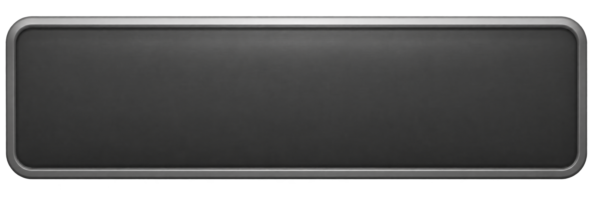

# 공통 버튼 배경 v1

가로형 모바일 UI에 재사용하는 회색 버튼 원본입니다. **2026-11-13 게임 코드 연결 완료, Unity/Android 화면 검증 전**입니다.

## 파일과 적용

- 원본: `button-base-v1.png` (2172 × 724 RGBA), 생성 프롬프트: `prompt.txt`.
- 동일 원본을 `Assets/Resources/OrdrArt/Ui/WideButton.png`에 포함했습니다.
- `OrdrMobileUiTheme`의 기본·메뉴·주요 행동·스킬·접기/펼치기 버튼에 적용합니다. 글자·가격·횟수는 기존 UI에서 따로 표시합니다.
- `OrdrMobileUiArtwork`가 최초 로딩 때 투명 외곽을 정리하고 작은 표면을 캐시합니다. 9분할 테두리, 색상, hover/눌림 밝기를 공통 처리하며 원본 PNG는 변경하지 않습니다.
- 일반 버튼은 푸른 회색, 선택은 금색, 주요 행동/스킬은 청록색입니다. 비활성 처리는 기존 `GUI.enabled`를 따릅니다.
- 수량·상태 카드는 기존 표현을 유지합니다. 닫기·페이지 버튼은 [사각 버튼](../skin-v1/README.md)을 사용합니다.

## 검증 상태

리소스 경로·원본 blob 일치·Unity 임포트 설정·스타일 호출 경로를 정적으로 대조했습니다. 4종 이미지 로딩/알파/캐시/분할/눌림 상태를 확인하는 EditMode 검사 소스를 추가했으나 로컬 실행하지 않았습니다. 작은 가로 화면에서 글자 대비·모서리·터치 영역 확인은 남아 있습니다.
