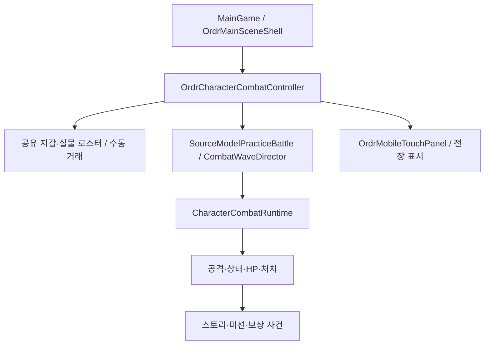

# 코드 구조

> **새 작업의 코드 지도:** 무엇을 고쳐야 하는지 빠르게 찾는 문서입니다. 기능 구현률·APK 차이는 [현재 상태](START_HERE.md), 미완료 작업은 [개발 작업](PLAYABLE_ROADMAP.md), 실제 조작은 [화면·조작](화면-조작-시스템.md)에 있습니다. **이 문서에 날짜별 개발 일지나 기능별 확률·비용을 중복 기록하지 않습니다.**

## 1. 실행 흐름

**컨트롤러는 연결과 수명**, **전투 런타임은 실제 판정**, **지갑·로스터는 거래**, **화면은 사용자 요청과 표시**를 담당합니다. UI에서 전투 수치나 보상을 따로 계산하지 않습니다.

## 2. 영역별 실제 진입점

| 작업 영역 | 먼저 열 파일 | 재사용할 역할 |
|---|---|---|
| **시작·세션** | [OrdrCharacterCombatController.cs](../Assets/Scripts/Unity/OrdrCharacterCombatController.cs), [OrdrMainSceneShell.cs](../Assets/Scripts/Unity/OrdrMainSceneShell.cs) | 원본 데이터·공통 서비스 연결, 시작/정지/재시작 및 동일 세션 유지 |
| **메뉴·입력·전장 UI** | [OrdrMobileTouchPanel.cs](../Assets/Scripts/Unity/OrdrMobileTouchPanel.cs), [OrdrMobileUiTheme.cs](../Assets/Scripts/Unity/OrdrMobileUiTheme.cs), [OrdrUnitWorldPresenter.cs](../Assets/Scripts/Unity/OrdrUnitWorldPresenter.cs) | 큰 버튼·가로 레이아웃·원본 좌표와 표시 좌표 구분 |
| **원본 유닛 객체** | [CharacterUnitCatalog.cs](../Assets/Scripts/Data/CharacterUnitCatalog.cs), [OriginalMapBaseStatCatalog.cs](../Assets/Scripts/Data/OriginalMapBaseStatCatalog.cs) | 프로젝트 ID와 `rawcode`, 원본 객체/능력 데이터 연결 |
| **공통 전투** | [CharacterCombatRuntime.cs](../Assets/Scripts/Combat/CharacterCombatRuntime.cs), CombatAttackPipeline, CombatScheduler, CombatResolution | 대상·공격 선언/명중·피해·상태·사망의 공통 정산 |
| **특수/자동 기술** | [CharacterCombatRuntime.SourceModelAdditionalAutoSkills.cs](../Assets/Scripts/Combat/CharacterCombatRuntime.SourceModelAdditionalAutoSkills.cs), [CharacterCombatRuntime.SourceModelBulkAutoSkills.cs](../Assets/Scripts/Combat/CharacterCombatRuntime.SourceModelBulkAutoSkills.cs), [SourceModelSixthAttackCatalog.cs](../Assets/Scripts/Combat/SourceModelSixthAttackCatalog.cs) | 도감 기반 모델·원본 JASS 콜백을 별도 근거와 승인 범위로 처리. 네이티브 효과 중복 실행 금지 |
| **오라·자원·소환수** | CombatStatusEngine, SourceModelResources, SourceModelIndependentAttacks, SourceModelTemporarySkills | 지속시간·MP/HP·소유자 변경·전장 리비전·독립 소환 생명주기 |
| **라운드·몬스터** | [SourceModelPracticeBattle.cs](../Assets/Scripts/Combat/SourceModelPracticeBattle.cs), [CombatWaveDirector.cs](../Assets/Scripts/Combat/CombatWaveDirector.cs) | 웨이브·적 이동·피해/보상·종료와 논리 시간. [원본 규칙·독립 연습 모델 구분](라운드-몬스터-시스템.md) |
| **지갑·실물 거래** | [SharedEconomySession.cs](../Assets/Scripts/Core/SharedEconomySession.cs), [EconomyTransactions.cs](../Assets/Scripts/Core/EconomyTransactions.cs), UnitRoster | 비용·보상·영수증·되돌리기, 여러 기능이 사용하는 한 지갑 |
| **조합** | [Original323CommonFusionPort.cs](../Assets/Scripts/Mobile/Original323CommonFusionPort.cs), [OriginalJassFusionPlanner.cs](../Assets/Scripts/Mobile/OriginalJassFusionPlanner.cs), [OriginalJassFusionAtomicCoordinator.cs](../Assets/Scripts/Mobile/OriginalJassFusionAtomicCoordinator.cs) | 원본 조건·재료 후보·확정 시 재검사·실물 교체 |
| **위습** | [MobileWispService.cs](../Assets/Scripts/Core/MobileWispService.cs), [Original323MobileWispOutcomeWorld.cs](../Assets/Scripts/Combat/Original323MobileWispOutcomeWorld.cs), [OriginalWispCombatRewardWorld.cs](../Assets/Scripts/Combat/OriginalWispCombatRewardWorld.cs) | 원본 보상 풀·실물 생성·보류 결과·실패 롤백 |
| **경제·돈 도박** | [SourceModelMoneyGamblingDesk.cs](../Assets/Scripts/Mobile/SourceModelMoneyGamblingDesk.cs), [SourceModelRegularMoneyGambling.cs](../Assets/Scripts/Mobile/SourceModelRegularMoneyGambling.cs), [Original323GraduatedRareShopWorld.cs](../Assets/Scripts/Mobile/Original323GraduatedRareShopWorld.cs) | 돈 도박·졸업/구매·재고·보류 추첨을 공유 지갑으로 정산 |
| **이세계 유닛 도박** | [SourceModelOtherworldUnitGambling.cs](../Assets/Scripts/Mobile/SourceModelOtherworldUnitGambling.cs), [Original323OtherworldGamblingWorld.cs](../Assets/Scripts/Mobile/Original323OtherworldGamblingWorld.cs), [Original323OtherworldGamblingRules.cs](../Assets/Scripts/Core/Original323OtherworldGamblingRules.cs) | 공유 지갑 원자 결제·CJM 분기/보류 추첨·RN/LT 실물 생성. StoryNativeRewardQueue의 GamblingCharges와 CreepPracticeWorld의 실제 최초 격파 신호를 연결. 해왕류 실제 완료 공급자·환전소·전체 저장은 별도 |
| **스토리·보상** | [Original323SoloStoryScenario.cs](../Assets/Scripts/Combat/Original323SoloStoryScenario.cs), [Original323StoryMobileProgression.cs](../Assets/Scripts/Core/Original323StoryMobileProgression.cs), [Original323SourceMaterialRewardWorld.cs](../Assets/Scripts/Combat/Original323SourceMaterialRewardWorld.cs) | 14개 건물·수동 파견·보상·성장·고유 아이템/초월위습 |
| **개인미션** | [OriginalPersonalMissionCatalog.cs](../Assets/Scripts/Core/OriginalPersonalMissionCatalog.cs), [OriginalPersonalMissionSession.cs](../Assets/Scripts/Core/OriginalPersonalMissionSession.cs), [PersonalMissionGameplay.cs](../Assets/Scripts/Core/PersonalMissionGameplay.cs) | 원본 18종·3칸·사건 판정·공유 지갑 보상·부분 저장. 게임별 사건 연결 여부는 별도 확인 |
| **도움소** | [OriginalHelperCowManaRecharge.cs](../Assets/Scripts/Core/OriginalHelperCowManaRecharge.cs), [OriginalHelperCowLiveCombatWorld.cs](../Assets/Scripts/Combat/OriginalHelperCowLiveCombatWorld.cs) | 공통 마나·위습 충전·광역 원본 공급자 계약 |
| **유닛 도박 3등급·리롤** | [SourceModelUnitGambling.cs](../Assets/Scripts/Mobile/SourceModelUnitGambling.cs), [Original323UnitGamblingRules.cs](../Assets/Scripts/Core/Original323UnitGamblingRules.cs), [Original323UnitGamblingWorld.cs](../Assets/Scripts/Mobile/Original323UnitGamblingWorld.cs), [SourceModelUnitReroll.cs](../Assets/Scripts/Mobile/SourceModelUnitReroll.cs) | CJP/CJS/CJK 분기·실물 생성·지갑·미션, CRj/CRl의 실제 유닛/토큰 원자 교체. 공용 횟수와 개체별 능력 권한을 구분 |
| **도박광 항법·공통 선택 제한** | [SourceModelGamblingNavigation.cs](../Assets/Scripts/Mobile/SourceModelGamblingNavigation.cs), [Original323NavigationSelection.cs](../Assets/Scripts/Core/Original323NavigationSelection.cs) | 21R 이후 카지노/리스크헷지 선택·CKR 충전 환산·공용 LN. 도움소 항법도 같은 선택 제한을 사용 |
| **악몽·이세계·항법** | [NightmareMutationRules.cs](../Assets/Scripts/Core/NightmareMutationRules.cs), [NavigationProgression.cs](../Assets/Scripts/Core/NavigationProgression.cs), [Ordr323OriginalHelperNavigation.cs](../Assets/Scripts/Combat/Ordr323OriginalHelperNavigation.cs) | 고정 모드·오로성 권장표, 검증 노드만 등록하는 틀, 도움소·도박광의 일부 실제 항법을 구분 |
| **스토리 표시** | [OrdrStoryBattlefieldView.cs](../Assets/Scripts/Unity/OrdrStoryBattlefieldView.cs) | 건물 HP/실제 피해 사건을 화면에만 표시. 파견 실물 좌표를 옮기지 않음 |
| **원작 피해 계약** | Ordr323DamageWorldBinding, Ordr323OriginalDamageRules, Ordr323MapDamageMath | 방어·면역·정수화와 원본 공격 구분. 실제 공급자 승인 여부 별도 |
| **데이터·빌드** | [OrdrCharacterDataSync.cs](../Assets/Editor/OrdrCharacterDataSync.cs), [OrdrAndroidDevelopmentBuild.cs](../Assets/Editor/OrdrAndroidDevelopmentBuild.cs) | `data/` → Unity Resources 동기화·기존 APK 제작 |

파일 목록은 **찾아갈 진입점**입니다. 인터페이스/등록/데이터가 있다고 그 기능이 최신 APK에서 완성됐다는 뜻은 아닙니다.

## 3. 공통 엔진을 바꾸기 전 확인할 것

1. **원본 근거:** 유닛 `rawcode`, 능력·조건·확률·비용·타깃·전장/시점이 확인됐는지 대조합니다. 추측한 값으로 실제 지급을 열지 않습니다.
2. **중복 호출:** 동일한 스킬을 도감 모델·JASS 콜백·네이티브 패시브가 이중 실행하지 않는지 확인합니다.
3. **실제 인스턴스:** 조합·판매·사망·파견·변신 뒤 예약 타격·오라·소환수 소유자가 남지 않게 합니다. 화면 마커와 실물 로스터는 별도입니다.
4. **거래/난수:** 비용 차감·유닛 생성·성공 기록은 원자적으로 처리하고, 보류된 위습/도박 추첨을 실패마다 다시 뽑지 않습니다. **커밋 후 알림 예외를 거래 실패로 오인해 중복 지급하지 않습니다.**
5. **게임 시간:** 일시정지·앱 전환·세션 교체 때 스킬 만료·재고 충전·화면 이벤트의 시간과 구독 해제를 확인합니다.

## 4. 상세 규칙·검증 자료는 어디에 있나요?

- 게임 정책: [작업 규칙](../AGENTS.md) · [원작 동등성 분류](PARITY.md)
- 수동 조작·가시성: [화면·조작](화면-조작-시스템.md)
- 조합·위습·돈 도박: [조합](조합-시스템.md) · [조합 거래 기술 근거](조합-거래-기술근거.md) · [위습](위습-시스템.md) · [경제·도박](경제-도박-시스템.md)
- 스토리·미션·도움소: [스토리](스토리-시스템.md) · [개인미션](개인미션-시스템.md) · [도움소](도움소-시스템.md)
- 모드·항법·전투 공통: [악몽·이세계·항법](악몽-이세계-항법-시스템.md) · [라운드·몬스터](라운드-몬스터-시스템.md) · [전투·스킬 공통 엔진](전투-공통엔진.md)
- 개별 캐릭터의 원본 기술과 과거 모델 구분: [캐릭터 기술·전투 연결](캐릭터-기술-원본과-전투연결.md) · [기본 기술·네이티브 패시브](원본-기본기술-네이티브-패시브.md) · [20명 원본 JASS 분석](원본-캐릭터-기술-추출표.md) · [관측형 스킬 시전·타격](원본-관측형-스킬-시전-타격.md) · [원본 오라·전투 연결](원본-오라-전투연결.md)
- 원본 전투 계산: [피해·방어·마법 저항](원본-피해-방어-마법저항-근거.md) · [캐릭터별 방깎·마방깎 JASS](원본-발동형-방어감소-기술사건.md)
- 작업/완료 기준: [개발 작업](PLAYABLE_ROADMAP.md)
- 원본 추출 파일: [데이터 안내](../data/README.md) · `data/original-2323C-*.json`
- 검사/빌드: `Assets/Tests/EditMode/`, `tests/`, `tools/build_character_runtime_coverage.py`, [실행 안내](unity-editmode-test.md)

**검사 명령·Actions 실행은 사용자 요청 시에만** 합니다. 문서 자체는 Unity/휴대폰 동작 검증을 대신하지 않습니다.
