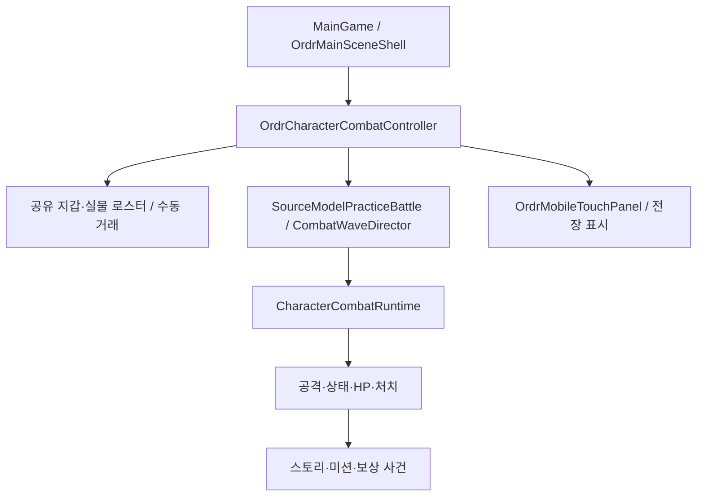

# 코드 구조

- 우타 E-09 B7W/B61/B6r 원본 소유권·h067↔h0AF 변신·B6m 60초 노래 그룹·활성/대기 h04O 독립 공격 ID/공격once 지시 복원: `Assets/Scripts/Combat/CharacterCombatRuntime.SourceUtaWorldState.cs` + `.SourceUtaSaveState.cs`; 생산자는 `.SourceModelFusionNativeFollowups.cs`와 `.SourceModelCompositeEffects.cs`. 공통 비보유 공격 시계는 `.SourceModelIndependentAttacks.cs`, 체크포인트는 `.SaveState.cs`, 큐 복원은 `.SourceModelTooltipManualActions.cs`. 이동 뒤의 오래된 타격은 무효화하고 죽은 적 중심의 원본 B6r/로저 지연 범위타격은 고정 시전 좌표를 유지합니다.

- 로저 I-04 인페르노(기절·후속)/테조로 E-11 B8S(0.45초)/S-샤크 SR-03 CEN(19.9초 반복, 0.1·0.2초 아군)의 타입별 예약: `Assets/Scripts/Combat/CharacterCombatRuntime.SourceFusionNativeSaveState.cs`. 재사용 시계·골드/3타 분기·몬스터 등장 시 A11S/AI19 스냅샷·활성 소유권 및 우타 저장 차단: `.SourceFusionNativeWorldState.cs`; 생산자 `.SourceModelFusionNativeFollowups.cs`, 복원 라우터 `.SourceModelTooltipManualActions.cs`.

- 6종 원본 모델 폼 소유권·지속시각/니카 H0BY MP100 복원: `CharacterCombatRuntime.SourceCompositeFormSaveState.cs`, `.SaveState.cs`. 비비 B5s·핸콕 B5F 20/25회 타입 예약: `.SourceVolleySaveState.cs` 및 `.SourceModelTooltipVolleys.cs`; 복원 라우터 `.SourceModelTooltipManualActions.cs`.

- 보니 TR-21 세월·40스택·속박/축소 실물 소유권: `Assets/Scripts/Combat/CharacterCombatRuntime.SourceBonneyAgeSaveState.cs`. 원본 JASS 다단/지연 5계열 예약의 정확한 피해 조합·장소·공격 타입·순번: `.SourceRemainingDelayedSaveState.cs` (스케줄 생산자 `.SourceModelRemainingCallbacks.cs`, 복원 라우터 `.SourceModelTooltipManualActions.cs`).

- 복합 스킬의 주기/성장/접근 영수증·킹 둔화/화재 예약 복원: `Assets/Scripts/Combat/CharacterCombatRuntime.SourceCompositeSkillSaveState.cs`; 생산자 `.SourceModelEighthSkills.cs`, `.SourceModelTwelfthForms.cs`, `.SourceModelEleventhForms.cs`, 복원 라우터 `.SourceModelTooltipManualActions.cs`.

- 베가펑크 B4a 구매 위성의 실물 ID/마나/공격·버프 시계/원본 기술 프로필 복원과 공유 지갑 영수증 대조: `Assets/Scripts/Combat/CharacterCombatRuntime.SourceSatelliteSaveState.cs`; 기존 위성 생산자 `.SourceModelNativeCharacters.cs`와 독립 공격자 `.SourceModelIndependentAttacks.cs`를 재사용합니다.

- TR-14 변신/EXPauseUnit 평타 해제/슈가 h06O 가상 투사체 예약 및 변신 이름·야마토 후속 소유권 복원: `Assets/Scripts/Combat/CharacterCombatRuntime.SourceTemporaryOwnerSaveState.cs` (생산자: `.SourceModelTemporarySkills.cs`/`.SourceModelRemainingCallbacks.cs`).

- 원본 지연 네이티브 스킬 예약 3종의 직렬화·복원·유효성 검증: `Assets/Scripts/Combat/CharacterCombatRuntime.SourceNativeDelayedSaveState.cs`; 생산자: `CharacterCombatRuntime.SourceModelNativeFollowups.cs`, `.SourceModelLegacyFollowups.cs`, 타입 큐 재연결: `.SourceModelTooltipManualActions.cs`.

- 원본 Bnm/Bnp/Bnr e0KD 네이티브 지연 시전의 체크포인트/소유권 검증: `Assets/Scripts/Combat/CharacterCombatRuntime.OriginalNativeDummySaveState.cs`; 비공개 결합: `Assets/Scripts/Mobile/OrdrUnpublishedWorldRestoreGraph.cs` (시전/타격/보상 재실행 금지, 완료 주문 ID 묘비 복원).

> 코드의 **현재 진입점**과 공통 엔진 경로만 기록합니다. 날짜별 개발 일지와 반복된 스킬 설명은 삭제했습니다. [현재 상태](START_HERE.md) / [개발 작업](PLAYABLE_ROADMAP.md)을 함께 확인하세요.

- 자동기술 공통 소유자/시계/수신자: `Assets/Scripts/Combat/CharacterCombatRuntime.SourceBulkOwnerSaveState.cs`. 공유 지갑 선물·강탈 영수증, 아냐/가반 상태효과 역검증: `.SourceBulkWalletSaveState.cs`; 생성/예외 처리: `.SourceModelBulkAutoSkills.cs`, 기본 재사용 시계: `.SourceModelAdditionalAutoSkills.cs`. 코어 결합은 `Assets/Scripts/Core/OrdrCoreCheckpoint.cs`.

- 추가 자동기술의 예약 DoT/후속 둔화 타입별 복원: `Assets/Scripts/Combat/CharacterCombatRuntime.SourceBulkDelayedSaveState.cs`; 생산자 `.SourceModelBulkAutoSkills.cs`, 복원 라우터 `.SourceModelTooltipManualActions.cs`, S03 전투·코어 검증 `.SaveState.cs` 및 `Assets/Scripts/Core/OrdrCoreCheckpoint.cs`.

- 흰수염 I-12/나루토 RN-02/조로 TR-20의 추가 지연 둔화·주기 공격 복원: `Assets/Scripts/Combat/CharacterCombatRuntime.SourceAdditionalTimedSaveState.cs`; 생성 `.SourceModelAdditionalAutoSkills.cs`/`.SourceModelSeventhSkills.cs`, 큐 복원 `.SourceModelTooltipManualActions.cs`, 전투/코어 검증 `.SaveState.cs`/`Assets/Scripts/Core/OrdrCoreCheckpoint.cs`. 조로 버프는 실행 시 재계산합니다.

- 킹 L-34 평타 지속피해·카타쿠리 LI-08 버프·코비 TR-24 비보유 분신의 타입 예약 및 소유자 장부: `Assets/Scripts/Combat/CharacterCombatRuntime.SourceKingKobySaveState.cs`; 현장 적용 `.SourceModelThirtiethSkills.cs`/`.SourceModelSeventhSkills.cs`/`.SourceModelTemporarySkills.cs`, 복원 분기 `.SourceModelTooltipManualActions.cs`, 코어 교차검증 `.SaveState.cs`/`Assets/Scripts/Core/OrdrCoreCheckpoint.cs`. strict payload `OrdrCheckpointBinaryCodec` v20. 아카이누 Bq9 미복원 소유권은 저장 거부 경계에서 명시 차단.

## 저장·비공개 복원 경로

- `Original323ScriptAttackProcRolls.CaptureState/RestoreState`는 실제 원본 `Bnm/Bnp/Bnr` 공격 사건별 유닛 ID·원본 피해 대상·공격 이벤트 순번·소비한 글로벌 H6 호출 순번·확률 결과·관측 증거를 영수증으로 기록합니다. `OrdrCoreCheckpointState.OriginalScriptAttackProcs`를 `OriginalScriptRandom`과 함께 검증합니다. `OrdrWorldRestoreGraphBuilder`는 공통 H6 원본 복원 후 신규 `Original323ScriptAttackProcRolls`를 생성하여 `CharacterCombatRuntime.ConfigureOriginal323ScriptAttackEffectWorldForRestore`에서 **실제 저장 액터가 복원된 새 전투**에만 등록합니다. 같은 attacked event의 재발동/재추첨은 거부합니다. 기존 WC3 네이티브 크리티컬/별도 전투 확률 RNG는 미포함입니다.
- 원본 네이티브 `Original323MoneyGamblingService.CaptureState/RestoreState`는 CJB/CJC의 실제 구매 ID·원본 BFi 연속 소비 순번 2개·선택 지점·지급액·미정산/완료 권리를 보존합니다. 원본 관측자가 재확인하지 못한 구매, 도중 일부만 소비된 원본 난수, 정산 중 체크포인트는 거부합니다. `OrdrWorldRestoreGraphBuilder`는 새 월드 전용 `CreateOriginalMoneyGamblingPorts`에서 읽기 전용 구매/정산 상태 목격자를 요구하고, 같은 H6 스트림에 영수증을 결합합니다. 복원 중 재구매·재추첨·재지급 금지, 미정산 권리는 기존 원본 ID로 원자 정산만 허용합니다. 모바일 연습 MoneyDesk는 별도이며 strict binary payload는 **v9**입니다.

- `OrdrTreasureRestoreGraphBuilder.Prepare` (`Assets/Scripts/Mobile/OrdrUnpublishedTreasureRestoreGraph.cs`)는 독립 모바일 탐색/상자·가이몬 꿈·공개·알람·도박형 탐색 시도·원본 지갑 정산과 바운티헌터의 기존 지도 초기 영수증을 **하나의 보물 비공개 소유자**에 복원합니다. 원본 `H6` 대신 저장된 모바일 공통 BFj 난수 사용 시에만 허용하며, 바운티 초기 지도 지급 기록 누락/원피스 네이티브 미처리 대기는 저장본 로드 전에 거부합니다. 이미 확보한 지도·사용한 탐색권을 재지급/재추첨하지 않고 동일 저장 DTO와 다시 비교합니다. 완료되지 않은 네이티브 시전과 원작 관측 공급자의 게시/실행 기능은 여전히 미지원입니다.
- `Original323WispDeferredAbilityRegistry.CaptureState/RestoreState`는 `OrdrCoreCheckpointState.WispDeferredAbilities`로 **A0YE/A0YZ의 보유 유닛 ID와 미적용 권리만** 직렬화합니다. `OrdrCoreCheckpoint.Validate`는 실제 로스터·중복·rawcode를 검증하고 `OrdrCommerceRestoreGraphBuilder.Prepare`는 새 Registry를 먼저 복원한 다음 유닛 도박/이세계 도박/졸업 상점 보상 공급자를 조립합니다. `IOriginal323RestoreCommerceOwner` 구현은 **실제 새 전투·같은 Registry** 소속인지 검사해 이전 세션의 팩토리를 차단하며, 원본 네이티브 능력을 복원 도중 실행하지 않습니다. `OrdrCharacterCombatController.CaptureWorldSubsystemFingerprint`는 Treasure·Registry도 동일 시점 비교에 포함합니다.
- `OrdrWorldRestoreGraphBuilder.Prepare` (`Assets/Scripts/Mobile/OrdrUnpublishedWorldRestoreGraph.cs`)는 기존 `OrdrCombatRestoreGraphBuilder` → `OrdrCommerceRestoreGraphBuilder` → `OrdrAuxiliaryRestoreGraphBuilder`를 **새 동일 세션**에서 직렬 결합합니다. 필요한 원본 증거·카탈로그가 빠지면 조립 전에 거부하며, 원본 `BFi`의 `OtherOriginalScriptCall`/ `MonsterDeathGold`는 기존 `commerce.RandomForPurpose`의 단일 커서에서 분기합니다. 신규 상거래 게이트는 `() => false`, 외부 라운드 콜백·기존 게임 미션 커밋 연결은 비활성입니다. `ValidateReconstructedState`는 새 객체들의 `CaptureState`를 기존 저장본 DTO와 **읽기 전용 전수 비교**하며 한 항목이라도 다르면 비공개 세계를 버립니다. **보물 중 포터블 모바일 탐색 상태만 허용**하고 네이티브 후속 의무/원본 BFi만 있는 보물은 안전 차단합니다.
- `OrdrUnpublishedAuxiliaryRestoreGraph.Dispose`는 실패한 비공개 세계에서 구독 해제의 중복 호출을 막고 각 실물 서비스의 `Dispose`를 끝까지 시도합니다. `OrdrUnpublishedWorldRestoreGraph`는 보조 세계 구독의 단일 소유자이며 정상 게임 컨트롤러/씬에 결과를 공개하거나 바꾸지 않습니다.

- `Original323SharedBfiRandom.CaptureCheckpoint/RestoreCheckpoint`는 원본 `H6/BFi`의 실제 전역 상태·누적 사용 횟수를 저장하고, 복원 전에 **같은 세션/논리 시각/커서**를 증명하는 `IOriginal323SharedBfiRestoreWitness`와 미래 호출 감시자를 요구합니다. `OrdrCommerceRestoreGraphBuilder.Prepare`는 원본 난수 1개에서 `Gambling`/ `RareWispBranch` 용도 뷰를 재구성하거나, 단독 모바일 `MobileRollbackWispRandom`을 복원합니다. 두 저장 형식 혼합·보류 도박/리롤의 항법 변경은 차단합니다.
- `OrdrCharacterCombatController.CaptureCheckpointAtSafeBoundary`의 `CaptureWorldSubsystemFingerprint`는 게임/공통 지갑/로스터/미션 이외의 전투·라운드·연구/파견·도박 보류 장부·원본/모바일 난수도 저장 전후 비교합니다. 리비전 변화·재진입 중에는 전체 진단 저장을 폐기합니다. 원본 실제 난수 관측·거래 중 native 효과는 별도 외부 공급자 책임입니다.
- `CharacterCombatRuntime.ValidateKumaAutoMissileState`는 `source-kuma-autofire-v1`의 예약 시전자·유닛 S-28·원본 payload·0.2초 시계·중복을 기존 타이머/공통 저장 검증에서 검사하며 아직 지원하지 않는 익명 Action 예약은 여전히 거부합니다.

- `Original323StoryManualDispatch.RestoreCommittedDeployments` + `Original323SoloStoryMovement.IsRestorableStoryPosition`은 완료된 솔로 스토리 파견의 기존 실물/좌표만 검증한 후 외부 파견 소유권을 복구합니다. `CharacterCombatRuntime.SaveState.cs`의 `ValidateExternalLaneState/RestoreExternalLaneOwners`는 스토리·포네그리프·공유 목표의 상호 배타성/로스터 ID/전장 정보를 확인하고 **이동·해독 시작·공유 출현 재실행 없이** 액터 소유권을 복구합니다. `OrdrCombatRestoreGraphBuilder.Prepare`가 저장된 해독/공유 기록을 전투 복원에 전달합니다.
- `Original323SharedObjectiveWorld.CaptureState/RestoreState`는 원본 출현·격파 확인·정산/미처리 대장 버프 영수증을 `OrdrCoreCheckpointState.SharedObjectives`로 보존합니다. `SourceCombatRuntimeCheckpoint.SharedDeployments`는 유닛별 목표 ID/출전 좌표/복귀 좌표를 보관합니다. `OrdrCoreCheckpoint.Validate`는 원본 공유 목표 실물·미션·전투 소유권을 교차 검사하며, `OrdrAuxiliaryRestoreGraphBuilder.Prepare`는 공유 미션 보상 월드와 출현 기록을 다시 구성합니다. **외부 원본 목격 공급자/공유 난수 없으면 실패**하며 보상·원본 출현·격파 콜백은 재실행하지 않습니다.

- `CharacterCombatRuntime.CreepDispatch.cs`의 `CaptureCreepDeployments`는 크립 출전 완료 유닛의 원래 ID·단계·목표 적·현재/복귀 좌표·이미 시도한 자동 이동기 영수증을 `SourceCombatRuntimeCheckpoint.CreepDeployments`에 저장합니다. `ValidateCreepDeploymentState`는 `OrdrCoreCheckpoint.Validate`에서 로스터·전투 액터·`Original323CreepPracticeState`의 실물 역사·좌표와 교차 검사합니다. `OrdrAuxiliaryRestoreGraphBuilder.Prepare`는 크립 실물 복원 후 `RestoreCreepDeploymentsDraft`로 원본 파견 권한을 재연결하며, 이동·시전·보상 없이 기존 배치를 재구성합니다. 네이티브 이동/변신 시전 진행 중과 원본 출처 확정 크립 보상은 별도 미완료로 차단합니다.

- `MoriaParticipationLedger.CaptureState/RestoreState`는 실제 라인 대상·기여한 소유자 ID를 보존하며, `CharacterCombatRuntime.ValidateSourceTransientState`가 살아 있는 적·원본 S-09 소유자·누락 영역 오라를 교차 검증합니다. `SourceCombatRuntimeCheckpoint.NamiZones`는 임시 `e00K/A089` 오라 영역의 좌표·전장/기한·안정된 원본 ID 순번을 저장하고 복원 시 기존 상태효과를 중복 계산하지 않습니다.
- 마리아 `D-01`의 `ScheduleSourceMariaPulse`는 `CombatTimedEffectQueue.ScheduleRestorable` 종류 `source-maria-cdh-v1`을 사용합니다. 소유자 모드/토큰·소모한 토큰 순번(`MariaNextToken`)과 큐의 다음 정확한 `At/Sequence`를 함께 검증하며, `RestoreSourceModelTimedEffect`는 기존 쿠마 `A0EA` 복원도 보존합니다. 복원 중 새 마리아 시전·재추첨·보상 지급은 하지 않으며 익명 예약은 여전히 거부합니다.
- 체크포인트 필드 추가 후 `OrdrCheckpointBinaryCodec`의 strict payload v18를 사용합니다. 기존 A/B 외피/손상 판정은 유지하며 전체 씬/게임용 이어하기는 미완성입니다.

- 원본 장비 증거 공급자는 새 게임 시작 시 `ConfigureSourceModelEquippedItems`, 진행 라운드의 비공개 복원 시 `ConfigureSourceModelEquippedItemsForRestore`에서만 연결합니다. 복원 전용 경로는 공격자·적·시계가 없는 전투 월드에서 1회만 가능하며, 장비 구매/원본 관측/영수증 처리를 재실행하지 않습니다. 옛 미완성 바이너리 초안은 v7에서 거부합니다.

- `OrdrCoreCheckpoint.PrepareWorldRestore`는 `SourceCombatRuntimeCheckpoint.Version=4`만 인정하고, 공개 `Restore`는 전투 초안이 있는 경우 기존대로 차단합니다. `CharacterCombatRuntime.RestoreActorWorldDraft`는 전투 로스터 밖의 원본 진화체 `e0HP` 1기를 별도 실물로 인정하며 실제 액터 중복·신원은 그대로 검사합니다.
- `OriginalEquippedItemLedger.CaptureState/RestoreState`는 장비별 원본 rawcode·개수·등급/타입, delta 영수증/소유자, native 전체 관측 리비전 및 삭제된 ID의 tombstone을 원자 재구성합니다. `CharacterCombatRuntime.ValidateEquipmentState`와 `OrdrCoreCheckpoint.ValidateCombatDraft`가 소유권·자료 형식/중복을 검사하고 원본 증거 공급자 재연결이 없으면 복원을 거부합니다. 불릿 육식 체 3초 효과는 `SourceCombatRuntimeCheckpoint.BulletStances`에 원본 유닛 ID·전장 리비전·절대 만료시각을 기록하고 `ValidateSourceSidecars`/비공개 `RestoreSourceSidecars`로 재시전 없이 연결합니다. 만료된 효과는 복원하지 않고, 잘못된 ID/폼·전장·시각/중복 레코드는 차단합니다. 나미 여진·모리아 기여·마리아 반복은 비공개 저장을 지원하며, 그 외 익명 예약과 실제 게임 이어하기 UI/전체 씬 복원은 비활성입니다.

## 원본 숫자·스탯 공급 경로

- `SourceModelBasicCombatRules.OriginalUnitPointValue`: 원본 `OriginalMapBaseStatCatalog.UnitPointValue`를 카탈로그 ID/원본 rawcode까지 대조. 히바리 도시락 자격 판정에 사용. **스탯 STR/AGI/INT와 별개**.
- `CharacterCombatRuntime.SourceModelRemainingCallbacks.cs`: 검은수염 Bzz/Bzr/Bzx의 순수 힘 `GetHeroStatBJ(STR,false)`×60,000/5,000/5,000을 기존 1회 피해 계산에 반영. `SourceModelCompositeEffects.cs`의 `ConfigureSourceModelHeroUnbonusedStrengthProvider`가 미연결이면 계수 보류.
- `CharacterCombatRuntime.SourceModelBulkAutoSkills.cs`: 나미 BWT의 보너스 포함 현재 INT `GetHeroStatBJ(INT,true)`×3,500/타를 시전 시점에 1회 취득. `ConfigureSourceModelHeroIntelligenceProvider` 공급 미연결이면 계수 보류.
- `Original323NativeHeroAttributeEvidence.cs`: 구매 위성/보유 영웅별 `GetHeroStatBJ(false/true)` 6개 값, 원본 rawcode, 폼 리비전, 네이티브 변경 리비전을 받는 읽기 전용 인터페이스. 현재 값은 아이템/버프/해제 직후 원본 관측자가 갱신해야 하며, 없는 입력을 0으로 만들지 않음.
- `Original323HeroAttributeWorld.cs`: 원본 객체의 초기 STR/AGI/INT 출처(맵 SHA, 원본 rawcode) + 동일 게임 경험치 장부의 레벨별 성장 + 개체별 보너스 목격값을 합성하는 공통 엔진. `OrdrCharacterCombatController`가 `Original323MobileStoryHeroExperienceWorld.LevelStateOf`와 함께 전투에 연결. 순수 STR(false) / 보너스 포함 STR·AGI·INT(true) 구분, 미공급이면 null 유지. `CharacterCombatRuntime.SourceModelSeventeenthSpecials.cs`는 구매한 위성의 개별 ID를 전달하므로 제작자와 rawcode만 같은 서로 다른 위성을 섞지 않음.
- `SourceModelBasicCombatRules.cs`는 폼 변경 리비전을 추적; `CharacterCombatRuntime.SourceModelCompositeEffects.cs`는 원본 `Bjq/Bxc` 교체의 이전 `STR/AGI/INT,false` 캡처/새 폼 SET 확정 분리. 실제 영웅 교체의 독립 비용/자격/실물 이동은 해당 기능 소유자가 처리해야 하며, 티켓만으로 변신을 실행하지 않음. `OrdrCharacterCombatController.ConfigureOriginalCurrentHeroStatWitness`를 통해 실측 공급자를 전투 시작 전에 연결.
- `Original323UnitBalanceHeroInitialAttributes.cs` / `data/original-2323C-hero-initial-attributes.json`: 고정 W3X `UnitBalance.slk` 70개 H행 **명시적 4개(H05N/H0A5 STR10·AGI11·INT1, H0BX/H0BY 각1) + 빈 숫자 66개 엔진 기본값 0**을 별도 출처로 등록. 근거는 `cuteu2474-a11y/open-realm`의 `games/warcraft-3/sheet/sheet.c` `FS_LoadSheetTyped`(calloc/셀 누락 시 쓰기 없음) 및 `game/g_metadata.c` `STB_SLK_INT` 스키마. 단순 임의 스탯 0 주입과 구분. 원본 Blizzard 실행, `ModifyHeroStat SET` 폼 승계, 장비/보너스 포함 `GetHeroStatBJ(true)`·위성 개체별 XP는 여전히 미검증. `SourceModelFifteenthSkills.cs` 타시기 `TR-27:skill:2`는 `STR,false`, 도플라밍고는 `STR,true` 분리.

- **출현 라운드별 피해/생존·상태 조회 공통화:** `SourceModelPracticeBattle.CaptureCombatPressure`는 `CombatWaveDirector.TryGetLivingMonsterSpawnWave`로 살아 있는 적을 출현 라운드별로 나누고 `ObserveActualWaveDamage`/`RewardActualDeath`에서 실제 HP 피해·타격·처치를 해당 원래 라운드에 귀속합니다. 외부 생성 적은 `UntrackedMainLaneEnemies`로 구분하며, 스토리·크립은 제외합니다. `CharacterCombatRuntime.HasActiveAttackFormulaBlock`은 예약기의 `IsAttackFormulaBlocked`와 `InspectBasicAttack`·`CurrentAttackTargetOf`가 공유하는 읽기 전용 판정입니다. 검사 코드: `CombatPressureAttributesOldSurvivorDamageToItsActualSpawnWave` 및 `ExpiredTemporaryAttackFormulaBlockDoesNotMisleadHudOrTargetQuery` (미실행).
- **크립 원본 단계·공유 보상:** `Original323CreepSourceProgression`은 `ObserveOriginalFirstSpawn(CTs/LB 증빙)` → `Original323CreepPracticeWorld.SpawnSourceConfirmedStage` → 실제 `EnemyExited(Defeated)` → 다음 프레임 `AdvancePending` → CTp/CTq 단계 전환 → CTr 완료로 진행합니다. 단순 객체 기본값은 별도 `SpawnPracticeStage`에만 존재합니다. `Original323CreepRewardWalletPort`가 공유 지갑 `TryGrantOnce` 영수증, 공유 `IOriginalWispRandom.NextInclusive(1,2)` 결과 캐시, 원본 위치 공급자를 통한 실물 `PS-01(h060)` 생성+실패 롤백, `SourceModelItemExcavation.OrdinaryStacks`를 사용합니다. `OrdrCharacterCombatController.ConfigureOriginalCreepSourceEvents`는 공급자를 등록하고 `ObserveOriginalFirstCreepSpawn`은 실제 원본 사건을 전달합니다. `Update`는 전투 step 종료 후에만 후속 처리합니다. `Original323CreepPracticeWorld.SaveState`는 원본 출현 기록을 v1로 저장 불가(안전 차단). 기존 `RecordThirdCreepDefeated`는 원본 사건으로 생성한 적에게만 연결합니다. 회귀 소스: `Original323CreepSourceProgressionTests`·`Original323CreepRewardWalletPortTests`. 기본 모바일 원본 출현/방어/유닛 허용 증빙 공급자 미연결.
- **원본 21종 크립 순간이동 연결:** `Original323CreepVerifiedMobilityAuthority.cs`의 `Original323CreepBlinkAbilityCatalog`는 R-05부터 MY-09까지 정확한 21명과 W3A 원본 AEbl 능력/최대거리/쿨타임을 열거합니다. `IOriginal323CreepVerifiedBlinkRuntime`는 미리보기/원본 시전/완료 관측을 책임지고, `IOriginal323CreepVerifiedAttackPosition`는 **즉시 무기 공격 가능 위치**와 **이동기 사용 후 공격 가능한 착지**를 별개로 증명합니다. 최초/완료 실제 좌표를 혼동해 무료 워프를 생성하지 않으며, 원본 능력 범위 초과나 객체 ID가 다른 경우 거부합니다. 원본 시전 관측 실패 시 공통 예약 잠금 정리·오류 통보를 하고 자동 재시전을 막습니다. 완료된 원본 AEbl 착지 증빙은 `IOriginal323CreepAbilityTicketLifecycle`에서 해당 파견 예약의 단 한 번의 `CommitCreepPlacement` 또는 실패 후 폐기되므로 복귀 후 재사용할 수 없습니다. `OrdrCharacterCombatController.ConfigureVerifiedCreepBlinkAbilities`가 런타임 연결점이며 실제 공급자가 기본 앱에 없으면 비활성입니다. 소스 검증: `Original323CreepPracticeWorldTests` 6건 추가(미실행).
- **크립 조건부 준비/단일 원본 시전:** `CharacterCombatRuntime.CreepDispatch.cs`의 `Original323CreepPreparationPlan`과 `IOriginal323CreepConditionalDispatchAuthority`가 이미 직접 공격 가능한 좌표가 없다면 단일 소유 유닛/적·단계·원본 능력 rawcode와 증빙을 검사합니다. `CanDispatchToCreep`의 조회는 무변이, `TryDispatchToCreep`은 `TryBeginPreparation`을 단 한 번 실행하고 진행 중 신청을 예약합니다. `OrdrCharacterCombatController.Update`의 전투 step 완료 뒤 `AdvancePendingCreepPreparations`가 원본의 Pending/Completed/Failed 신호를 읽고, 완료되더라도 같은 소유 인스턴스/살아 있는 대상/실제 공격 가능한 위치가 다시 승인된 경우에만 `CommitCreepPlacement`합니다. 기존 `EncounterSpawned`의 다음 단계 자동 연결도 같은 경로입니다. `TryAutoRetargetInactiveCreepActors`는 기존 시전/준비로 순간적으로 자격이 없는 개체를 전투 스텝 종료 후 다시 검사하되, 이미 자동 시작한 원본 시전 실패를 반복 충전하지 않도록 같은 다음 대상의 자동 요청을 한 번으로 제한합니다. `IsLockedFromRosterTransactions`/`IsLockedFromOwnedUnitConsumption`은 시전 중 거래·복귀 충돌을 막고, 유닛 제거 시 준비 예약도 폐기합니다. UI는 진행 상태를 표시하며 `Original323CreepPracticeWorldTests`에 원본 cast 1회·조건 불일치·취소·다음 단계·유닛 제거 회귀 7건 추가(미실행). **실물 ID 교체형 영구 변신**과 실제 원본 준비 제공자·허용 증빙/폼/착지는 별도 연결 전에는 비활성입니다.
- **원본 승인형 크립 출전/전장 분리:** `CharacterCombatRuntime.CreepDispatch.cs`의 `IOriginal323CreepDispatchAuthority.TryResolveAttackPlacement`가 **실제 현재 살아 있는** `Original323CreepEncounter`와 실물 소유 인스턴스에 대한 원본 사냥 자격·공격 위치를 확인한 경우에만 `TryDispatchToCreep` 또는 재파견할 수 있습니다. 평타/범위 기술/적 오라는 `CanAttackInThisLane`을 통과한 동일 목표 크립만, 아군 지원은 `CanShareAllyCombatLane`에서 동일 크립 목표만 허용합니다. `Original323CreepPracticeWorld.EncounterSpawned`는 실제 앞 단계 처치 후 **물리적으로 다음 단계가 생성된 경우**만 출전 유지/재자격 검사/적정 위치 이동을 알립니다. 부적격자는 이전 출전 상태에서 대기, 슈슈 처치 뒤 명시적 수동 복귀. `OrdrCharacterCombatController.ConfigureVerifiedCreepDispatchAuthority`는 승인 공급자가 없으면 기본 비활성, `OrdrMobileTouchPanel.DrawStoryCreepOverview`는 단계/HP/가능 개체 1기 파견·이동·복귀만 노출. 유닛 소비는 공통 `RemoveCharacter`에서 파견 기록 해제, `OriginalFusionUnitSwap`은 크립 목적지 불변성을 커밋 전에 확인. `CharacterCombatRuntime.SaveState.CaptureRuntimeDraft`는 아직 크립 출전 상태 복원 형식이 없어 출전 중 저장 캡처를 거절합니다. 검사 소스: `Original323CreepPracticeWorldTests`(미실행). 원본 자격/변신/실전 최종 방어·보상 공급자 미연결.
- **파견 중 원자 소비:** `CharacterCombatRuntime.IsLockedFromOwnedUnitConsumption`은 일반 파견 여부와 별도로 공유 목표/포네그리프 잠금을 검사합니다. `BeginOriginalFusionUnitSwap`·`BeginOriginalUnitRemoval`·`BeginOriginalUnitRemovalBatch`는 `OriginalFusionUnitSwap`에 입력의 원래 파견 상태·위치·효과 리비전을 보관하고 커밋에서 재검사합니다. `RemoveCharacter`의 공통 장부/시전자/오라/소환 효과 정리가 최종 제거 시에만 실행되며 `Original323StoryManualDispatch.OnUnitRemoved`가 파견 표시를 함께 폐기합니다. `Original323LowerGradeSaleService`, `Original323UnitDecompositionService`, `OriginalJassLiveCombatFusionWorld`, `OriginalJassCombatUnitFusionWorld`는 이 공통 소비 정책을 사용합니다. 실행 가능 원본 조합은 `Original323CommonFusionPort`의 `OriginalJassFusionPlanner(permitStoryUnitConsumption: true)`에서 파견 재료도 예약합니다. 읽기 전용/미승인 제작식은 기존 보류 유지. 회귀 소스 `Original323OwnedMaterialFusionTests`·`Original323UnitDecompositionTests`(미실행).
- **스토리 파견 후보/동일 상태 묶음:** `MobileStoryDispatchBrowser.Collect`는 기존 `IOriginalStoryDispatchPort`가 현재 승인한 개체와 이미 파견된 개체만 표시합니다. `Group`은 동일 원본 유닛 ID/파견·복귀 상태/상태 서명이 같은 후보를 묶어 그룹 단위로 페이지 처리합니다. `MobileStoryUnitGroup.FirstCurrentlyActionable`은 확인 시점의 원본 자격으로 한 인스턴스만 선택합니다. `OrdrMobileTouchPanel.StoryDispatchDisplayState`는 흔함·안흔함의 활성 상태효과 없음과 실제 평타 준비 상태/다음 시각이 같을 때만 묶고, 그 외는 개별 표시합니다. 크립 파견 자격·전투를 허위 활성화하지 않습니다. `MobileStoryDispatchBrowserTests` 소스(미실행).
- **6유닛 1~4R 실전 계측:** `Assets/Tests/EditMode/OrdrFirstRoundSixUnitSimulationTests.cs`의 `SixUnitFirstFourRoundsProduceObservedWavePressureTrace`는 실제 `OrdrCharacterCombatController.BeginStandaloneBattle`·`SourceModelPracticeBattle.Advance(0.5)`·컨트롤러 자동 시전 호출을 사용합니다. `ActualEnemyDamage`에서 실제 HP 피해를 유닛별로 관측하고 `CaptureCombatPressure().OriginWaves`로 이월 몬스터의 원래 출현 라운드를 추적합니다. 70마리/20초 타이머도 5초마다/상태 전환 때 기록하며 모델 패배 시 정상 종료해 원인을 남깁니다. 출력: `sim-results/first-four-round-six-units.txt`; 기존 요청형 `.github/workflows/ordr-six-unit-first-round-simulation.yml` + `.github/ordr-first-round-simulation-request.txt` 변경 시 1회 CI, APK 없음. 6기 직접 생성은 위습 실제 구매/원작 실측이 아님.
- **70마리/20초 연속 카운트:** `GameSession.WaveEnemyCountChanged`는 웨이브 적의 실제 생성/처치/탈출 직후 개수를 통지합니다. `SourceModelPracticeBattle.ObserveActualWaveCount`는 시작·복원 시 구독하고 폐기 시 해제하므로 한 전투 구간의 70→69→70도 즉시 유예를 초기화합니다. 기존 `Advance`의 0.1초 관측은 시간 만료 판정을 담당합니다. `SourceModelPracticeBattleTests.DeathCountdownObservesBriefBelowLimitReboundWithinOneWaveFrame` 회귀 소스 추가(미실행).
- **초반 라운드 전투 압박도 조회:** `SourceModelPracticeBattle.CaptureCombatPressure()` → `CharacterCombatRuntime.CaptureBasicAttackDiagnostics()`. 화면 페이지와 무관하게 전체 유닛의 평타 준비/쿨타임/공식 보류/대상 거절/원본 사거리 밖/전장 표적 없음 분류를 읽기 전용으로 집계합니다. `SourceModelPracticeBattle.ObserveActualWaveDamage`는 `CharacterCombatRuntime.ActualEnemyDamage` (공통 `CombatResolution.DamageApplied`)를 구독해 실제 적 HP 감소를 공격 주체별로 모으고 현재 살아 있는 라운드 원본 출현 ID로 필터링합니다. UI 매 프레임 호출은 금지합니다. 관측값은 스킬/평타 혼합 피해이며 복원 직후는 부분 구간만 포함합니다. 혼합 6기 1~4R 추적은 `SourceModelPracticeBattleTests.FullMixedOpeningRosterProducesFirstFourRoundPressureTrace` (테스트 코드만, 미실행).
- **독립 공격체 유한 거리 예약:** `CharacterCombatRuntime.SourceModelIndependentAttacks.cs`의 `ReachableSourceIndependentTargets`를 `NextSourceIndependentAttackAt`과 `ExecuteReadySourceIndependentAttacks`가 공유합니다. 같은 전장에 적이 있어도 독립 공격체의 공격 사거리 밖이면 불필요한 scheduler wake-up을 발생시키지 않습니다. `attackonce` 지정 적은 사거리 밖으로 나가도 일반 표적 자동 변경을 하지 않습니다. 기존 `SourceModelScriptAttackSkillTests.SatelliteAttackClockDoesNotWakeForOutOfRangeEnemy`에 실제 구매한 H0AB 위성 기반 거리 경계 검사를 추가했습니다(미실행). 이월 몬스터 진단 검사는 56초 정확한 라운드 경계에서 전환한 뒤 신규 몬스터와 구분합니다.
- **독립 주기 스킬 대상/예약 일치:** `CharacterCombatRuntime.SelectRunnablePeriodicTarget` → `NextEligibleAttackAt`·`ExecuteReadyPeriodicSkills`·`ExecuteAdditionalAutoPeriodic`·`ExecuteBulkAutoPeriodic`. 같은 전장에만 있는 사거리 밖 몬스터를 실제 발동 대상으로 계산하지 않으며, 추가 주기 스킬은 대상 선정 후에만 시계를 시작·소모합니다. 예약기는 실제 주기 소유자만 검사하고, 빈 `ActivatedSkills` 사전의 기본 주기 실행/벌크 주기 소유자가 아닌 유닛의 불필요한 전체 적 검색을 건너뜁니다. MY-08 가족사진의 기존 자기 시전은 유지합니다. `SourceModelPracticeBattleTests.OutOfRangePeriodicDoesNotRegisterOrSpendSlotsWhenOtherUnitsAttack` (코드만, 미실행).
- **평타 공식 보류와 독립 자동 주기 효과:** `CharacterCombatRuntime.NextEligibleAttackAt`는 `IsAttackFormulaBlocked`를 평타 스케줄에만 적용합니다. 기존 `NextAdditionalAutoPeriodicAt`·`NextBulkAutoPeriodicAt`·매핑된 주기형 스킬은 별도 예약 경로로 유지하며 `ExecuteReadyPeriodicSkills`에서도 평타 보류로 차단하지 않습니다. `ExecuteReadyAttacks` 자체의 평타 보류 규칙은 변경하지 않았습니다. 검증 코드: `SourceModelPracticeBattleTests.DeferredBasicDamageDoesNotSuppressIndependentWeatherPeriodic`(미실행).
- **선택 유닛 현재 전투 수치:** `OrdrMobileTouchPanel.DrawSelectedUnitCombatStats` → `CharacterCombatRuntime.SourceModelUnitAttackOf` → `SourceModelBasicCombatRules.PreviewBasicAttackPower`와 `CombatAttackPipeline.InspectCurrentAttackInterval`. 원본 객체 주사위·강화/폼/연구/오라·영웅 공속 공급을 실제 평타/공격 스케줄러와 공유하며 UI는 공격/난수/시간을 진행하지 않습니다. 결과는 대상 방어·스킬·치명타 전 평타 범위이며 네이티브 실기 확정 피해가 아닙니다.

- **선택위습:** `OrdrMobileTouchPanel.DrawFusion` 상단 → `DrawChoiceWispMerge` 흔함 9종 선택/확정 → `OrdrCharacterCombatController.RequestChoiceWispMerge` → `MobileWispService.MergeChoice` → `Original323SourceCommonWispWorld.Begin(string)`의 원본 흔함 9종 매핑 및 트랜잭션. 원자 지갑/로스터, 실패 시 생성 롤백, 랜덤위습 BFi/카운터 불변. 외부 원본 승인 월드는 별도. 실기 검증 전.

- **미사용 위습 부유 표시:** `OrdrMobileTouchPanel.CurrentIdleWispMarkers/DrawUnusedWispMarkers`는 공유 지갑의 랜덤위습과 실제 스토리 초월 보상 미사용 횟수만 읽습니다. `MobileUnspentWispOverlay.ShouldShowWispResource`는 선택위습을 명시적으로 제외합니다. `MobileUnspentWispOverlay.MarkerRect`가 애니메이션 화면 위치/전장 히트박스를 공통 계산하고, `BlocksWorldTap`이 같은 사각형에서 전장 터치를 차단합니다. 마커 터치는 `SelectTab`만 수행하며 위습 소모/보상 지급은 기존 수동 명령으로 유지합니다.

## 원본 확인 스킬 진입점

- `SourceModelUnitEffects.IsRoundNativePassiveTarget` 및 `CharacterCombatRuntime.SourceModelEffects.cs:CompleteSourceModelHit`: 브룩 `U-03/A07P`·타시기 `U-09/A07Q`가 일반/광폭화/보스 모두에서 동일한 발동 가능 대상 조건을 사용합니다. 추가 피해는 기존 기본 공격 피해 패킷에 1회, 기절은 생존 대상에 0.3/0.7초. `SourceModelUnitEffectTests.cs`에 발동·불발·피해 회귀 테스트 소스 작성(미실행); 네이티브 저항과 실기 검증 별도.
- `CharacterCombatRuntime.SourceModelEffects.cs`의 `CompleteSourceModelHit`: 로빈 U-01 `A07M` 추가 2명은 주공격 1명 외 **시전자 기준 600 이내** 같은 전장 살아 있는 적만 선택합니다. 기존 가까운 순서/ID 동률·개별 기본 피해/처치 정산 재사용. 지상/공중 별도 모바일 엔진은 없으며, 원작 네이티브 추가 발사 순서는 실측 전입니다. `SourceModelUnitEffectTests.cs`의 600/601 경계 회귀 검사 코드는 작성됐지만 미실행입니다.
- `SourceModelScriptAttackCatalog.Rankyaku` / `SourceModelRankyakuGeometry.Contains`: 원본 `A0VS(AUcs)` 반폭 200→250·이동 800을 `Rng=1700` 시전 거리와 구분해 블루노(U-04, Bnm) 및 후쿠로(U-13, Bnp)에 공유합니다. `CharacterCombatRuntime.SourceModelAttackSkills.cs`는 공격 선언에서 시전자 방향을 1회 취득해 캐스터 기점 람각 경로를 계산합니다. 외부 방향 관측은 `ConfigureSourceModelRankyakuFacing`, 기본 모바일 모델은 공격 선언의 공격 방향을 사용합니다. 다른 타깃 지향 투사체에는 적용하지 않습니다. 동위치 주문의 엔진 발사·비행·면역은 미확인입니다.

- `CharacterCombatRuntime.SourceModelTooltipVolleys.cs`: 비비 B5s/핸콕 B5F 20·25타 시점 예약, 살아 있는 적 재선정, 핸콕 물리 Chaos 적용.
- `CharacterCombatRuntime.SourceModelTooltipManualActions.cs`: 히바리 h0CN 물품 제작/사용/판매 거래 및 마리아 CDh 5초 영속 주기.
- `Original323SourceDedicatedSkillPort.cs`: 지갑의 h0CN 제작 영수증·재고에서 도시락 생성자를 복원하고, 제작자 소멸 뒤에도 별도 물품 사용/판매 제어 제공.
- `MobileDedicatedSkillActions.cs`: `IsDetachedItem` 항목은 선택 유닛과 무관하게 노출. `OrdrMobileTouchPanel.cs`: 미선택 상태에서도 이 물품 스킬 표시.
- `CharacterCombatRuntime.SourceModelTooltipManualActions.cs`: 전장 이동 시 비비/핸콕 `practice-volley:`와 마리아 `practice-maria:` 예약 콜백을 기존 취소 엔진에서 함께 해제.
- `CharacterCombatRuntime.SaveState.cs`: 아직 복원할 수 없는 익명 지연 타격의 저장 차단 유지.
- 근거는 [스킬 구현 체크](스킬-구현-체크.md). 이전의 범용 `physical=Melee` 정책은 원본과 불일치하므로 제거됨. NUnit·Unity·Android 검증 전.

## 저장·이어하기 진입점

| 역할 | 현재 코드 |
|---|---|
| 상태 계약·난수 검증 | OrdrCoreCheckpoint.cs — 세션/로스터/지갑·전투 v4·BFi/위습/졸업/등급별 난수 |
| 안전한 동기 캡처 | OrdrCharacterCombatController.CaptureCheckpointAtSafeBoundary / CaptureWorldCheckpointDraft — 일시정지 복구 및 동일 시점 대조 |
| 파일 기록 | OrdrCoreCheckpointStore.cs — SHA-256, A/B 슬롯, 임시 파일 |
| 공격·폼·예약 복원 초안 | CharacterCombatRuntime.SaveState.cs / CombatTimedEffectQueue.cs / CombatWaveDirector.cs |
| 미공개 전투·보조 그래프 | OrdrUnpublishedCombatRestoreGraph.cs / OrdrUnpublishedAuxiliaryRestoreGraph.cs |
| **미공개 도박·상점 그래프** | OrdrUnpublishedCommerceRestoreGraph.cs — 같은 지갑과 4개의 난수 기록, 보류 추첨·100G 지원 |
| 실제 이어하기 UI 미구현 | OrdrMainSceneShell.cs / OrdrCharacterCombatController.cs — 전체 월드 안전 게시 전에는 차단 |

**기존 SK-05/06 공통 경로:** `CharacterCombatRuntime.SourceModelTooltipManualActions.cs`의 비비 강화는 결제별 고유 영수증·보류 결과를 재사용하고, `CharacterCombatRuntime.SaveState.cs`는 보류 추첨 저장을 거부합니다. `CharacterCombatRuntime.SourceModelOriginalSpecials.cs`의 쿠마 10% 공격은 `ApplySourceModelNextThirtySkill` 피해·기절 처리기를 재사용합니다. 상세 원본 수치·미완료는 [스킬 구현 체크](스킬-구현-체크.md)에만 정리합니다. Unity/Android 실행 미검증.

**임시 소환/분신/자폭은 투사체·비보유 이펙트가 원칙**입니다. 내부 전투 ID가 있다는 이유로 실제 보유 유닛을 새로 만들지 않습니다.

## 실행 흐름

**컨트롤러는 연결과 수명**, **전투 런타임은 실제 판정**, **지갑·로스터는 거래**, **화면은 사용자 요청과 표시**를 담당합니다. UI에서 전투 수치나 보상을 따로 계산하지 않습니다.

## 영역별 코드 진입점

| 작업 영역 | 먼저 열 파일 | 재사용할 역할 |
|---|---|---|
| **시작·세션** | [OrdrCharacterCombatController.cs](../Assets/Scripts/Unity/OrdrCharacterCombatController.cs), [OrdrMainSceneShell.cs](../Assets/Scripts/Unity/OrdrMainSceneShell.cs) | 원본 데이터·공통 서비스 연결, 시작/정지/재시작 및 동일 세션 유지 |
| **보물 독립 모바일 탐색** | [원본 범위·보상 장부](../Assets/Scripts/Combat/Original323TreasureHunt.cs), [내부 출현·시전 공급자](../Assets/Scripts/Combat/Original323MobileTreasureSession.cs), [공유 위습 영수증](../Assets/Scripts/Combat/Original323TreasureWalletWorld.cs), [바운티헌터 원본 CRW·원피스 보상 월드](../Assets/Scripts/Combat/Original323BountyTreasureWorld.cs), [보물 스냅샷·복원 DTO](../Assets/Scripts/Combat/Original323TreasureSaveState.cs), [모바일 탭·중복 차단](../Assets/Scripts/Mobile/MobileTreasureGacha.cs), [컨트롤러](../Assets/Scripts/Unity/OrdrCharacterCombatController.cs) | 원본 근거의 탐색 범위·보물 출현과 모바일 원버튼 조작 연결. A05D 네이티브 공급자·CCQ/YL/CRW 사건 포트, 영수증 재정산·체크포인트 추가. 원본 A05D W3A 마나·쿨타임, 실제 CRW 출현·원본 추첨 공급, A0KV/i4 실물 능력 적용·전체 복원·실기 미검증. 마지막 지도 LL/LK+10은 [공통 라인 네이티브 스냅샷](../Assets/Scripts/Combat/CharacterCombatRuntime.SourceModelFusionNativeFollowups.cs)과 [아이템 수치 조회](../Assets/Scripts/Mobile/Original323FusionSourceItemLedger.cs)에 연결 |
| **화면/배속/초상화 공통 엔진** | [캐릭터별 사진](../Assets/Scripts/Unity/OrdrCharacterPortraits.cs), [프레임 내부 UV·비율](../Assets/Scripts/Unity/MobileSpritePortraitDisplay.cs), [메인 전장](../Assets/Scripts/Unity/OrdrUnitWorldPresenter.cs), [시작·게임 배경](../Assets/Scripts/Unity/OrdrMainSceneShell.cs), [스토리 전장](../Assets/Scripts/Unity/OrdrStoryBattlefieldView.cs), [메뉴·조합·강화소·스토리](../Assets/Scripts/Unity/OrdrMobileTouchPanel.cs), [공용 테마](../Assets/Scripts/Unity/OrdrMobileUiTheme.cs), [게임 시계](../Assets/Scripts/Core/MobileGameSpeedClock.cs) | 아군 공유 5×2 시트 우선 사용 롤백, 실제 개별 사진 로컬→캐시→기존 다운로드. 비율 유지·프레임 내부 사진, 한 배속 버튼 1→2→4→1, 오른쪽 불투명 패널/카메라 외곽 재도색·GUI.depth 순서 고정, 왼쪽 장식 마크 제거, 조합 등급 괄호/중앙정렬/보유 표시·선택위습 텍스트만·강화소 1행, 스토리 보상 목록 숨김(원본 보상/그린블러드 거래 불변). 실제 Unity/Android 실행 미검증 |
| **메뉴·입력·전장 UI** | [OrdrMobileTouchPanel.cs](../Assets/Scripts/Unity/OrdrMobileTouchPanel.cs), [OrdrMobileUiTheme.cs](../Assets/Scripts/Unity/OrdrMobileUiTheme.cs), [OrdrUnitWorldPresenter.cs](../Assets/Scripts/Unity/OrdrUnitWorldPresenter.cs), [MobileOwnedUnitFormation.cs](../Assets/Scripts/Unity/MobileOwnedUnitFormation.cs), [MobileInteractionPolicy.cs](../Assets/Scripts/Mobile/MobileInteractionPolicy.cs) | 큰 버튼·가로 레이아웃·전장 초상화/페이지 배치·원본 좌표와 표시 좌표 구분 |
| **원본 유닛 객체** | [CharacterUnitCatalog.cs](../Assets/Scripts/Data/CharacterUnitCatalog.cs), [OriginalMapBaseStatCatalog.cs](../Assets/Scripts/Data/OriginalMapBaseStatCatalog.cs) | 프로젝트 ID와 `rawcode`, 원본 객체/능력 데이터 연결 |
| **공통 전투** | [CharacterCombatRuntime.cs](../Assets/Scripts/Combat/CharacterCombatRuntime.cs), [CombatTimedEffectQueue.cs](../Assets/Scripts/Combat/CombatTimedEffectQueue.cs), [CharacterSkillEffectExecutor.cs](../Assets/Scripts/Combat/CharacterSkillEffectExecutor.cs), CombatAttackPipeline, CombatScheduler, CombatResolution | 대상·공격 선언/명중·피해·상태·사망의 공통 정산. 예약 타격은 단일 시계/등록 순서·참조별 취소를 보존하고, 유닛 제거에서는 시전자와 대상 예약을 함께 취소. `RefreshAfterCommittedCombatLaneChange`는 기존 레인 적 대상/해당 유닛 대상 타격만 취소해 영구 자동 발동의 자기 시계를 보존. 실행 검증은 별도 |
| **특수/자동 기술** | [CharacterCombatRuntime.SourceModelAdditionalAutoSkills.cs](../Assets/Scripts/Combat/CharacterCombatRuntime.SourceModelAdditionalAutoSkills.cs), [CharacterCombatRuntime.SourceModelBulkAutoSkills.cs](../Assets/Scripts/Combat/CharacterCombatRuntime.SourceModelBulkAutoSkills.cs), [CharacterCombatRuntime.SourceModelRemainingCallbacks.cs](../Assets/Scripts/Combat/CharacterCombatRuntime.SourceModelRemainingCallbacks.cs), [SourceModelSixthAttackCatalog.cs](../Assets/Scripts/Combat/SourceModelSixthAttackCatalog.cs), [SourceModelSeventhAttackCatalog.cs](../Assets/Scripts/Combat/SourceModelSeventhAttackCatalog.cs), [SourceModelAfterHitAttackCatalog.cs](../Assets/Scripts/Combat/SourceModelAfterHitAttackCatalog.cs) | 도감 기반 모델·원본 JASS 콜백을 별도 근거와 승인 범위로 처리. 네이티브 효과 중복 실행 금지 |
| **도감 Q/W·지원** | [CharacterCombatRuntime.SourceModelManualSupport.cs](../Assets/Scripts/Combat/CharacterCombatRuntime.SourceModelManualSupport.cs), [CharacterCombatRuntime.SourceModelRareLaw.cs](../Assets/Scripts/Combat/CharacterCombatRuntime.SourceModelRareLaw.cs) | 7개 수동 지원 기술의 자동 대상·전장·버프/재생·쿨타임/소멸, 2개 수동 필살기, 버기 독립 공버프. R-05/S-05 중복 가속 회피. 코드 모델이며 원작 동등성·Unity 실행 미검증 |
| **오라·자원·소환수** | CombatStatusEngine, SourceModelResources, SourceModelIndependentAttacks, SourceModelTemporarySkills | 지속시간·MP/HP·소유자 변경·전장 리비전·독립 소환 생명주기 |
| **라운드·몬스터** | [SourceModelPracticeBattle.cs](../Assets/Scripts/Combat/SourceModelPracticeBattle.cs), [CombatWaveDirector.cs](../Assets/Scripts/Combat/CombatWaveDirector.cs), [Original323MonsterNativeAbilityRuntime.cs](../Assets/Scripts/Combat/Original323MonsterNativeAbilityRuntime.cs) | 웨이브·적 이동·피해/보상·종료와 논리 시간. [원본 규칙·독립 연습 모델 구분](라운드-몬스터-시스템.md) |
| **지갑·실물 거래** | [SharedEconomySession.cs](../Assets/Scripts/Core/SharedEconomySession.cs), [EconomyTransactions.cs](../Assets/Scripts/Core/EconomyTransactions.cs), UnitRoster | 비용·보상·영수증·되돌리기, 여러 기능이 사용하는 한 지갑 |
| **조합** | [Original323CommonFusionPort.cs](../Assets/Scripts/Mobile/Original323CommonFusionPort.cs), [OriginalJassFusionPlanner.cs](../Assets/Scripts/Mobile/OriginalJassFusionPlanner.cs), [OriginalJassFusionAtomicCoordinator.cs](../Assets/Scripts/Mobile/OriginalJassFusionAtomicCoordinator.cs) | 원본 조건·재료 후보·확정 시 재검사·실물 교체 |
| **위습** | [MobileWispService.cs](../Assets/Scripts/Core/MobileWispService.cs), [Original323MobileWispOutcomeWorld.cs](../Assets/Scripts/Combat/Original323MobileWispOutcomeWorld.cs), [OriginalWispCombatRewardWorld.cs](../Assets/Scripts/Combat/OriginalWispCombatRewardWorld.cs), [Original323SourceCommonWispWorld.cs](../Assets/Scripts/Combat/Original323SourceCommonWispWorld.cs) | 원본 보상 풀·실물 생성·보류 결과·실패 롤백 |
| **경제·돈 도박** | [SourceModelMoneyGamblingDesk.cs](../Assets/Scripts/Mobile/SourceModelMoneyGamblingDesk.cs), [SourceModelRegularMoneyGambling.cs](../Assets/Scripts/Mobile/SourceModelRegularMoneyGambling.cs), [Original323GraduatedRareShopWorld.cs](../Assets/Scripts/Mobile/Original323GraduatedRareShopWorld.cs) | 돈 도박·졸업/구매·재고·보류 추첨을 공유 지갑으로 정산 |
| **이세계 유닛 도박** | [SourceModelOtherworldUnitGambling.cs](../Assets/Scripts/Mobile/SourceModelOtherworldUnitGambling.cs), [Original323OtherworldGamblingWorld.cs](../Assets/Scripts/Mobile/Original323OtherworldGamblingWorld.cs), [Original323OtherworldGamblingRules.cs](../Assets/Scripts/Core/Original323OtherworldGamblingRules.cs) | 공유 지갑 원자 결제·CJM 분기/보류 추첨·RN/LT 실물 생성. StoryNativeRewardQueue의 GamblingCharges와 CreepPracticeWorld의 실제 최초 격파 신호, SharedMissionRewardWorld의 CNU 해왕류 완료 영수증 충전을 연결. 해왕류 실제 등장·사망 증빙 공급자·환전소·전체 저장은 별도 |
| **스토리·보상** | [Original323SoloStoryScenario.cs](../Assets/Scripts/Combat/Original323SoloStoryScenario.cs), [Original323StoryMobileProgression.cs](../Assets/Scripts/Core/Original323StoryMobileProgression.cs), [Original323SourceMaterialRewardWorld.cs](../Assets/Scripts/Combat/Original323SourceMaterialRewardWorld.cs), [Original323StoryNativeRewardQueue.cs](../Assets/Scripts/Combat/Original323StoryNativeRewardQueue.cs), [Original323StoryManualDispatch.cs](../Assets/Scripts/Mobile/Original323StoryManualDispatch.cs) | 14개 건물·수동 파견·보상·성장·고유 아이템/초월위습 |
| **개인미션** | [OriginalPersonalMissionCatalog.cs](../Assets/Scripts/Core/OriginalPersonalMissionCatalog.cs), [OriginalPersonalMissionSession.cs](../Assets/Scripts/Core/OriginalPersonalMissionSession.cs), [PersonalMissionGameplay.cs](../Assets/Scripts/Core/PersonalMissionGameplay.cs) | 원본 18종·3칸·사건 판정·공유 지갑 보상·부분 저장. 게임별 사건 연결 여부는 별도 확인 |
| **도움소** | [OriginalHelperCowManaRecharge.cs](../Assets/Scripts/Core/OriginalHelperCowManaRecharge.cs), [OriginalHelperCowLiveCombatWorld.cs](../Assets/Scripts/Combat/OriginalHelperCowLiveCombatWorld.cs), [OriginalHelperCowAutoArea.cs](../Assets/Scripts/Combat/OriginalHelperCowAutoArea.cs), [Ordr323OriginalAlchemyCastService.cs](../Assets/Scripts/Combat/Ordr323OriginalAlchemyCastService.cs) | 공통 마나·위습 충전·광역 원본 공급자 계약 |
| **유닛 도박 3등급·리롤** | [SourceModelUnitGambling.cs](../Assets/Scripts/Mobile/SourceModelUnitGambling.cs), [Original323UnitGamblingRules.cs](../Assets/Scripts/Core/Original323UnitGamblingRules.cs), [Original323UnitGamblingWorld.cs](../Assets/Scripts/Mobile/Original323UnitGamblingWorld.cs), [SourceModelUnitReroll.cs](../Assets/Scripts/Mobile/SourceModelUnitReroll.cs) | CJP/CJS/CJK 분기·실물 생성·지갑·미션, CRj/CRl의 실제 유닛/토큰 원자 교체. 공용 횟수와 개체별 능력 권한을 구분 |
| **도박광 항법·공통 선택 제한** | [SourceModelGamblingNavigation.cs](../Assets/Scripts/Mobile/SourceModelGamblingNavigation.cs), [Original323NavigationSelection.cs](../Assets/Scripts/Core/Original323NavigationSelection.cs) | 21R 이후 카지노/리스크헷지 선택·CKR 충전 환산·공용 LN. 도움소 항법도 같은 선택 제한을 사용 |
| **악몽·이세계·항법** | [NightmareMutationRules.cs](../Assets/Scripts/Core/NightmareMutationRules.cs), [NavigationProgression.cs](../Assets/Scripts/Core/NavigationProgression.cs), [Ordr323OriginalHelperNavigation.cs](../Assets/Scripts/Combat/Ordr323OriginalHelperNavigation.cs) | 고정 모드·오로성 권장표, 검증 노드만 등록하는 틀, 도움소·도박광의 일부 실제 항법을 구분 |
| **크립 파견·토벌 진입점(구현 대상)** | [OrdrMobileTouchPanel.cs](../Assets/Scripts/Unity/OrdrMobileTouchPanel.cs), [MobileStoryDispatchBrowser.cs](../Assets/Scripts/Mobile/MobileStoryDispatchBrowser.cs), [Original323StoryManualDispatch.cs](../Assets/Scripts/Mobile/Original323StoryManualDispatch.cs), [Original323CreepPracticeWorld.cs](../Assets/Scripts/Combat/Original323CreepPracticeWorld.cs), [CharacterCombatRuntime.cs](../Assets/Scripts/Combat/CharacterCombatRuntime.cs), [컨트롤러](../Assets/Scripts/Unity/OrdrCharacterCombatController.cs) | [F03](PLAYABLE_ROADMAP.md): Story 하위 크립 화면·개체별 목적지·파견/복귀·별도 토벌 UI. 현재 `CanAttackInThisLane`는 Creep/SeaKing/Challenge를 차단하고 `IsStoryDeployed`는 건물 파견만 구분. 대상별 자격과 목적지를 확장하고 일반 공격뿐 아니라 광역/오라·예약타·소환수·판매/조합 제한도 같은 판정을 사용해야 함 |
| **공유 도전과제·포네그리프** | [공유 목표 사건/출전 월드](../Assets/Scripts/Combat/Original323SharedObjectiveWorld.cs), [공유 미션 지급·미실행 의무](../Assets/Scripts/Combat/Original323SharedMissionRewardWorld.cs), [해독·완료 장부](../Assets/Scripts/Combat/Original323PoneglyphSession.cs), [적 아군 레인](../Assets/Scripts/Combat/CharacterCombatRuntime.cs), [컨트롤러](../Assets/Scripts/Unity/OrdrCharacterCombatController.cs), [기록지침 UI](../Assets/Scripts/Unity/OrdrMobileTouchPanel.cs) | 나머지 5종 실제 객체/보스의 출현 증빙·전투 사망·별도 정산 증빙을 전용 레인과 결합. 출전·복귀 시 중복 타격 제한·목표 소멸 자동 복귀, 공통 유닛 거래/원본 시전 잠금과 조합 후보/스토리 파견 갱신 연결. 출전·해독 전환 후 효과 정리와 확정 유닛 제거 시 해독 장부 정리는 공통 전투 런타임에서 처리. 공유 5종의 단독 지급 입구 차단·원본 사망과 전투 사망의 선후 무관 확정·대장 출현 의무 미정산 재시도는 객체 월드/보상 월드에서 처리. 기본 APK에는 외부 원본 목표 공급자 미설치; 완료 조건은 [F04](PLAYABLE_ROADMAP.md) |
| **스토리 표시** | [OrdrStoryBattlefieldView.cs](../Assets/Scripts/Unity/OrdrStoryBattlefieldView.cs) | 건물 HP/실제 피해 사건을 화면에만 표시. 파견 실물 좌표를 옮기지 않음 |
| **원작 피해 계약** | Ordr323DamageWorldBinding, Ordr323OriginalDamageRules, Ordr323MapDamageMath | 방어·면역·정수화와 원본 공격 구분. 실제 공급자 승인 여부 별도 |
| **연구소·강화소 원본 추출** | [measure_original_player_upgrades.py](../tools/measure_original_player_upgrades.py), [단계별 JSON](../data/original-2323C-player-research-upgrades.json), [읽기 쉬운 실측표](원본-연구-강화-실측.md) | W3X SLK·JASS·W3A → 4개 연구 가격/오라 + 18개 강화의 353레벨 필드 공식/시작 기술. **게임 구매·전투 적용과 별개**. [구현 연결 순서](연구소-강화소-구현명세.md) |
| **연구소 시작/오라 모델** | [원본 시작 거래·상태](../Assets/Scripts/Core/Original323PlayerResearchSession.cs), [원본 자원 풀](../Assets/Scripts/Combat/CharacterCombatRuntime.SourceModelResources.cs), [공격력 결합](../Assets/Scripts/Combat/SourceModelBasicCombatRules.cs), [컨트롤러](../Assets/Scripts/Unity/OrdrCharacterCombatController.cs), [UI](../Assets/Scripts/Unity/OrdrMobileTouchPanel.cs) | 원본 h06S 3종 연구 시작 결제·중복 차단·현재/후속 유닛 오라. 기후 변화는 네이티브 이동 처리기가 구성된 경우만 결제. 완료·취소·환급·전체 저장·실행 검증은 미연결. [명세](연구소-강화소-구현명세.md) |
| **강화소 실행 모델** | [SourceModelPlayerUpgrades.cs](../Assets/Scripts/Combat/SourceModelPlayerUpgrades.cs), [거래 세션](../Assets/Scripts/Core/Original323PlayerUpgradeSession.cs), [모델 계약](../Assets/Scripts/Core/Original323SourceUpgradeModel.cs), [런타임 자료](../data/original-2323C-player-upgrade-runtime.json), [생성기](../tools/build_player_upgrade_runtime.mjs) | 독립 전투 초기화 → 원본 기술 장부 → 공유 지갑 단일 단계 결제 → 평타/공속/공격력 비례 스킬의 동적 조회. 실제 보스 o01W 격파로 해금. 검증 단계/월드와 모델 혼합 금지. [8개 회귀 검사](../Assets/Tests/EditMode/SourceModelPlayerUpgradesTests.cs)는 작성만 했으며 영구 저장·원작 동등성은 미완료 |
| **ImportedArt 가져오기 고정** | [실제 PNG 5종](../Assets/Resources/ImportedArt/), 각 `.png.meta`, [OrdrImportedArtAtlas.cs](../Assets/Scripts/Unity/OrdrImportedArtAtlas.cs), [OrdrBattlefieldArt.cs](../Assets/Scripts/Unity/OrdrBattlefieldArt.cs), [아트 통합 검사](../Assets/Tests/EditMode/OrdrImportedArtIntegrationTests.cs) | Unity 6/Android에서 원본 비정규 텍스처 크기와 5×2 유닛·4×4 건물 셀을 보존하도록 `nPOTScale=0` 및 maxTextureSize 2048 고정. 보스·라인은 같은 해적 본체를 공유하고 화면 표시 크기/후광만 구분. 실제 Unity/Android 재검증 전 |
| **데이터·빌드** | [OrdrCharacterDataSync.cs](../Assets/Editor/OrdrCharacterDataSync.cs), [OrdrAndroidDevelopmentBuild.cs](../Assets/Editor/OrdrAndroidDevelopmentBuild.cs) | `data/` → Unity Resources 동기화·기존 APK 제작 |

파일 목록은 **찾아갈 진입점**입니다. 인터페이스/등록/데이터가 있다고 그 기능이 최신 APK에서 완성됐다는 뜻은 아닙니다.

## 공통 엔진 변경 전 확인

1. **원본 근거:** 유닛 `rawcode`, 능력·조건·확률·비용·타깃·전장/시점이 확인됐는지 대조합니다. 추측한 값으로 실제 지급을 열지 않습니다.
2. **중복 호출:** 동일한 스킬을 도감 모델·JASS 콜백·네이티브 패시브가 이중 실행하지 않는지 확인합니다.
3. **실제 인스턴스:** 조합·판매·사망·파견·변신 뒤 예약 타격·오라·소환수 소유자가 남지 않게 합니다. 화면 마커와 실물 로스터는 별도입니다.
4. **거래/난수:** 비용 차감·유닛 생성·성공 기록은 원자적으로 처리하고, 보류된 위습/도박 추첨을 실패마다 다시 뽑지 않습니다. **커밋 후 알림 예외를 거래 실패로 오인해 중복 지급하지 않습니다.**
5. **게임 시간:** 일시정지·앱 전환·세션 교체 때 스킬 만료·재고 충전·화면 이벤트의 시간과 구독 해제를 확인합니다.

## 참고 문서

관련 게임 규칙·원본 근거·검사 안내는 **[문서 목차](README.md)**에서 찾아보세요. 이 파일은 수정 대상 **코드 위치와 공통 엔진 역할만** 관리합니다.

## 크립 외 부가 목표 연결 진입점

[부가 목표 구현 명세](부가목표-구현명세.md)의 F04·M03 작업용 지도입니다. 아래는 기존 API이며 정식 공급자 연결 완료를 뜻하지 않습니다.

| 책임 | 기존 진입점 | 연결할 작업 |
|---|---|---|
| 구성/생성/격파 | OrdrCharacterCombatController.ConfigureOriginal323SharedObjectiveWitness, ConfigureOriginal323SharedMissionFollowUps, ObserveOriginal323SharedObjectiveSpawn/Defeat | 시작 전 공급자 연결, 실제 로컬 사건 전달 |
| 목표 생명주기 | Original323SharedObjectiveWorld.ObserveSpawn, TrySettleDefeat, TryObserveAppliedAdmiralBuff | 정의 검증, 중복 사건, 생성/버프 의무 복구 |
| 출전/복귀 | 컨트롤러 RequestSharedObjectiveDispatch/Recall → CharacterCombatRuntime.TryDispatchToSharedObjective/TryRecallFromSharedObjective | 자격 검사와 실제 개체 귀속, 예약 공격/지원 전장 격리 |
| 지급 | Original323SharedMissionRewardWorld.TrySettleDefeatedObjective, TryRecordRealGateAdmiralSpawn, TryRecordRealAdmiralBuff | 기존 지갑 영수증, 보류 추첨, 지급 후 미션 기록 실패 복구 |
| 공유 완료/해금 | Original323PoneglyphSession 및 SaveState | 서로 다른 공유 8종 집계, 목표 장부와 교차 검증 |
| 전체 복원 | CharacterCombatRuntime.SaveState, OrdrCoreCheckpoint, OrdrUnpublishedCombatRestoreGraph, OrdrUnpublishedAuxiliaryRestoreGraph | 공유 출전 복원 거부 조건을 소유권 재결합과 함께 해결 |

개인 토벌 7종은 별도 60초 라인 도전입니다. OriginalPersonalMissionSession 등 배정형 개인미션을 이름만 보고 토벌 엔진으로 사용하지 않습니다.

### 캐릭터 수동 기능 공통 UI

- `OrdrMobileTouchPanel.DrawDedicatedActionCard/DrawDedicatedTargetPicker`: 공통 카드·인라인 확인·적격 아군 목록. `DrawDedicatedSkillMargin`은 같은 오른쪽 패널로 진입, `DrawSelectedDecompositionCard`는 기존 분해 명령 재사용.
- `MobileDedicatedSkillActions.Find/EligibleTargets`: 실제 제공 목록과 소유자 ID 대조, `IOriginalDedicatedSkillTargetQuery`로 읽기 전용 후보 질의. 실행은 기존 Request/RequestTargeted에서 재검사.
- `Original323SourceDedicatedSkillPort.CanTarget`: 브륄레/도시락의 기존 전투 자격 함수 연결. Offer의 ActionLabel/IsCompleted/CompletedLabel은 표시 메타데이터이며 별도 게임 상태가 아님.
- `Original323UnitDecompositionService.Progress`: 기존 남은 시전 시간에서 읽는 표시용 진행률. 별도 시계 없음.
