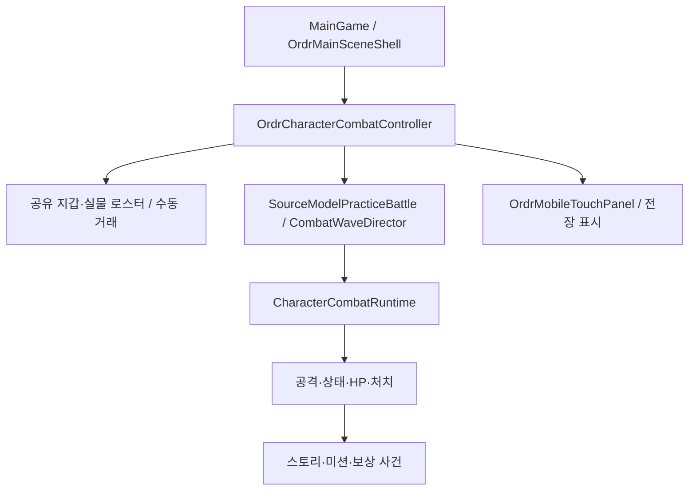

**독립 소환체 공격·오라 공통 전장 게이트:** `CharacterCombatRuntime.SourceModelIndependentAttacks.cs`의 `CanSourceIndependentStayOnLane`은 소유자 실물 존재·해독·공유 목표·스토리 전장 이동을 검사합니다. 독립 공격 `CanSourceIndependentAttack`과 `CharacterCombatRuntime.SourceModelEffects.cs`의 `CanSourceIndependentShareAura`가 이 조건을 재사용하고, 버프를 받을 독립체도 유효 전장인지 검사합니다. 객체 공격 주사위는 `SourceModelBasicCombatRules.cs`에서 원본 자료가 있는 경우만 허용하며, 실제 Unity 실행 검증은 별도입니다.

**S02 전투 타임라인 코어(2026-11-14):** `CombatScheduler.CaptureState/RestoreState`(공격 타이머), `CombatSkillTriggerEngine.CaptureState/RestoreState`(스킬별 이벤트/쿨타임), `CombatAttackPipeline.CaptureState/RestoreState`(공통 이벤트 순번), `CharacterActiveAbilities.CaptureState/RestoreState`(HP/MP·절대 쿨타임), `CombatStatusEngine.CaptureState/Restore`(오라·발동 효과, 종료 시각·revision), `CombatTimedEffectQueue.CaptureState/RestoreState`(식별 가능한 예약 타격, 익명 Action 차단), `CombatWaveDirector.CaptureState/Restore`(원본 스폰 계획과 생존·사망 장부), `SourceModelPracticeBattle.CaptureState`(65R 타이머/점수/이동), `CharacterCombatRuntime.CaptureRuntimeDraft`(유닛·적/소유자 리비전), `OrdrCharacterCombatController.CaptureWorldCheckpointDraft`(하나의 S01/S02 스냅샷). 완전한 월드 복구/실제 저장·이어하기는 후속.

**S01/S02 핵심 저장 초안(2026-11-14, 실행 미검증):** [`OrdrCoreCheckpoint.cs`](../Assets/Scripts/Core/OrdrCoreCheckpoint.cs) = 버전/원본 해시·논리시간·GameSession/UnitRoster/PersonalMissionGameplay 상태의 복구 전 교차 검증. [`OrdrCoreCheckpointStore.cs`](../Assets/Scripts/Unity/OrdrCoreCheckpointStore.cs) = Unity JsonUtility·SHA-256·두 저장 슬롯·임시 파일. `OrdrCharacterCombatController.CaptureCoreCheckpointDraft` = 진행 중 실제 공통 지갑·로스터·미션·시계의 한 시점 스냅샷 입구. **전투 상태·오라·예약 함수/난수/상점/스토리 등 완전 월드가 없으므로 실제 저장/이어하기 UI에 연결하지 않습니다.** 테스트 코드는 [`OrdrCoreCheckpointTests.cs`](../Assets/Tests/EditMode/OrdrCoreCheckpointTests.cs), 실행 미검증입니다.

> **메인 전장 거리/에셋 연결(2026-11-14, 실행 미검증):** `SourceModelPracticeBattle.cs`의 `SourceModelMainLaneGeometry`→`CharacterCombatRuntime.SourceModelFifthSkills.cs`의 출전 좌표→`CombatAttackPipeline.cs`의 레인별 유한 사거리→`SourceModelBasicCombatRules.cs`의 SLK `OriginalRange`. 적 보스 동선은 `SourceModelPracticeBattle.MoveLivingMonsters`, 양수 반경 적 오라는 `CombatAuraSystem.Refresh`, 표시 에셋은 `OrdrBattlefieldArt`(ImportedArt/battle-floor 및 enemy-pirate)에서 연결합니다. UI 화면 슬롯은 전투 좌표를 변경하지 않습니다.

# 코드 구조

**일반 상점 메뉴 제거·APK 빌드 경로:** `OrdrMobileTouchPanel`의 `Tab.Shop`·빈 상점 구매확인 UI·미사용 `pendingEconomy` 상태를 제거했습니다. `DrawWispEconomyOffers`는 기존 위습 실물 거래 버튼으로 남고, `RefreshCurrent`에서 도박과 위습의 실제 `ManualEconomyCategory`만 갱신합니다. `IOriginalEconomyPort`·`VerifiedShopSession`·돈 도박 졸업 상점·콤푸 환전/발굴·강화 서비스는 변경하지 않았습니다. `tests/test_player_building_left_menu.py`·`tests/test_random_wisp_submenu.py`에서 이미 합의한 조합 필터·상점 메뉴/구매확인 구형 문자열 검사를 현행 화면 및 위습 동작 계약으로 갱신했습니다. Actions는 `.github/ordr-apk-build-request.txt` 변경을 포함한 **main의 명시적 요청 커밋만** 푸시 시 검사/APK 제작하고, 일반 코드 푸시는 자동 빌드하지 않습니다.

**미션 UI 분리:** `OrdrMobileTouchPanel.DrawMissions`에서 공유/개인 버튼을 전환합니다. `DrawSharedMissionBoard`는 `Original323PoneglyphSession`의 검증된 공유 8종 상태를 각 카드로 표시하고, `DrawSharedMissionSelectedDetail`에서 원본 목표 설명과 (이미 실제 출현한 경우에만) 기존 `RequestSharedObjectiveDispatch/Recall`을 연결합니다. 신규 미션-클릭 수행은 적격 캐릭터 명세 미확정으로 **비활성 UI만 제공**하고 원본 사건·보상/해금 계산은 변경하지 않습니다. 기록지침의 `DrawPoneglyphPanel`은 해독/보물만 담당하며, 미션 탭의 특성포인트 잔액·보상 문구는 표시하지 않되 기존 지급 거래는 바꾸지 않습니다. 코드 반영만 완료, 컴파일·Android 실제 동작 확인은 남아 있습니다.

**도박소·위습 공통 알림 UI:** `OrdrMobileTouchPanel.DrawGambling`은 원본 `MobileManualOffer.Id`로 돈 도박과 유닛(하급·중급·고급·이세계) 도박을 분류하여 한 줄씩 표시합니다. `OrdrMobileUiTheme.DrawHoldActionRow(..., compact:true)`와 `MobileLongPressGesture`로 단일 탭 거래/길게 누름 상세를 분리합니다. `RunGamblingRewardAction`과 `RunWispDirect`는 전후 `Combat.MobileUnitSnapshot()`의 새 인스턴스 ID로 유닛 획득 여부를 확인하고 `PublishRewardToast`→`DrawRewardToast`에서 사진·이름 또는 확정 메시지를 왼쪽 상단에 3.2초 표시합니다. `BlocksWorldTap`으로 팝업 클릭 관통을 방지합니다. 콤푸 환전·아이템 발굴도 이 알림을 재사용하며 기존 항법 실행·원본 경제·난수·롤백 규칙은 유지합니다. 테스트/기기 실행은 요청 전 보류.

**메인 전장 유닛 표시:** `MobileOwnedUnitFormation`이 132px 선호 카드·94px 상한 초상화와 `PortraitRect`/`NameRect`/`QuantityRect`를 같은 배치 모델로 제공하고, `OrdrUnitWorldPresenter`가 SpriteRenderer(상단 사진)와 IMGUI(하단 큰 이름판·우상단 `×N` 배지)에 공통 좌표를 사용합니다. 상단 `OrdrMainSceneShell` 30px HUD와 기존 하단 페이지 공간은 보존하고 원본 전투/유닛 좌표·선택은 변경하지 않음. 테스트 코드는 갱신됐으나 실행하지 않음.

**조합 UI 공통 표시 모델:** `MobileFusionPreview.Ingredients`/`MobileFusionIngredient`에서 원본 재료명·필요량·실제 총 보유량·초상화 카탈로그 ID·골드/목재 조건을 구조화하며 `OriginalJassFusionPlanner`·`Original323CommonFusionPort`·읽기 전용 포트·보조 조합으로 합칩니다. `OrdrMobileTouchPanel`은 상단 선택 결과/재료 사진, 버튼식 필터, 간결한 결과 목록, 하단 1건 실행/명시적 복귀만 제어하고 원본의 승인·잠금·소비 조건을 수정하지 않습니다. 코드만 수정했으며 Unity·Android 검증은 요청 전 보류입니다.

**스토리 파견 재료의 조합 표시:** `OriginalJassFusionPlanner`는 메인 전장 재료와 스토리 소유 재료를 별도 집계해 수량·정확한 인스턴스 ID를 제공하며 `Original323CommonFusionPort`는 복귀 전 제작 금지/임박 오분류를 유지합니다. `OriginalJassReadOnlyFusionPort`·`AssistedFusionService`도 소유량 표시와 복귀 대기 상태를 구분합니다. `MobileFusionPreview.StoryMaterialInstances` → `OrdrMobileTouchPanel.DrawFusionConfirmation`의 명시적 `RequestStoryRecall`(1회=1기) → 원본 조합 확정 재검증. 실제 교체 거래의 `IsLockedFromRosterTransactions` 보호는 유지합니다.

**구매 위성·임시 소환수 전장 게이트:** `CharacterCombatRuntime.SourceModelIndependentAttacks.cs`는 영구 베가펑크 위성(`practice-satellite:`)을 플레이어가 구매한 전장 고정 독립 객체로 판정하여 제작자가 제거돼도 공격·기술·오라가 남도록 하고, 나머지 임시 소환수·블랙 애로우는 제작자 삭제/해독/파견 시 멈춥니다. `CharacterCombatRuntime.SourceModelEffects.cs`는 대상 유닛 및 독립 객체의 실제 전장으로 오라 자격을 통합합니다. 검증: `SourceModelScriptAttackSkillTests`·`Original323SoloStoryScenarioTests`·`SourceModelPracticeBattleTests`의 종전 실패 경로(실행 미확인).

**카툰풍 UI 테마:** `art/ui/cartoon-v1/`의 4종 원본 → `Assets/Resources/OrdrArt/CartoonUi/` 동일 PNG blob + Read/Write 임포트 → `Assets/Scripts/Unity/OrdrCartoonUiArtwork.cs` 투명 여백 정리/384·128·512px 캐시/상태 밝기/9분할 → `OrdrMobileUiTheme.InitializeAuxiliaryStyles` → `OrdrMobileTouchPanel` 기존 버튼/선택/확인창/도움말. 청록 일반 기능, 주황 주요 액션/선택, 사각 닫기·페이지, 갈색 대비 조정 양피지 안내. 오른쪽 전체 상세 패널은 무테 유지. `OrdrCartoonUiArtworkTests` 4종 리소스 및 상태 검사 추가(실행 미검증). 원본 참고 보드 2종은 게임 미포함.

**도감 파생 데이터 재생성:** `tools/rebuild_tooltip_inventory_exports.py --write`는 `data/character-skill-profiles.json`으로부터 문서화된 기술/패시브 개수만 `data/unit-runtime-status.json`에 동기화하고 `tools/classify_character_skills.py`의 분류 규칙으로 `data/original-2323C-skill-research-queue.json`을 재생성합니다. `--verify`는 변경 없이 두 출력이 최신인지 확인합니다. 네이티브 연결 효과·검증 등급·유닛 획득 권한에는 영향 없음.

## C07 마르코 형태별 전투 경로(스킬 설명 기반, 실행 미검증)

- `data/character-skill-profiles.json`의 LI-03에 인간형 10% 현재체력20% 폭발/특수몹20만, 불사조 8인 75만 마법, 인간375범위100%마법 및 불사조400범위80%물리 평타, 불사조 공격시 HP+1, 형태별 치명타 도감 데이터를 보강. 원본 출처: https://ordsearch.net/characters/326
- `CharacterCombatRuntime.SourceModelEleventhForms.cs`는 `ExecuteSourceModelEleventhFormDeclaredAttack`에서 형태별 스킬/공격시 후속을 재사용하고, `CompleteSourceModelHit`에서 이미 확정된 기본공격 결과에 추가 광역 피해를 연결합니다. 스킬 선언과 타격 성공을 구분해 취소 공격의 광역 중복 타격을 막습니다. 추가 8명은 같은 전장/반경 내 주 대상 제외, 안정적인 ID 순서의 TOOLTIP_MODEL_ONLY 선택입니다.
- `SourceModelUnitEffects.BeforeBasicHit`의 기존 h08O 네이티브 A15N 15% 치명타 추첨을 유지하되 현재 F 변신 상태일 때 배수만 3.25(인간형)→3(불사조형)으로 변경합니다. 새 치명타 난수나 공격 콜백은 만들지 않습니다. `CharacterCombatRuntime.SourceModelResources.cs`는 동전장 아군 봉리력 +3 HP/초를 겹치지 않게 지급하고, 원본 SLK 자기 자연 재생 +0.5와 별도 계산합니다.
- `SourceModelScriptAttackSkillTests` 및 `tests/test_source_model_eleventh_forms.py`에 추가 8명·단일 10% 폭발·아군 회복/중복·원본 기술 구성 확인 코드를 추가했습니다. Unity·Android/APK 검사 결과는 아직 미확인입니다.

**UI 스크롤 연결:** `MobilePanelScrollGesture.Begin`의 선택적 가로축/스크롤바 여백 설정을 `OrdrMobileTouchPanel.HandleStripScroll`에서 재사용합니다. 왼쪽 목록과 스킬 줄은 Repaint에서 각각 viewport/최대 스크롤을 기록하고 화면 크기·배율 변경 시 입력 경계를 초기화합니다. `MobileMapSkillLayout`은 자원/스킬 공간 및 모든 고정 UI의 월드 입력 차단을, `OrdrMobileUiTheme.ResourceChip`은 자원 이름·정확한 숫자의 좁은 폭 2단 표시를 담당합니다.

## 마르코 F 스킬 발동 띠 연결 (코드·미검증)

- `Original323SourceDedicatedSkillPort.AvailableSkills/Execute`가 LI-03/h08O 보유 개체의 F 수동 변신을 `MobileDedicatedSkillActions`의 공통 승인·실행 경로에 등록합니다. `OrdrMobileTouchPanel.DrawDedicatedSkillMargin`은 기존 가로 스킬 띠를 유지하며 선택한 마르코의 버튼을 맨 앞에 보이고 선택 변경 시 가로 스크롤을 초기화합니다.
- `CharacterCombatRuntime.SourceModelEleventhForms.cs`가 기본 인간형/불사조형 상태·10.75초 소유자별 쿨타임·해독/공유출전 제한을 관리, `SourceModelEffects.cs`에서 인간형 +125% IAS를 기존 전투 속도 상한 공식에 합산합니다. 수동 F는 HP·MP·공격 타이머·기존 다른 폼 엔진을 재설정하지 않고 판매/조합 시 폼 상태·대기 장부만 삭제합니다.
- 외부 원본 형태 증거를 연결한 실행 경로에서는 그 정보를 우선하고 수동 F를 혼합하지 않습니다. 불사조형 공격속도 감소와 양 형태의 정확한 공격력 증감 수치는 원본 값 미확정으로 보류합니다. `SourceModelScriptAttackSkillTests`에 리본 노출·왕복·쿨타임·레인·소유자·공속 회귀 소스를 추가했습니다(실행 미검증).

## C06 제한 마르코 형태·전투 근거 연결 (코드·미실행)

- `CharacterCombatRuntime.SourceModelEleventhForms.cs`: 기존 `ConfigureSourceModelMarcoFormEvidence`를 그대로 사용하며 유효한 LI-03/h08O 소유자·비해독/비공유 레인 외에는 형태가 노출되지 않도록 제한. 원본 도감 기반 HP15 이상 **발동 전 검사**와 불사조 10 HP/18%, 인간형 7 HP/15% 정확히 분리. 스킬의 원본 프로필 구성(범위·추가 단일 타격·스턴)을 먼저 확인하므로 누락된 컴포넌트에 비용/피해를 잘못 적용하지 않습니다.
- 불사조형 원래 기본 타격 외 추가 40% 단일 고정 스킬 피해를 **첫 모델 HP 피해의 40%**로 표현(TOOLTIP_MODEL_ONLY). 원본 실제 JASS 40% 기초량/면역/순서 미확정. 인간형 기존 마법·현재체력30%·2초 기절과 공통 체력/유닛/쿨타임 장부 유지. `SourceModelScriptAttackSkillTests`에 증거 없음, HP15 경계, 40% 단일 추가 피해, 해독·삭제 후 금지 관련 소스 검사 3건(미실행) 추가.

## C06 변신 사전 감사와 생명주기 정리 (코드·미실행)

- 기존 `SourceModelBasicCombatRules.SetSourceForm/FormAttackOf`와 `CombatAttackPipeline.ConfigurePracticeAttackOverride`, `CharacterActiveAbilities`의 자원·쿨타임 장부가 이미 동작합니다. 새로운 공통 폼 엔진을 만들지 않으며 자원/쿨타임 재초기화도 하지 않습니다.
- `CharacterCombatRuntime.RefreshAfterCommittedCombatLaneChange` → `ForgetSourceModelFormsOnLaneChange`가 소유자 이전 레인의 스네이크맨 시전, 야마토/임시 변신 버프·이름, 보니 니카/기타 10차 폼을 **동일 커밋 즉시** 취소합니다. 니카 H0BY는 기존 `ForgetSourceModelTenthFormState`의 원본 MP 최대치 복원을 실행합니다. 스네이크맨 예약은 유효 완료 시각까지 같아야 새 변신 시전에 영향을 주지 않습니다.
- `RemoveCharacter`는 기존 구현돼 있었지만 호출되지 않았던 `ForgetSourceModelFusionNativeActor`를 실행해 우타 B61/인트로·테소로·로저·샤크 상태를 정리합니다. 우타 해독·공유출전 중 B61 HP10 변신/회복 처리 차단, `PracticeFormOf`에서 h0AF를 신세계로 표시합니다.
- `SourceModelScriptAttackSkillTests`에 야마토 임시 폼 즉시 정리, 도플라밍고 비용 보존, 보니 니카 MP 최대치 복원, 우타 삭제 상태와 해독 중 자동 회복 억제 검사 소스 5건 추가(미실행). 마르코는 당시 외부 원본 폼 증거가 있어야만 전투 처리했으나, 후속으로 도감에서 확인한 수동 F 명령(10.75초)을 연결했습니다.

## C05 일시 스킬 공통화 (코드·실행 미검증)

슈가 R-24: SourceModelRemainingCallbacks의 BpT 0.35초 근사 접근/500 직접 타격과 h06O 3.5초 공통 수명·BpS/e01M 사망 사건을 유지하며 실물 보유 유닛은 생성하지 않습니다. 폭발 범위는 네이티브 검증 전 임의 구현하지 않습니다.

전설 모리아 L-12: SourceModelBasicCombatRules에서 h05D 및 본체 h02N의 원본 공격 데이터가 완전할 때만 독립 공격을 승인합니다. SourceModelRemainingCallbacks, SourceModelBulkAutoSkills는 18초 비보유 가상 효과를 공유하고 SourceModelIndependentAttacks는 장군좀비의 원본 공격 버프 상속 출처를 제한적으로 허용합니다.

우타 E-09: SourceModelFusionNativeFollowups의 B6s/h04O 병사를 공통 임시 효과로 이전합니다. SourceModelCompositeEffects의 중복 sourceSongSoldierExpiry를 제거하고 실제 공격자·레인·수명으로 7초 병사를 집계합니다. 삭제·파견·해독 종료는 공통 정리에서 그룹/공격자 상태를 동시에 회수합니다.

OrdrUnitWorldPresenter는 기존 재사용 투사체 풀과 TryGetSourceTransientProjectileOrigin 원점 조회를 사용합니다. 렌더링이 피해나 난수를 변경하지 않습니다. 압살롬 도박 영구 좀비 U-14, 특별함 모리아 S-09 블랙 애로우, 우타 원본 수치/확률은 변경하지 않습니다.

> **새 작업의 코드 지도:** 무엇을 고쳐야 하는지 빠르게 찾는 문서입니다. 기능 구현률·APK 차이는 [현재 상태](START_HERE.md), 미완료 작업은 [개발 작업](PLAYABLE_ROADMAP.md), 실제 조작은 [화면·조작](화면-조작-시스템.md)에 있습니다. **이 문서에 날짜별 개발 일지나 기능별 확률·비용을 중복 기록하지 않습니다.**

## 특별함 모리아 S-09 블랙 애로우 (코드만)

- `CharacterCombatRuntime.SourceModelEffects.cs`의 실제 양성 평타 처치 판정 → `CharacterCombatRuntime.SourceModelNativeFollowups.cs`의 10초 가상 효과 생성. 기존 `SpawnCharacter(U-14)`은 사용하지 않음.
- `SourceModelBasicCombatRules.cs`가 원본 `h00H` 공격 스탯을 독립 공격 처리기로 승인(영구 U-14의 기존 원본 매핑 증거와 중복 등록 금지), `CharacterCombatRuntime.SourceModelTemporarySkills.cs`는 가상 효과를 보유·소환 화면에서 제외하고 삭제/해독/전장 이동/시간 만료를 공통 정리. `CharacterCombatRuntime.SourceModelIndependentAttacks.cs`는 정확히 만료된 공격의 후속 1타를 막음.
- `CharacterCombatRuntime.SourceModelEffects.cs`는 모리아의 **실제 양성 평타 적중**을 식별하고 `SourceModelNativeFollowups.cs`에 0.05초 `BNba/BNdm` 표식을 전달합니다. 전투 공통 `DamageApplied`는 처치 직전에 해당 표식이 유효하면 **다른 공격자 처치도 포함**하여 10초 `h00H` 가상 공격 효과로 전환합니다. 중복 사망·해제·대상 삭제·소유자 삭제/전장 변경 정리, 최초 적중 판정과 피해 합산을 분리했습니다.
- `CombatStatusEngine.cs`에 별도 `SourceBlackArrowDeathMark` 상태형을 **기존 enum 마지막에 추가**해 표식이 피해/기절로 잘못 계산되지 않도록 했습니다. `CharacterCombatRuntime.SourceModelIndependentAttacks.cs`는 표시용 가상 공격 출발지 조회만 노출합니다. `OrdrUnitWorldPresenter.cs`는 이를 기존 재사용 투사체로 렌더링하며 소환수 유닛 아이콘은 만들지 않습니다.
- `SourceModelPracticeBattleTests.cs`: 영구 U-14 공존, 10초 만료, 0.05초 표식+다른 공격자 사망, 즉시 사망, 해독/삭제/해제/보스 배제 회귀 소스 총 7건(실행 미검증). 전설 모리아 그림자/장군좀비 및 다른 좀비 보상은 변경하지 않음.

## C05 삭제·해독 전환 공통 생명주기

- `CharacterCombatRuntime.RemoveCharacter`가 `ForgetSourceManualSupport(true)` 및 `ForgetSourceModelEleventhActor`를 호출하여 다른 아군의 임대 버프·재생과 사라진 소유자의 폼/기술 카운터를 정리합니다.
- `CharacterCombatRuntime.SetOriginalPoneglyphChanneling`는 해독 시작과 종료 모두 `RefreshAfterCommittedCombatLaneChange`를 사용합니다. 중복 시작은 해독 상태를 다시 초기화하지 않습니다.
- `Assets/Tests/EditMode/CharacterCombatLifecycleCleanupTests.cs`에 두 경로의 회귀 검사 소스를 두었습니다(미실행). 원본 특수 기술 개별 종료·동등성 검증은 별도입니다.

## 캐릭터 C03/C04 원본 분기 연결(2026-11-08, 코드만)

- `CharacterCombatRuntime.SourceModelRemainingCallbacks.cs`: `RemainingBlackbeardForcesBzq`가 A903 광폭화의 무조건 발동 및 Bdi 보스의 대상별 최초 prop-window 64 게이트를 관리하고, `OnSourceRemainingDeclared`의 TR-01 `Bz1`이 표적별 `Bzq` 지연 피해를 분리합니다. L-36의 `BtV → BtT`는 선언 시 버프만 검사하고, 양성 적중 때는 등록 표적을 검증합니다. `CharacterCombatRuntime.RemoveEnemyRuntimeState`에서 보스의 게이트 기록을 지워 동일 ID로 재출현한 적에게 이전 상태가 새지 않도록 합니다. 모든 변경은 코드만 연결되었고 원본 A904·A0HS 2레벨·Unity/Android는 미검증입니다.

## 이번 추가 연결(2026-11-07, 코드만)

- 아이템 패시브: `Original323FusionSourceItemLedger.cs`에 선언된 `Original323SourceItemPassiveRules` → 공유 지갑 원본 발굴 AI15·고유 AI18/AI20 수령 장부 → `Ordr323OriginalHelperCowActor.AdvanceBaseManaRegeneration`의 전투시계 기반 재생 가산 / `CharacterCombatRuntime.SourceModelFusionNativeFollowups`의 `LL→A11S` 출현시 스냅샷 → `SourceModelCompositeEffects`의 라인 폭발형 피해 가산. `OrdrMobileTouchPanel.DrawItemExcavation`에서 현재 보너스를 표시합니다. **원본 BhL 확인·코드만 연결**, Unity/Android 미검증. **후속:** `SourceModelMoneyGamblingDesk.WoodRights/BuyWood`에서 AI13의 `i5+2`를 5회 기본 재고와 별도 소모 영수증으로 적용. `Original323SourceItemPassiveRules`는 AI10 기록지침 A05D/BJI 알림·AI13 `dL`·AI19 `LK` 원본 변화량을 조회합니다. `Original323TreasureHunt`의 승인된 시전 증빙 → 선택적 `IOriginal323TreasureCastOriginWitness` 시전자 확인 → `Original323TreasureAlarmJournal` 전투 시계 예약 → 컨트롤러 `AdvanceWitnessedTreasureAlarms` → UI 일반 공지/기록지침 남은 시간으로 연결했습니다. `Original323MonsterGoldService`는 AI13 상태에서 원본 `dL` 부족 증명을 거부합니다. `CharacterCombatRuntime.SourceModelFusionNativeFollowups`는 AI19의 생성 시점 16→21 A04Q 원본 `Def5` 피해 배율 비율을 미확인 연습 라인 몬스터에만 스냅샷해 `SourceModelCompositeMagicFactor`에 반영합니다. 이미 증명된 A04Q에 이중 적용하지 않으며 원본 시전·골드 증명 공급자·A04Q·전체 스킬/실기 검증은 여전히 미완료.

- 공유 목표 전장 격리: `CharacterCombatRuntime.CanShareAllyCombatLane`가 메인/스토리/공유 목표 ID별/포네그리프 해독 유닛을 분리. 아군 스킬·특수 오라·지원·언변 버프의 기존 `IsStoryDeployed` 이진 판정을 교체했습니다. `SourceModelIndependentAttacks` 광역 공격도 실물의 `CanAttackInThisLane` 또는 소환수의 원래 레인 판정에 맡기고, 독립 공격자 소유자 이탈 시 공격을 중단합니다. `SourceModelSummonState.LaneRevision`으로 출전·복귀·해독 변경 때 잔류 소환수를 폐기합니다. **원본 공유 목표 공급자·실기 검증은 미완료**.

- 기록지침 보물 탐색: `OrdrMobileTouchPanel.DrawTreasureGacha` → `OrdrCharacterCombatController.RequestMobileTreasureGacha` → `MobileTreasureGacha` → `Original323TreasureHunt`; 가이몬은 필수 조건이 아닌 범위/수량 보정, 실제 16개 보물사냥꾼 정산 공통 메서드. 원본 시전·시전자 승인 시 `Original323TreasureAlarmJournal`에 AI10 97/77초 탐색 알람, 독립 `Original323GaimonRevealPort.ObserveOriginalCcq`와 네이티브 `collect=false` 승인 시 `RegisterAuthorizedCcq`에 297초 위치 공개 알람을 전투 시계로 예약·표시. 원본 시전 공급자·실기 연결은 미완료.
- 환전소·발굴: `SourceModelGamblingNavigation.ExchangeHouse` → `SourceModelUnitGambling`의 원본 CJS 중급 시도 원자 보상(`CompuResource +1`, 도박 성공/실패 무관) → `SourceModelCompuExchange` 7종 환전 → `Original323CompuUnitWorld` 실물 해적선/랜덤전용/토큰 생성·실패 롤백. CKH/CKI는 `SourceModelItemExcavation`의 원본 BhS/BhT 스택(최대 10) 충전 → 12/10종 비복원 아이템 추첨 → 기존 `Original323FusionSourceItemLedger` 고유 아이템 장부로 연결. `OrdrMobileTouchPanel` 도박 화면에 상태/조작 추가. **BhL 개별 아이템 사용/패시브 효과·외형·전체 저장·실기 검증은 별도**.
- 연구소: `Original323PlayerResearchSession.SourceCost`는 공유 지갑 `wood` 키를 사용. `OrdrMobileTouchPanel.UpgradeResourceName`은 `wood/lumber` 모두 목재로 표시.
- 세 경로 모두 실행·실기 검증은 미실시.

- 공유 F04 후속 연결: `Original323SharedMissionRewardWorld`가 룸바·문·종·해왕류·파괴왕 발굴 보상을 기존 `SourceModelItemExcavation.OrdinaryStacks`에 합쳐 실제 `BhS` 발굴 메뉴가 소비하도록 만듭니다. `Original323SharedObjectiveWorld`가 중복 등장/격파 사건을 멱등 수신하고 원본 `CM1/CM0` 버프 적용의 선행 사건을 보관하며, `OrdrCharacterCombatController.ConfigureOriginal323SharedMissionFollowUps`가 버프 적용 증거 공급자를 연결합니다. 기본 APK에 해당 대장 버프 적용 증거와 5종 목표 최종 출현 자료는 미연결, 통합/실기 검사 미실시.

## 1. 실행 흐름

**컨트롤러는 연결과 수명**, **전투 런타임은 실제 판정**, **지갑·로스터는 거래**, **화면은 사용자 요청과 표시**를 담당합니다. UI에서 전투 수치나 보상을 따로 계산하지 않습니다.

**기술 중복 방지 도구:** [`audit_character_skill_coverage.py`](../tools/audit_character_skill_coverage.py)는 전체 `Assets/Scripts/**/*.cs`·도감 프로필·유닛 레지스트리·[수동 코드 증거](../data/character-skill-execution-witnesses.json)를 함께 읽어 기술 554개와 개별 효과를 감사합니다. `--inspect L-19:skill:2`로 후보 실행 경로를 살펴보고, `--write`로 [기술 감사표](스킬-구현-현황.md)·[JSON](../data/character-skill-code-coverage.json)·[CSV](../data/character-skill-code-coverage.csv)를 생성합니다. 이 도구는 전투 실행 테스트나 구현 완성률 계산기가 아닙니다.

**원본 공격 콜백:** `CharacterCombatRuntime.SourceModelRemainingCallbacks.cs`에서 JASS `Bnw`~`CGd` 확률·객체 능력 수치·명중 후 단계·예약 피해를 처리하고, 네이티브 지정 대상 우선 선택과 마젤란 무작위 보조 시전자 위치, 키자루의 모바일 무제한 첫 도달을 관리합니다. `CharacterCombatRuntime.SourceModelAttackSkills.cs`는 모바일 무제한 시전 대상 도달을 위해 `ProjectileLine` 회랑을 선택 대상까지 연장하되 폭은 유지하며, 희귀 아카이누 블리자드 추첨·히든 아카이누 보스 누적/광폭화 B05G 상태별 타격을 맡고, `CharacterCombatRuntime.SourceModelRemainingCallbacks.cs`의 공용 서리 갑옷 상태는 바제스 B07T의 명중 피해별 유효시간과 아카이누 B05G의 디스펠 가능 신분을 관리합니다. `CharacterCombatRuntime.SourceModelTemporarySkills.cs`는 변신 시전과 분리된 **공격 일시정지/복귀·더미 수명** 및 자폭·시간 만료·소유자 정리의 단일 소환수 종료 경로를 처리합니다. 슈가 `h06O` 사망은 `BpS/e01M` 사건을 발행하지만 화면 렌더링은 미연결입니다. `SourceModelUnitEffects.cs`는 `Ablo` 공속 버프, `CharacterCombatRuntime.SourceModelLegacyFollowups.cs`는 적 `A04R`·원본 포인트를 맡습니다. 미확인 주문 피해·면역·투사체와 버프 소멸은 `EffectDeferred`로 구분합니다.

**제트 I-10 도감 모델:** `SourceModelUnconnectedSkillCatalog.cs`에서 대상 기술을 승인하고 `SourceModelNextThirtySkillCatalog.cs`에서 ID·프로필 전 필드를 검사합니다. `CharacterCombatRuntime.SourceModelNextThirtyAttacks.cs`는 직선 330·보스 가산을 적용하고, `CharacterCombatRuntime.SourceModelZephyrCharge.cs`는 0.7초 충전·단일 대상 추가 피해·소유자/전장 변경 정리를 담당합니다. 기존 피해·타깃 처리 재사용, 원작 애니메이션·Unity 실행 미검증.

**바제스 D-06 주기 피해:** `CharacterCombatRuntime.SourceModelBurgessBasic.cs`는 성공 평타 피해로 `파동 엘보` 대기시간을 주기당 최대 9초 당기고, 범위 마법·현재 HP 폭발·특수 적 추가 피해·일반 적 기절을 실행합니다. `CharacterCombatRuntime.SourceModelAdditionalAutoSkills.cs`의 공용 주기 시계와 `CharacterCombatRuntime.cs`의 중복 발동 방지 분기를 재사용합니다. `CharacterCombatRuntime.SourceModelAdditionalAutoSkills.cs`의 판매·조합 정리와 `CharacterCombatRuntime.SourceModelEleventhForms.cs`의 전장 변경 정리가 상태를 제거합니다. 제트의 차지 상태도 두 경로에서 함께 정리합니다. 원본 시전 프레임·라운딩/면역 및 실기 미검증.

## 2. 영역별 실제 진입점

| 작업 영역 | 먼저 열 파일 | 재사용할 역할 |
|---|---|---|
| **시작·세션** | [OrdrCharacterCombatController.cs](../Assets/Scripts/Unity/OrdrCharacterCombatController.cs), [OrdrMainSceneShell.cs](../Assets/Scripts/Unity/OrdrMainSceneShell.cs) | 원본 데이터·공통 서비스 연결, 시작/정지/재시작 및 동일 세션 유지 |
| **메뉴·입력·전장 UI** | [OrdrMobileTouchPanel.cs](../Assets/Scripts/Unity/OrdrMobileTouchPanel.cs), [OrdrMobileUiTheme.cs](../Assets/Scripts/Unity/OrdrMobileUiTheme.cs), [OrdrUnitWorldPresenter.cs](../Assets/Scripts/Unity/OrdrUnitWorldPresenter.cs), [MobileOwnedUnitFormation.cs](../Assets/Scripts/Unity/MobileOwnedUnitFormation.cs), [MobileInteractionPolicy.cs](../Assets/Scripts/Mobile/MobileInteractionPolicy.cs) | 큰 버튼·가로 레이아웃·전장 초상화/페이지 배치·원본 좌표와 표시 좌표 구분 |
| **원본 유닛 객체** | [CharacterUnitCatalog.cs](../Assets/Scripts/Data/CharacterUnitCatalog.cs), [OriginalMapBaseStatCatalog.cs](../Assets/Scripts/Data/OriginalMapBaseStatCatalog.cs) | 프로젝트 ID와 `rawcode`, 원본 객체/능력 데이터 연결 |
| **공통 전투** | [CharacterCombatRuntime.cs](../Assets/Scripts/Combat/CharacterCombatRuntime.cs), [CombatTimedEffectQueue.cs](../Assets/Scripts/Combat/CombatTimedEffectQueue.cs), [CharacterSkillEffectExecutor.cs](../Assets/Scripts/Combat/CharacterSkillEffectExecutor.cs), CombatAttackPipeline, CombatScheduler, CombatResolution | 대상·공격 선언/명중·피해·상태·사망의 공통 정산. 예약 타격은 단일 시계/등록 순서·참조별 취소를 보존하고, 유닛 제거에서는 시전자와 대상 예약을 함께 취소. `RefreshAfterCommittedCombatLaneChange`는 기존 레인 적 대상/해당 유닛 대상 타격만 취소해 영구 자동 발동의 자기 시계를 보존. 실행 검증은 별도 |
| **특수/자동 기술** | [CharacterCombatRuntime.SourceModelAdditionalAutoSkills.cs](../Assets/Scripts/Combat/CharacterCombatRuntime.SourceModelAdditionalAutoSkills.cs), [CharacterCombatRuntime.SourceModelBulkAutoSkills.cs](../Assets/Scripts/Combat/CharacterCombatRuntime.SourceModelBulkAutoSkills.cs), [CharacterCombatRuntime.SourceModelRemainingCallbacks.cs](../Assets/Scripts/Combat/CharacterCombatRuntime.SourceModelRemainingCallbacks.cs), [SourceModelSixthAttackCatalog.cs](../Assets/Scripts/Combat/SourceModelSixthAttackCatalog.cs), [SourceModelSeventhAttackCatalog.cs](../Assets/Scripts/Combat/SourceModelSeventhAttackCatalog.cs), [SourceModelAfterHitAttackCatalog.cs](../Assets/Scripts/Combat/SourceModelAfterHitAttackCatalog.cs) | 도감 기반 모델·원본 JASS 콜백을 별도 근거와 승인 범위로 처리. 네이티브 효과 중복 실행 금지 |
| **도감 Q/W·지원** | [CharacterCombatRuntime.SourceModelManualSupport.cs](../Assets/Scripts/Combat/CharacterCombatRuntime.SourceModelManualSupport.cs), [CharacterCombatRuntime.SourceModelRareLaw.cs](../Assets/Scripts/Combat/CharacterCombatRuntime.SourceModelRareLaw.cs) | 7개 수동 지원 기술의 자동 대상·전장·버프/재생·쿨타임/소멸, 2개 수동 필살기, 버기 독립 공버프. R-05/S-05 중복 가속 회피. 코드 모델이며 원작 동등성·Unity 실행 미검증 |
| **오라·자원·소환수** | CombatStatusEngine, SourceModelResources, SourceModelIndependentAttacks, SourceModelTemporarySkills | 지속시간·MP/HP·소유자 변경·전장 리비전·독립 소환 생명주기 |
| **라운드·몬스터** | [SourceModelPracticeBattle.cs](../Assets/Scripts/Combat/SourceModelPracticeBattle.cs), [CombatWaveDirector.cs](../Assets/Scripts/Combat/CombatWaveDirector.cs), [Original323MonsterNativeAbilityRuntime.cs](../Assets/Scripts/Combat/Original323MonsterNativeAbilityRuntime.cs) | 웨이브·적 이동·피해/보상·종료와 논리 시간. [원본 규칙·독립 연습 모델 구분](라운드-몬스터-시스템.md) |
| **지갑·실물 거래** | [SharedEconomySession.cs](../Assets/Scripts/Core/SharedEconomySession.cs), [EconomyTransactions.cs](../Assets/Scripts/Core/EconomyTransactions.cs), UnitRoster | 비용·보상·영수증·되돌리기, 여러 기능이 사용하는 한 지갑 |
| **조합** | [Original323CommonFusionPort.cs](../Assets/Scripts/Mobile/Original323CommonFusionPort.cs), [OriginalJassFusionPlanner.cs](../Assets/Scripts/Mobile/OriginalJassFusionPlanner.cs), [OriginalJassFusionAtomicCoordinator.cs](../Assets/Scripts/Mobile/OriginalJassFusionAtomicCoordinator.cs) | 원본 조건·재료 후보·확정 시 재검사·실물 교체 |
| **위습** | [MobileWispService.cs](../Assets/Scripts/Core/MobileWispService.cs), [Original323MobileWispOutcomeWorld.cs](../Assets/Scripts/Combat/Original323MobileWispOutcomeWorld.cs), [OriginalWispCombatRewardWorld.cs](../Assets/Scripts/Combat/OriginalWispCombatRewardWorld.cs), [Original323SourceCommonWispWorld.cs](../Assets/Scripts/Combat/Original323SourceCommonWispWorld.cs) | 원본 보상 풀·실물 생성·보류 결과·실패 롤백 |
| **경제·돈 도박** | [SourceModelMoneyGamblingDesk.cs](../Assets/Scripts/Mobile/SourceModelMoneyGamblingDesk.cs), [SourceModelRegularMoneyGambling.cs](../Assets/Scripts/Mobile/SourceModelRegularMoneyGambling.cs), [Original323GraduatedRareShopWorld.cs](../Assets/Scripts/Mobile/Original323GraduatedRareShopWorld.cs) | 돈 도박·졸업/구매·재고·보류 추첨을 공유 지갑으로 정산 |
| **이세계 유닛 도박** | [SourceModelOtherworldUnitGambling.cs](../Assets/Scripts/Mobile/SourceModelOtherworldUnitGambling.cs), [Original323OtherworldGamblingWorld.cs](../Assets/Scripts/Mobile/Original323OtherworldGamblingWorld.cs), [Original323OtherworldGamblingRules.cs](../Assets/Scripts/Core/Original323OtherworldGamblingRules.cs) | 공유 지갑 원자 결제·CJM 분기/보류 추첨·RN/LT 실물 생성. StoryNativeRewardQueue의 GamblingCharges와 CreepPracticeWorld의 실제 최초 격파 신호, SharedMissionRewardWorld의 CNU 해왕류 완료 영수증 충전을 연결. 해왕류 실제 등장·사망 증빙 공급자·환전소·전체 저장은 별도 |
| **스토리·보상** | [Original323SoloStoryScenario.cs](../Assets/Scripts/Combat/Original323SoloStoryScenario.cs), [Original323StoryMobileProgression.cs](../Assets/Scripts/Core/Original323StoryMobileProgression.cs), [Original323SourceMaterialRewardWorld.cs](../Assets/Scripts/Combat/Original323SourceMaterialRewardWorld.cs), [Original323StoryNativeRewardQueue.cs](../Assets/Scripts/Combat/Original323StoryNativeRewardQueue.cs), [Original323StoryManualDispatch.cs](../Assets/Scripts/Mobile/Original323StoryManualDispatch.cs) | 14개 건물·수동 파견·보상·성장·고유 아이템/초월위습 |
| **개인미션** | [OriginalPersonalMissionCatalog.cs](../Assets/Scripts/Core/OriginalPersonalMissionCatalog.cs), [OriginalPersonalMissionSession.cs](../Assets/Scripts/Core/OriginalPersonalMissionSession.cs), [PersonalMissionGameplay.cs](../Assets/Scripts/Core/PersonalMissionGameplay.cs) | 원본 18종·3칸·사건 판정·공유 지갑 보상·부분 저장. 게임별 사건 연결 여부는 별도 확인 |
| **도움소** | [OriginalHelperCowManaRecharge.cs](../Assets/Scripts/Core/OriginalHelperCowManaRecharge.cs), [OriginalHelperCowLiveCombatWorld.cs](../Assets/Scripts/Combat/OriginalHelperCowLiveCombatWorld.cs), [OriginalHelperCowAutoArea.cs](../Assets/Scripts/Combat/OriginalHelperCowAutoArea.cs), [Ordr323OriginalAlchemyCastService.cs](../Assets/Scripts/Combat/Ordr323OriginalAlchemyCastService.cs) | 공통 마나·위습 충전·광역 원본 공급자 계약 |
| **유닛 도박 3등급·리롤** | [SourceModelUnitGambling.cs](../Assets/Scripts/Mobile/SourceModelUnitGambling.cs), [Original323UnitGamblingRules.cs](../Assets/Scripts/Core/Original323UnitGamblingRules.cs), [Original323UnitGamblingWorld.cs](../Assets/Scripts/Mobile/Original323UnitGamblingWorld.cs), [SourceModelUnitReroll.cs](../Assets/Scripts/Mobile/SourceModelUnitReroll.cs) | CJP/CJS/CJK 분기·실물 생성·지갑·미션, CRj/CRl의 실제 유닛/토큰 원자 교체. 공용 횟수와 개체별 능력 권한을 구분 |
| **도박광 항법·공통 선택 제한** | [SourceModelGamblingNavigation.cs](../Assets/Scripts/Mobile/SourceModelGamblingNavigation.cs), [Original323NavigationSelection.cs](../Assets/Scripts/Core/Original323NavigationSelection.cs) | 21R 이후 카지노/리스크헷지 선택·CKR 충전 환산·공용 LN. 도움소 항법도 같은 선택 제한을 사용 |
| **악몽·이세계·항법** | [NightmareMutationRules.cs](../Assets/Scripts/Core/NightmareMutationRules.cs), [NavigationProgression.cs](../Assets/Scripts/Core/NavigationProgression.cs), [Ordr323OriginalHelperNavigation.cs](../Assets/Scripts/Combat/Ordr323OriginalHelperNavigation.cs) | 고정 모드·오로성 권장표, 검증 노드만 등록하는 틀, 도움소·도박광의 일부 실제 항법을 구분 |
| **크립 파견·토벌 진입점(구현 대상)** | [OrdrMobileTouchPanel.cs](../Assets/Scripts/Unity/OrdrMobileTouchPanel.cs), [MobileStoryDispatchBrowser.cs](../Assets/Scripts/Mobile/MobileStoryDispatchBrowser.cs), [Original323StoryManualDispatch.cs](../Assets/Scripts/Mobile/Original323StoryManualDispatch.cs), [Original323CreepPracticeWorld.cs](../Assets/Scripts/Combat/Original323CreepPracticeWorld.cs), [CharacterCombatRuntime.cs](../Assets/Scripts/Combat/CharacterCombatRuntime.cs), [컨트롤러](../Assets/Scripts/Unity/OrdrCharacterCombatController.cs) | [F03](PLAYABLE_ROADMAP.md): Story 하위 크립 화면·개체별 목적지·파견/복귀·별도 토벌 UI. 현재 `CanAttackInThisLane`는 Creep/SeaKing/Challenge를 차단하고 `IsStoryDeployed`는 건물 파견만 구분. 대상별 자격과 목적지를 확장하고 일반 공격뿐 아니라 광역/오라·예약타·소환수·판매/조합 제한도 같은 판정을 사용해야 함 |
| **공유 도전과제·포네그리프** | [공유 목표 사건/출전 월드](../Assets/Scripts/Combat/Original323SharedObjectiveWorld.cs), [공유 미션 지급·미실행 의무](../Assets/Scripts/Combat/Original323SharedMissionRewardWorld.cs), [해독·완료 장부](../Assets/Scripts/Combat/Original323PoneglyphSession.cs), [적 아군 레인](../Assets/Scripts/Combat/CharacterCombatRuntime.cs), [컨트롤러](../Assets/Scripts/Unity/OrdrCharacterCombatController.cs), [기록지침 UI](../Assets/Scripts/Unity/OrdrMobileTouchPanel.cs) | 나머지 5종 실제 객체/보스의 출현 증빙·전투 사망·별도 정산 증빙을 전용 레인과 결합. 출전·복귀 시 중복 타격 제한·목표 소멸 자동 복귀, 공통 유닛 거래/원본 시전 잠금과 조합 후보/스토리 파견 갱신 연결. 출전·해독 전환 후 효과 정리와 확정 유닛 제거 시 해독 장부 정리는 공통 전투 런타임에서 처리. 공유 5종의 단독 지급 입구 차단·원본 사망과 전투 사망의 선후 무관 확정·대장 출현 의무 미정산 재시도는 객체 월드/보상 월드에서 처리. 기본 APK에는 외부 원본 목표 공급자 미설치; 완료 조건은 [F04](PLAYABLE_ROADMAP.md) |
| **스토리 표시** | [OrdrStoryBattlefieldView.cs](../Assets/Scripts/Unity/OrdrStoryBattlefieldView.cs) | 건물 HP/실제 피해 사건을 화면에만 표시. 파견 실물 좌표를 옮기지 않음 |
| **원작 피해 계약** | Ordr323DamageWorldBinding, Ordr323OriginalDamageRules, Ordr323MapDamageMath | 방어·면역·정수화와 원본 공격 구분. 실제 공급자 승인 여부 별도 |
| **연구소·강화소 원본 추출** | [measure_original_player_upgrades.py](../tools/measure_original_player_upgrades.py), [단계별 JSON](../data/original-2323C-player-research-upgrades.json), [읽기 쉬운 실측표](원본-연구-강화-실측.md) | W3X SLK·JASS·W3A → 4개 연구 가격/오라 + 18개 강화의 353레벨 필드 공식/시작 기술. **게임 구매·전투 적용과 별개**. [구현 연결 순서](연구소-강화소-구현명세.md) |
| **연구소 시작/오라 모델** | [원본 시작 거래·상태](../Assets/Scripts/Core/Original323PlayerResearchSession.cs), [원본 자원 풀](../Assets/Scripts/Combat/CharacterCombatRuntime.SourceModelResources.cs), [공격력 결합](../Assets/Scripts/Combat/SourceModelBasicCombatRules.cs), [컨트롤러](../Assets/Scripts/Unity/OrdrCharacterCombatController.cs), [UI](../Assets/Scripts/Unity/OrdrMobileTouchPanel.cs) | 원본 h06S 3종 연구 시작 결제·중복 차단·현재/후속 유닛 오라. 기후 변화는 네이티브 이동 처리기가 구성된 경우만 결제. 완료·취소·환급·전체 저장·실행 검증은 미연결. [명세](연구소-강화소-구현명세.md) |
| **강화소 실행 모델** | [SourceModelPlayerUpgrades.cs](../Assets/Scripts/Combat/SourceModelPlayerUpgrades.cs), [거래 세션](../Assets/Scripts/Core/Original323PlayerUpgradeSession.cs), [모델 계약](../Assets/Scripts/Core/Original323SourceUpgradeModel.cs), [런타임 자료](../data/original-2323C-player-upgrade-runtime.json), [생성기](../tools/build_player_upgrade_runtime.mjs) | 독립 전투 초기화 → 원본 기술 장부 → 공유 지갑 단일 단계 결제 → 평타/공속/공격력 비례 스킬의 동적 조회. 실제 보스 o01W 격파로 해금. 검증 단계/월드와 모델 혼합 금지. [8개 회귀 검사](../Assets/Tests/EditMode/SourceModelPlayerUpgradesTests.cs)는 작성만 했으며 영구 저장·원작 동등성은 미완료 |
| **데이터·빌드** | [OrdrCharacterDataSync.cs](../Assets/Editor/OrdrCharacterDataSync.cs), [OrdrAndroidDevelopmentBuild.cs](../Assets/Editor/OrdrAndroidDevelopmentBuild.cs) | `data/` → Unity Resources 동기화·기존 APK 제작 |

파일 목록은 **찾아갈 진입점**입니다. 인터페이스/등록/데이터가 있다고 그 기능이 최신 APK에서 완성됐다는 뜻은 아닙니다.

## 3. 공통 엔진을 바꾸기 전 확인할 것

1. **원본 근거:** 유닛 `rawcode`, 능력·조건·확률·비용·타깃·전장/시점이 확인됐는지 대조합니다. 추측한 값으로 실제 지급을 열지 않습니다.
2. **중복 호출:** 동일한 스킬을 도감 모델·JASS 콜백·네이티브 패시브가 이중 실행하지 않는지 확인합니다.
3. **실제 인스턴스:** 조합·판매·사망·파견·변신 뒤 예약 타격·오라·소환수 소유자가 남지 않게 합니다. 화면 마커와 실물 로스터는 별도입니다.
4. **거래/난수:** 비용 차감·유닛 생성·성공 기록은 원자적으로 처리하고, 보류된 위습/도박 추첨을 실패마다 다시 뽑지 않습니다. **커밋 후 알림 예외를 거래 실패로 오인해 중복 지급하지 않습니다.**
5. **게임 시간:** 일시정지·앱 전환·세션 교체 때 스킬 만료·재고 충전·화면 이벤트의 시간과 구독 해제를 확인합니다.

## 참고 문서

관련 게임 규칙·원본 근거·검사 안내는 **[문서 목차](README.md)**에서 찾아보세요. 이 파일은 수정 대상 **코드 위치와 공통 엔진 역할만** 관리합니다.

