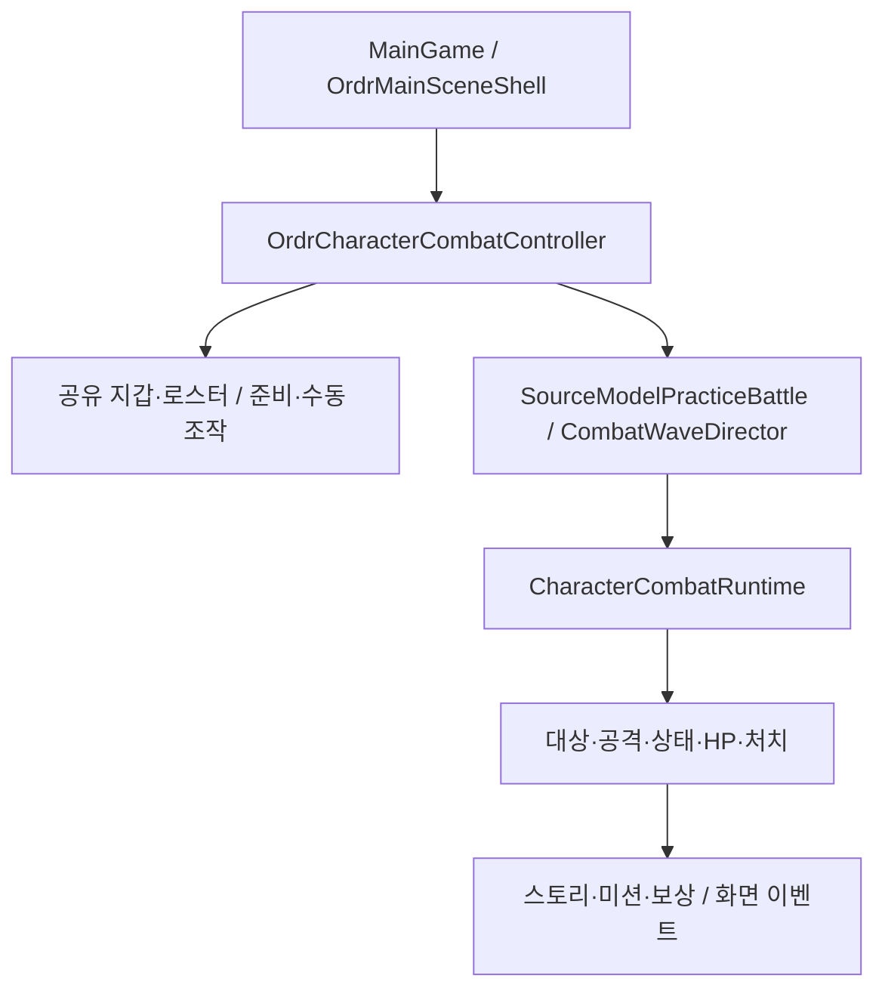

# 코드 구조

이 문서는 수정할 코드와 재사용 경계를 안내합니다. 기능 상태는 [현재 상태](START_HERE.md), 남은 작업은 [개발 작업](PLAYABLE_ROADMAP.md)에서 확인합니다.

## 실행 흐름

개발용 연습과 원작 검증 경로는 공통 런타임을 사용하지만 승인 의미가 다릅니다. 모델 입력을 원본 관측 공급자로 바꿔 감싸지 않습니다.

## 영역별 진입점

아래 파일명은 저장소의 같은 이름을 검색하면 찾을 수 있습니다.

| 영역 | 파일·함수 | 책임 |
|---|---|---|
| 시작·세션 구성 | [OrdrCharacterCombatController.cs](../Assets/Scripts/Unity/OrdrCharacterCombatController.cs), [OrdrMainSceneShell.cs](../Assets/Scripts/Unity/OrdrMainSceneShell.cs) | 준비·전투·정지 시계와 동일 세션의 데이터/서비스 연결 |
| 메뉴·터치 | [OrdrMobileTouchPanel.cs](../Assets/Scripts/Unity/OrdrMobileTouchPanel.cs) | DrawUnits·DrawFusion·DrawStory·DrawWisp. 피해나 재화를 직접 계산하지 않음 |
| 유닛·조합 탐색 | MobileOwnedRosterBrowser, MobileFusionBrowser, MobileStoryDispatchBrowser | 보유 개체 선택·등급 필터·원본 재료 탐색·조합 임박. 제작 권한과 구분 |
| 전장 표시 | [OrdrUnitWorldPresenter.cs](../Assets/Scripts/Unity/OrdrUnitWorldPresenter.cs), MobileMapSkillLayout, OrdrBattlefieldArt | 고정 배경·카메라 경계·초상화·공격 이펙트. 표시 Transform과 런타임 좌표를 분리 |
| 도감·원본 객체 | [CharacterUnitCatalog.cs](../Assets/Scripts/Data/CharacterUnitCatalog.cs), [OriginalMapBaseStatCatalog.cs](../Assets/Scripts/Data/OriginalMapBaseStatCatalog.cs) | 프로젝트 ID와 원본 rawcode·공격 객체·출처 연결 |
| 전투 | [CharacterCombatRuntime.cs](../Assets/Scripts/Combat/CharacterCombatRuntime.cs), CombatAttackPipeline, CombatScheduler, CombatResolution | 공격 선언/명중·대상·HP·사망의 공통 정산 |
| 모델 스킬 | CharacterCombatRuntime.SourceModel*.cs, SourceModel*SkillCatalog | 승인된 원본/도감 패킷 실행. 같은 기술의 JASS와 툴팁 중복 실행 방지 |
| 자원·폼·소환 | SourceModelUnitResourceCatalog, SourceModelResources, SourceModelTemporarySkills, SourceModelIndependentAttacks | HP/MP·재생·폼·소환 수명·소유자·전장 변경 정리 |
| 상태·오라 | CombatStatusEngine, SourceModelUnitEffects, Original323AuraCommonRules | 상태 적용/만료·원본 정체성·중첩 경계. 아군 방어 상태와 실제 피격 공급은 별개 |
| 라운드·이동 | [SourceModelPracticeBattle.cs](../Assets/Scripts/Combat/SourceModelPracticeBattle.cs), [CombatWaveDirector.cs](../Assets/Scripts/Combat/CombatWaveDirector.cs) | 독립 웨이브·이동률·적 생존·보상·종료. Step(0)으로 잔여 계산을 소진한 뒤 다음 출현 |
| 지갑·로스터 | SharedEconomySession, EconomyTransactions, UnitRoster | 실제 인스턴스와 단일 지갑·거래 영수증·롤백 |
| 조합 | [Original323CommonFusionPort.cs](../Assets/Scripts/Mobile/Original323CommonFusionPort.cs), OriginalJassFusionPlanner, OriginalJassFusionAtomicCoordinator, OriginalFusionUnitSwap | 원본 조건 순서·재료 예약·실제 교체와 비용. 미리보기만으로 실행 허가하지 않음 |
| 위습 | MobileWispService, Original323MobileWispOutcomeWorld, OriginalWispCombatRewardWorld | 원본 풀·실물 생성·재화 차감·실패 롤백·보류된 추첨 결과 재사용 |
| 원작 피해 계약 | Ordr323DamageWorldBinding, Ordr323OriginalDamageRules, Ordr323MapDamageMath | 원본 공격·방어·면역·정수화 계약. 실제 공급자 완성 여부 별도 확인 |
| 빌드·데이터 | [OrdrCharacterDataSync.cs](../Assets/Editor/OrdrCharacterDataSync.cs), [OrdrAndroidDevelopmentBuild.cs](../Assets/Editor/OrdrAndroidDevelopmentBuild.cs) | data→Resources 동기화·필수 패킹·APK 해시 증빙 |

## 스토리와 최근 보상 연결

| 연결점 | 현재 역할 |
|---|---|
| [Original323SoloStoryScenario.cs](../Assets/Scripts/Combat/Original323SoloStoryScenario.cs) | 14개 건물·시간 제한·격파 정산. 독립 공격자의 피해는 살아 있는 원소유자에게 귀속 |
| [Original323StoryMobileProgression.cs](../Assets/Scripts/Core/Original323StoryMobileProgression.cs) | 재화·특성·연구·모바일 경험치 및 외부 원본 보상 월드 연결 |
| [Original323SourceMaterialRewardWorld.cs](../Assets/Scripts/Combat/Original323SourceMaterialRewardWorld.cs) | 고대의 배·원본 사건 재료·초월위습 선택. Original323KumaWispChoiceWorld는 기존 이름을 유지하며 여러 선택지 처리 |
| Original323KumaWispChoiceWorld.TryChoose / TryChooseBoxItem | 재화 꾸러미·쿠마·레일리+해적선과 고유 아이템 선택을 기존 지갑/로스터 거래로 처리. 영구 획득 플래그는 재료 소비 뒤에도 유지 |
| [Original323MobileStoryHeroExperienceWorld](../Assets/Scripts/Combat/Original323StoryNativeRewardQueue.cs), [Original323HeroLevelRules.cs](../Assets/Scripts/Combat/Original323HeroLevelRules.cs) | 13·14단계 XP·원본 H*** + A07O 자격, 58개 폼/24레벨 성장. 같은 보상 파일의 Original323ShirahoshiTraitPurchase가 Bz6 4포인트 원자 차감/영수증을 처리하고 성장 판독에 연결. XP바는 OrdrMobileTouchPanel에서 표시, 특수 능력 실전 발동은 별도 |
| [CharacterCombatRuntime.StoryGreenBlood.cs](../Assets/Scripts/Combat/CharacterCombatRuntime.StoryGreenBlood.cs), [Original323StoryGreenBloodRules.cs](../Assets/Scripts/Combat/Original323StoryGreenBloodRules.cs) | 직접 선택한 실물 유닛의 변환/강화. 같은 종류 여러 기 중 선택 개체만 처리 |
| Original323FusionSourceItemLedger, Original323StoryNativeRewardQueue | 고유 아이템 잔액·영구 획득 기록과 단계별 영수증. 커밋 후 알림 예외로 재지급하지 않음 |

5% 원본 고유 보상과 XP 자격의 출처는 [스토리 원본 근거](../data/original-2323C-story-native-reward-evidence.json), 레벨·성장 수치의 출처는 [영웅 성장 근거](../data/original-2323C-hero-level-growth-evidence.json)에 있습니다. `CharacterCombatRuntime.SourceModelEffects`와 `SourceModelTwentiethSkills`는 주능력치 공격력/민첩 공속을, `SourceModelResources`는 지능 마나 재생을 적용합니다. 현재 수치/자격은 이 문서에 복제하지 않고 해당 코드와 자료를 함께 대조합니다.

## 스토리 공성 표시

`OrdrMainSceneShell`이 `OrdrStoryBattlefieldView`의 수명과 표시를 관리합니다. 오른쪽 건물·HP, 왼쪽 일렬 파견 대형은 화면 좌표로만 배치하며 런타임 위치를 옮기지 않습니다. `OnCombatEvent`의 실제 공격/시전/스킬 피해와 `ActualEnemyDamage`를 구분하여, 건물 피격은 실제 HP 피해에서만 발생합니다. 독립 소환수는 기존 소유자 조회를 재사용합니다.

파견 스냅샷은 0.12초 간격으로 갱신하고 없어진 유닛/오래된 연출을 제거합니다. 화면 크기별 한 줄 페이지·개별 선택과 클리핑을 적용합니다. 효과 시간은 `Combat.Time`이므로 일시정지/앱 전환 동안 멈춥니다. 화면 비활성화·세션 교체 시 이벤트를 해제하고 이전 건물 ID의 효과가 다음 건물에 번지지 않게 합니다. Unity/기기 화면 확인은 아직 하지 않았습니다.

## 돈 도박 연결

`SourceModelMoneyGamblingDesk`가 일반/고급 도박과 졸업 목재·특성포인트·희귀 1회 구매를 하나의 공유 지갑에 연결합니다. `Original323GraduatedRareShopWorld`가 CJE의 43개 희귀·7개 특수 객체를 원본 rawcode에 검증하고, CJF의 99%/1% 추첨·보류 결과·실물 생성/롤백·A0YE 연기 영수증을 처리합니다. `SourceModelRegularMoneyGambling`의 기존 두 번 추첨·보류 결과·영수증/재고 처리를 두 등급이 재사용합니다. 컨트롤러의 `PracticeMoneyGambling`은 기존 일반 도박 참조를 보존하고, `PracticeMoneyGamblingDesk`가 실제 경제 포트가 됩니다. 승인된 별도 원본 경제 포트는 덮어쓰지 않습니다.

`SourceModelPracticeBattle.RewardActualDeath`의 웨이브 원장에 실제 격파된 보스 rawcode가 있을 때만 내부 콜백을 호출합니다. Desk는 o01V만 CIK→CIJ/R009로 기록합니다. 라운드 도달·버튼 탭·일반 적 처치로 해금하지 않습니다. CJC의 고급 반환 누계 35000 이상이면 마지막 반환·졸업·R01M·목재 구매 기회 5회를 원자 확정합니다. 비용/보상 수치는 추출 자료와 대조합니다.

`DrawEconomy`가 등급별 재고·대기·손익, 졸업 상점 구매 항목과 최근 6건 기록을 표시합니다. 스토리 R01N 연구는 `Original323StoryMobileProgression.HasResearch`를 통해 H0B0 구매에 연결합니다. Q015 최상위 3회 조합은 원본 rawcode에 대조한 결과 등급으로 기록하여 동일 공유 특성 포인트 지갑으로 지급합니다. 돈 도박은 유닛 도박 미션에 연결하지 않습니다. `SourceModelRegularMoneyGamblingTests`에는 해금·분기 경계·정확/초과 졸업·커밋 후 예외·기회 소비·상태 복원·특성 구매 재고/시간·희귀 1회 소환/롤백 회귀를 추가했습니다(실행 전).

## 수정 전 확인할 경계

- 새 효과를 넣기 전에 원본 객체·능력 소유·JASS 함수·타깃·시점·피해 타입과 기존 처리기를 찾습니다. 툴팁 등록은 실행 명세 전체가 아닙니다.
- 소유자 제거·조합·판매·폼 변경·파견 이동 때 예약 공격과 상태를 정리합니다. 지연 공격은 선언 당시 전장 리비전을 확인합니다.
- 지갑 커밋 뒤 관찰자 예외와 커밋 전 실패를 구분합니다. 영수증이 확정된 거래는 재지급하지 않습니다.
- 위습 자동 정산은 컨트롤러의 deferAutomaticUntilFlush/FlushAutomaticSafely 경계를 유지합니다. 보류된 추첨 결과를 실패마다 다시 뽑지 않습니다.
- 최적화는 측정 뒤 진행합니다. 대상 선정·난수 호출 순서·효과 만료·처치 보상·거래 잠금을 바꾸지 않습니다.
- 캐릭터 초상화는 개인용 Resources 우선, 없으면 HTTPS 다운로드/기기 캐시와 대체 아이콘을 사용합니다. [개인용 이미지 안내](PRIVATE_PORTRAIT_BUILD.md).

## 검사와 현황 자료

- `Assets/Tests/EditMode/`: C# 전투·거래·화면 경계 검사.
- `tests/`: JSON·원본 감사·연결 계약 회귀.
- `tools/build_character_runtime_coverage.py`: 기본/확장/변신 카탈로그 집계. 중복·누락 ID를 거부하고 `--verify`는 파일을 수정하지 않고 현재 입력 JSON과 비교합니다. `--output`으로 별도 결과 파일을 지정할 수 있습니다.
- `tools/build_unit_runtime_status.py`와 `tools/render_unit_status_docs.py`: 실제 C# 지원 내보내기 기반 현황·유닛 표 생성.

카탈로그 변경은 실제 ID·원본 객체·비전투/폼 분류를 대조한 뒤 집계를 재생성합니다. C# 지원 변경은 먼저 실제 지원 내보내기를 갱신합니다. 집계 도구 자체가 현재 C# 실행을 검사하는 것은 아닙니다. `tests/test_character_runtime_coverage.py`는 보상 상자의 전투 미승인, 중복/누락 거부와 CLI의 읽기 전용·오래된 결과 거부를 확인합니다.

`tools/classify_original_fusion_blockers.py`는 저장소 경로를 POSIX 표기로 내보내어 Windows/Linux 결과를 일치시킵니다. Linux 전용 패키징 회귀는 POSIX 환경에서만 실행하고, 다른 환경은 명시적으로 건너뜁니다.

실행 허가와 명령은 [작업 규칙](../AGENTS.md)·[실행과 APK](unity-editmode-test.md)에 있습니다.
