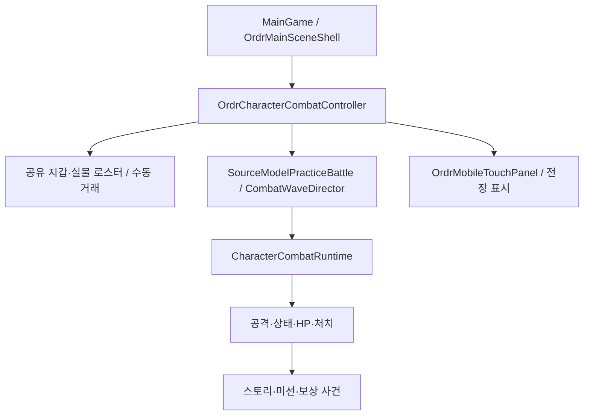

# 코드 구조

> 코드의 **현재 진입점**과 공통 엔진 경로만 기록합니다. 날짜별 개발 일지와 반복된 스킬 설명은 삭제했습니다. [현재 상태](START_HERE.md) / [개발 작업](PLAYABLE_ROADMAP.md)을 함께 확인하세요.

## 원본 숫자·스탯 공급 경로

- `SourceModelBasicCombatRules.OriginalUnitPointValue`: 원본 `OriginalMapBaseStatCatalog.UnitPointValue`를 카탈로그 ID/원본 rawcode까지 대조. 히바리 도시락 자격 판정에 사용. **스탯 STR/AGI/INT와 별개**.
- `CharacterCombatRuntime.SourceModelRemainingCallbacks.cs`: 검은수염 Bzz/Bzr/Bzx의 순수 힘 `GetHeroStatBJ(STR,false)`×60,000/5,000/5,000을 기존 1회 피해 계산에 반영. `SourceModelCompositeEffects.cs`의 `ConfigureSourceModelHeroUnbonusedStrengthProvider`가 미연결이면 계수 보류.
- `CharacterCombatRuntime.SourceModelBulkAutoSkills.cs`: 나미 BWT의 보너스 포함 현재 INT `GetHeroStatBJ(INT,true)`×3,500/타를 시전 시점에 1회 취득. `ConfigureSourceModelHeroIntelligenceProvider` 공급 미연결이면 계수 보류.
- **실제 게임의 원본 초기 영웅 능력치/성장/폼 및 위성 스탯 입력은 아직 연결되지 않았습니다.** 영웅 스탯 0이나 UnitPointValue 131을 임의 기본값으로 넣지 않습니다.

## 원본 확인 스킬 진입점

- `CharacterCombatRuntime.SourceModelTooltipVolleys.cs`: 비비 B5s/핸콕 B5F 20·25타 시점 예약, 살아 있는 적 재선정, 핸콕 물리 Chaos 적용.
- `CharacterCombatRuntime.SourceModelTooltipManualActions.cs`: 히바리 h0CN 물품 제작/사용/판매 거래 및 마리아 CDh 5초 영속 주기.
- `Original323SourceDedicatedSkillPort.cs`: 지갑의 h0CN 제작 영수증·재고에서 도시락 생성자를 복원하고, 제작자 소멸 뒤에도 별도 물품 사용/판매 제어 제공.
- `MobileDedicatedSkillActions.cs`: `IsDetachedItem` 항목은 선택 유닛과 무관하게 노출. `OrdrMobileTouchPanel.cs`: 미선택 상태에서도 이 물품 스킬 표시.
- `CharacterCombatRuntime.SourceModelTooltipManualActions.cs`: 전장 이동 시 비비/핸콕 `practice-volley:`와 마리아 `practice-maria:` 예약 콜백을 기존 취소 엔진에서 함께 해제.
- `CharacterCombatRuntime.SaveState.cs`: 아직 복원할 수 없는 익명 지연 타격의 저장 차단 유지.
- 근거는 [스킬 구현 체크](스킬-구현-체크.md). 이전의 범용 `physical=Melee` 정책은 원본과 불일치하므로 제거됨. NUnit·Unity·Android 검증 전.

## 저장·이어하기 진입점

| 역할 | 현재 코드 |
|---|---|
| 상태 계약·난수 검증 | OrdrCoreCheckpoint.cs — 세션/로스터/지갑·전투 v4·BFi/위습/졸업/등급별 난수 |
| 안전한 동기 캡처 | OrdrCharacterCombatController.CaptureCheckpointAtSafeBoundary / CaptureWorldCheckpointDraft — 일시정지 복구 및 동일 시점 대조 |
| 파일 기록 | OrdrCoreCheckpointStore.cs — SHA-256, A/B 슬롯, 임시 파일 |
| 공격·폼·예약 복원 초안 | CharacterCombatRuntime.SaveState.cs / CombatTimedEffectQueue.cs / CombatWaveDirector.cs |
| 미공개 전투·보조 그래프 | OrdrUnpublishedCombatRestoreGraph.cs / OrdrUnpublishedAuxiliaryRestoreGraph.cs |
| **미공개 도박·상점 그래프** | OrdrUnpublishedCommerceRestoreGraph.cs — 같은 지갑과 4개의 난수 기록, 보류 추첨·100G 지원 |
| 실제 이어하기 UI 미구현 | OrdrMainSceneShell.cs / OrdrCharacterCombatController.cs — 전체 월드 안전 게시 전에는 차단 |

**기존 SK-05/06 공통 경로:** `CharacterCombatRuntime.SourceModelTooltipManualActions.cs`의 비비 강화는 결제별 고유 영수증·보류 결과를 재사용하고, `CharacterCombatRuntime.SaveState.cs`는 보류 추첨 저장을 거부합니다. `CharacterCombatRuntime.SourceModelOriginalSpecials.cs`의 쿠마 10% 공격은 `ApplySourceModelNextThirtySkill` 피해·기절 처리기를 재사용합니다. 상세 원본 수치·미완료는 [스킬 구현 체크](스킬-구현-체크.md)에만 정리합니다. Unity/Android 실행 미검증.

**임시 소환/분신/자폭은 투사체·비보유 이펙트가 원칙**입니다. 내부 전투 ID가 있다는 이유로 실제 보유 유닛을 새로 만들지 않습니다.

## 실행 흐름

**컨트롤러는 연결과 수명**, **전투 런타임은 실제 판정**, **지갑·로스터는 거래**, **화면은 사용자 요청과 표시**를 담당합니다. UI에서 전투 수치나 보상을 따로 계산하지 않습니다.

## 영역별 코드 진입점

| 작업 영역 | 먼저 열 파일 | 재사용할 역할 |
|---|---|---|
| **시작·세션** | [OrdrCharacterCombatController.cs](../Assets/Scripts/Unity/OrdrCharacterCombatController.cs), [OrdrMainSceneShell.cs](../Assets/Scripts/Unity/OrdrMainSceneShell.cs) | 원본 데이터·공통 서비스 연결, 시작/정지/재시작 및 동일 세션 유지 |
| **메뉴·입력·전장 UI** | [OrdrMobileTouchPanel.cs](../Assets/Scripts/Unity/OrdrMobileTouchPanel.cs), [OrdrMobileUiTheme.cs](../Assets/Scripts/Unity/OrdrMobileUiTheme.cs), [OrdrUnitWorldPresenter.cs](../Assets/Scripts/Unity/OrdrUnitWorldPresenter.cs), [MobileOwnedUnitFormation.cs](../Assets/Scripts/Unity/MobileOwnedUnitFormation.cs), [MobileInteractionPolicy.cs](../Assets/Scripts/Mobile/MobileInteractionPolicy.cs) | 큰 버튼·가로 레이아웃·전장 초상화/페이지 배치·원본 좌표와 표시 좌표 구분 |
| **원본 유닛 객체** | [CharacterUnitCatalog.cs](../Assets/Scripts/Data/CharacterUnitCatalog.cs), [OriginalMapBaseStatCatalog.cs](../Assets/Scripts/Data/OriginalMapBaseStatCatalog.cs) | 프로젝트 ID와 `rawcode`, 원본 객체/능력 데이터 연결 |
| **공통 전투** | [CharacterCombatRuntime.cs](../Assets/Scripts/Combat/CharacterCombatRuntime.cs), [CombatTimedEffectQueue.cs](../Assets/Scripts/Combat/CombatTimedEffectQueue.cs), [CharacterSkillEffectExecutor.cs](../Assets/Scripts/Combat/CharacterSkillEffectExecutor.cs), CombatAttackPipeline, CombatScheduler, CombatResolution | 대상·공격 선언/명중·피해·상태·사망의 공통 정산. 예약 타격은 단일 시계/등록 순서·참조별 취소를 보존하고, 유닛 제거에서는 시전자와 대상 예약을 함께 취소. `RefreshAfterCommittedCombatLaneChange`는 기존 레인 적 대상/해당 유닛 대상 타격만 취소해 영구 자동 발동의 자기 시계를 보존. 실행 검증은 별도 |
| **특수/자동 기술** | [CharacterCombatRuntime.SourceModelAdditionalAutoSkills.cs](../Assets/Scripts/Combat/CharacterCombatRuntime.SourceModelAdditionalAutoSkills.cs), [CharacterCombatRuntime.SourceModelBulkAutoSkills.cs](../Assets/Scripts/Combat/CharacterCombatRuntime.SourceModelBulkAutoSkills.cs), [CharacterCombatRuntime.SourceModelRemainingCallbacks.cs](../Assets/Scripts/Combat/CharacterCombatRuntime.SourceModelRemainingCallbacks.cs), [SourceModelSixthAttackCatalog.cs](../Assets/Scripts/Combat/SourceModelSixthAttackCatalog.cs), [SourceModelSeventhAttackCatalog.cs](../Assets/Scripts/Combat/SourceModelSeventhAttackCatalog.cs), [SourceModelAfterHitAttackCatalog.cs](../Assets/Scripts/Combat/SourceModelAfterHitAttackCatalog.cs) | 도감 기반 모델·원본 JASS 콜백을 별도 근거와 승인 범위로 처리. 네이티브 효과 중복 실행 금지 |
| **도감 Q/W·지원** | [CharacterCombatRuntime.SourceModelManualSupport.cs](../Assets/Scripts/Combat/CharacterCombatRuntime.SourceModelManualSupport.cs), [CharacterCombatRuntime.SourceModelRareLaw.cs](../Assets/Scripts/Combat/CharacterCombatRuntime.SourceModelRareLaw.cs) | 7개 수동 지원 기술의 자동 대상·전장·버프/재생·쿨타임/소멸, 2개 수동 필살기, 버기 독립 공버프. R-05/S-05 중복 가속 회피. 코드 모델이며 원작 동등성·Unity 실행 미검증 |
| **오라·자원·소환수** | CombatStatusEngine, SourceModelResources, SourceModelIndependentAttacks, SourceModelTemporarySkills | 지속시간·MP/HP·소유자 변경·전장 리비전·독립 소환 생명주기 |
| **라운드·몬스터** | [SourceModelPracticeBattle.cs](../Assets/Scripts/Combat/SourceModelPracticeBattle.cs), [CombatWaveDirector.cs](../Assets/Scripts/Combat/CombatWaveDirector.cs), [Original323MonsterNativeAbilityRuntime.cs](../Assets/Scripts/Combat/Original323MonsterNativeAbilityRuntime.cs) | 웨이브·적 이동·피해/보상·종료와 논리 시간. [원본 규칙·독립 연습 모델 구분](라운드-몬스터-시스템.md) |
| **지갑·실물 거래** | [SharedEconomySession.cs](../Assets/Scripts/Core/SharedEconomySession.cs), [EconomyTransactions.cs](../Assets/Scripts/Core/EconomyTransactions.cs), UnitRoster | 비용·보상·영수증·되돌리기, 여러 기능이 사용하는 한 지갑 |
| **조합** | [Original323CommonFusionPort.cs](../Assets/Scripts/Mobile/Original323CommonFusionPort.cs), [OriginalJassFusionPlanner.cs](../Assets/Scripts/Mobile/OriginalJassFusionPlanner.cs), [OriginalJassFusionAtomicCoordinator.cs](../Assets/Scripts/Mobile/OriginalJassFusionAtomicCoordinator.cs) | 원본 조건·재료 후보·확정 시 재검사·실물 교체 |
| **위습** | [MobileWispService.cs](../Assets/Scripts/Core/MobileWispService.cs), [Original323MobileWispOutcomeWorld.cs](../Assets/Scripts/Combat/Original323MobileWispOutcomeWorld.cs), [OriginalWispCombatRewardWorld.cs](../Assets/Scripts/Combat/OriginalWispCombatRewardWorld.cs), [Original323SourceCommonWispWorld.cs](../Assets/Scripts/Combat/Original323SourceCommonWispWorld.cs) | 원본 보상 풀·실물 생성·보류 결과·실패 롤백 |
| **경제·돈 도박** | [SourceModelMoneyGamblingDesk.cs](../Assets/Scripts/Mobile/SourceModelMoneyGamblingDesk.cs), [SourceModelRegularMoneyGambling.cs](../Assets/Scripts/Mobile/SourceModelRegularMoneyGambling.cs), [Original323GraduatedRareShopWorld.cs](../Assets/Scripts/Mobile/Original323GraduatedRareShopWorld.cs) | 돈 도박·졸업/구매·재고·보류 추첨을 공유 지갑으로 정산 |
| **이세계 유닛 도박** | [SourceModelOtherworldUnitGambling.cs](../Assets/Scripts/Mobile/SourceModelOtherworldUnitGambling.cs), [Original323OtherworldGamblingWorld.cs](../Assets/Scripts/Mobile/Original323OtherworldGamblingWorld.cs), [Original323OtherworldGamblingRules.cs](../Assets/Scripts/Core/Original323OtherworldGamblingRules.cs) | 공유 지갑 원자 결제·CJM 분기/보류 추첨·RN/LT 실물 생성. StoryNativeRewardQueue의 GamblingCharges와 CreepPracticeWorld의 실제 최초 격파 신호, SharedMissionRewardWorld의 CNU 해왕류 완료 영수증 충전을 연결. 해왕류 실제 등장·사망 증빙 공급자·환전소·전체 저장은 별도 |
| **스토리·보상** | [Original323SoloStoryScenario.cs](../Assets/Scripts/Combat/Original323SoloStoryScenario.cs), [Original323StoryMobileProgression.cs](../Assets/Scripts/Core/Original323StoryMobileProgression.cs), [Original323SourceMaterialRewardWorld.cs](../Assets/Scripts/Combat/Original323SourceMaterialRewardWorld.cs), [Original323StoryNativeRewardQueue.cs](../Assets/Scripts/Combat/Original323StoryNativeRewardQueue.cs), [Original323StoryManualDispatch.cs](../Assets/Scripts/Mobile/Original323StoryManualDispatch.cs) | 14개 건물·수동 파견·보상·성장·고유 아이템/초월위습 |
| **개인미션** | [OriginalPersonalMissionCatalog.cs](../Assets/Scripts/Core/OriginalPersonalMissionCatalog.cs), [OriginalPersonalMissionSession.cs](../Assets/Scripts/Core/OriginalPersonalMissionSession.cs), [PersonalMissionGameplay.cs](../Assets/Scripts/Core/PersonalMissionGameplay.cs) | 원본 18종·3칸·사건 판정·공유 지갑 보상·부분 저장. 게임별 사건 연결 여부는 별도 확인 |
| **도움소** | [OriginalHelperCowManaRecharge.cs](../Assets/Scripts/Core/OriginalHelperCowManaRecharge.cs), [OriginalHelperCowLiveCombatWorld.cs](../Assets/Scripts/Combat/OriginalHelperCowLiveCombatWorld.cs), [OriginalHelperCowAutoArea.cs](../Assets/Scripts/Combat/OriginalHelperCowAutoArea.cs), [Ordr323OriginalAlchemyCastService.cs](../Assets/Scripts/Combat/Ordr323OriginalAlchemyCastService.cs) | 공통 마나·위습 충전·광역 원본 공급자 계약 |
| **유닛 도박 3등급·리롤** | [SourceModelUnitGambling.cs](../Assets/Scripts/Mobile/SourceModelUnitGambling.cs), [Original323UnitGamblingRules.cs](../Assets/Scripts/Core/Original323UnitGamblingRules.cs), [Original323UnitGamblingWorld.cs](../Assets/Scripts/Mobile/Original323UnitGamblingWorld.cs), [SourceModelUnitReroll.cs](../Assets/Scripts/Mobile/SourceModelUnitReroll.cs) | CJP/CJS/CJK 분기·실물 생성·지갑·미션, CRj/CRl의 실제 유닛/토큰 원자 교체. 공용 횟수와 개체별 능력 권한을 구분 |
| **도박광 항법·공통 선택 제한** | [SourceModelGamblingNavigation.cs](../Assets/Scripts/Mobile/SourceModelGamblingNavigation.cs), [Original323NavigationSelection.cs](../Assets/Scripts/Core/Original323NavigationSelection.cs) | 21R 이후 카지노/리스크헷지 선택·CKR 충전 환산·공용 LN. 도움소 항법도 같은 선택 제한을 사용 |
| **악몽·이세계·항법** | [NightmareMutationRules.cs](../Assets/Scripts/Core/NightmareMutationRules.cs), [NavigationProgression.cs](../Assets/Scripts/Core/NavigationProgression.cs), [Ordr323OriginalHelperNavigation.cs](../Assets/Scripts/Combat/Ordr323OriginalHelperNavigation.cs) | 고정 모드·오로성 권장표, 검증 노드만 등록하는 틀, 도움소·도박광의 일부 실제 항법을 구분 |
| **크립 파견·토벌 진입점(구현 대상)** | [OrdrMobileTouchPanel.cs](../Assets/Scripts/Unity/OrdrMobileTouchPanel.cs), [MobileStoryDispatchBrowser.cs](../Assets/Scripts/Mobile/MobileStoryDispatchBrowser.cs), [Original323StoryManualDispatch.cs](../Assets/Scripts/Mobile/Original323StoryManualDispatch.cs), [Original323CreepPracticeWorld.cs](../Assets/Scripts/Combat/Original323CreepPracticeWorld.cs), [CharacterCombatRuntime.cs](../Assets/Scripts/Combat/CharacterCombatRuntime.cs), [컨트롤러](../Assets/Scripts/Unity/OrdrCharacterCombatController.cs) | [F03](PLAYABLE_ROADMAP.md): Story 하위 크립 화면·개체별 목적지·파견/복귀·별도 토벌 UI. 현재 `CanAttackInThisLane`는 Creep/SeaKing/Challenge를 차단하고 `IsStoryDeployed`는 건물 파견만 구분. 대상별 자격과 목적지를 확장하고 일반 공격뿐 아니라 광역/오라·예약타·소환수·판매/조합 제한도 같은 판정을 사용해야 함 |
| **공유 도전과제·포네그리프** | [공유 목표 사건/출전 월드](../Assets/Scripts/Combat/Original323SharedObjectiveWorld.cs), [공유 미션 지급·미실행 의무](../Assets/Scripts/Combat/Original323SharedMissionRewardWorld.cs), [해독·완료 장부](../Assets/Scripts/Combat/Original323PoneglyphSession.cs), [적 아군 레인](../Assets/Scripts/Combat/CharacterCombatRuntime.cs), [컨트롤러](../Assets/Scripts/Unity/OrdrCharacterCombatController.cs), [기록지침 UI](../Assets/Scripts/Unity/OrdrMobileTouchPanel.cs) | 나머지 5종 실제 객체/보스의 출현 증빙·전투 사망·별도 정산 증빙을 전용 레인과 결합. 출전·복귀 시 중복 타격 제한·목표 소멸 자동 복귀, 공통 유닛 거래/원본 시전 잠금과 조합 후보/스토리 파견 갱신 연결. 출전·해독 전환 후 효과 정리와 확정 유닛 제거 시 해독 장부 정리는 공통 전투 런타임에서 처리. 공유 5종의 단독 지급 입구 차단·원본 사망과 전투 사망의 선후 무관 확정·대장 출현 의무 미정산 재시도는 객체 월드/보상 월드에서 처리. 기본 APK에는 외부 원본 목표 공급자 미설치; 완료 조건은 [F04](PLAYABLE_ROADMAP.md) |
| **스토리 표시** | [OrdrStoryBattlefieldView.cs](../Assets/Scripts/Unity/OrdrStoryBattlefieldView.cs) | 건물 HP/실제 피해 사건을 화면에만 표시. 파견 실물 좌표를 옮기지 않음 |
| **원작 피해 계약** | Ordr323DamageWorldBinding, Ordr323OriginalDamageRules, Ordr323MapDamageMath | 방어·면역·정수화와 원본 공격 구분. 실제 공급자 승인 여부 별도 |
| **연구소·강화소 원본 추출** | [measure_original_player_upgrades.py](../tools/measure_original_player_upgrades.py), [단계별 JSON](../data/original-2323C-player-research-upgrades.json), [읽기 쉬운 실측표](원본-연구-강화-실측.md) | W3X SLK·JASS·W3A → 4개 연구 가격/오라 + 18개 강화의 353레벨 필드 공식/시작 기술. **게임 구매·전투 적용과 별개**. [구현 연결 순서](연구소-강화소-구현명세.md) |
| **연구소 시작/오라 모델** | [원본 시작 거래·상태](../Assets/Scripts/Core/Original323PlayerResearchSession.cs), [원본 자원 풀](../Assets/Scripts/Combat/CharacterCombatRuntime.SourceModelResources.cs), [공격력 결합](../Assets/Scripts/Combat/SourceModelBasicCombatRules.cs), [컨트롤러](../Assets/Scripts/Unity/OrdrCharacterCombatController.cs), [UI](../Assets/Scripts/Unity/OrdrMobileTouchPanel.cs) | 원본 h06S 3종 연구 시작 결제·중복 차단·현재/후속 유닛 오라. 기후 변화는 네이티브 이동 처리기가 구성된 경우만 결제. 완료·취소·환급·전체 저장·실행 검증은 미연결. [명세](연구소-강화소-구현명세.md) |
| **강화소 실행 모델** | [SourceModelPlayerUpgrades.cs](../Assets/Scripts/Combat/SourceModelPlayerUpgrades.cs), [거래 세션](../Assets/Scripts/Core/Original323PlayerUpgradeSession.cs), [모델 계약](../Assets/Scripts/Core/Original323SourceUpgradeModel.cs), [런타임 자료](../data/original-2323C-player-upgrade-runtime.json), [생성기](../tools/build_player_upgrade_runtime.mjs) | 독립 전투 초기화 → 원본 기술 장부 → 공유 지갑 단일 단계 결제 → 평타/공속/공격력 비례 스킬의 동적 조회. 실제 보스 o01W 격파로 해금. 검증 단계/월드와 모델 혼합 금지. [8개 회귀 검사](../Assets/Tests/EditMode/SourceModelPlayerUpgradesTests.cs)는 작성만 했으며 영구 저장·원작 동등성은 미완료 |
| **데이터·빌드** | [OrdrCharacterDataSync.cs](../Assets/Editor/OrdrCharacterDataSync.cs), [OrdrAndroidDevelopmentBuild.cs](../Assets/Editor/OrdrAndroidDevelopmentBuild.cs) | `data/` → Unity Resources 동기화·기존 APK 제작 |

파일 목록은 **찾아갈 진입점**입니다. 인터페이스/등록/데이터가 있다고 그 기능이 최신 APK에서 완성됐다는 뜻은 아닙니다.

## 공통 엔진 변경 전 확인

1. **원본 근거:** 유닛 `rawcode`, 능력·조건·확률·비용·타깃·전장/시점이 확인됐는지 대조합니다. 추측한 값으로 실제 지급을 열지 않습니다.
2. **중복 호출:** 동일한 스킬을 도감 모델·JASS 콜백·네이티브 패시브가 이중 실행하지 않는지 확인합니다.
3. **실제 인스턴스:** 조합·판매·사망·파견·변신 뒤 예약 타격·오라·소환수 소유자가 남지 않게 합니다. 화면 마커와 실물 로스터는 별도입니다.
4. **거래/난수:** 비용 차감·유닛 생성·성공 기록은 원자적으로 처리하고, 보류된 위습/도박 추첨을 실패마다 다시 뽑지 않습니다. **커밋 후 알림 예외를 거래 실패로 오인해 중복 지급하지 않습니다.**
5. **게임 시간:** 일시정지·앱 전환·세션 교체 때 스킬 만료·재고 충전·화면 이벤트의 시간과 구독 해제를 확인합니다.

## 참고 문서

관련 게임 규칙·원본 근거·검사 안내는 **[문서 목차](README.md)**에서 찾아보세요. 이 파일은 수정 대상 **코드 위치와 공통 엔진 역할만** 관리합니다.

