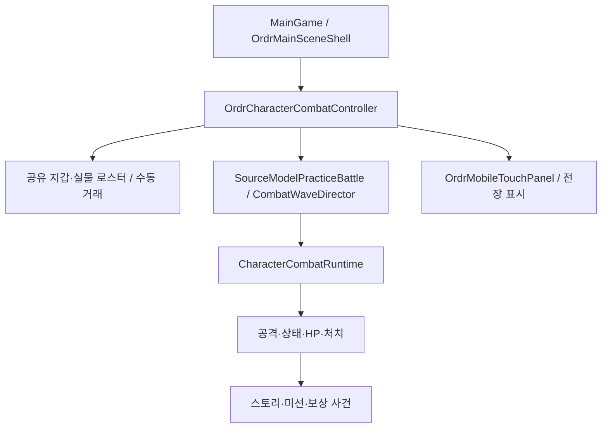

# 코드 구조

> **새 작업의 코드 지도:** 무엇을 고쳐야 하는지 빠르게 찾는 문서입니다. 기능 구현률·APK 차이는 [현재 상태](START_HERE.md), 미완료 작업은 [개발 작업](PLAYABLE_ROADMAP.md), 실제 조작은 [화면·조작](화면-조작-시스템.md)에 있습니다. **이 문서에 날짜별 개발 일지나 기능별 확률·비용을 중복 기록하지 않습니다.**

## 이번 추가 연결(2026-11-07, 코드만)

- 아이템 패시브: `Original323FusionSourceItemLedger.cs`에 선언된 `Original323SourceItemPassiveRules` → 공유 지갑 원본 발굴 AI15·고유 AI18/AI20 수령 장부 → `Ordr323OriginalHelperCowActor.AdvanceBaseManaRegeneration`의 전투시계 기반 재생 가산 / `CharacterCombatRuntime.SourceModelFusionNativeFollowups`의 `LL→A11S` 출현시 스냅샷 → `SourceModelCompositeEffects`의 라인 폭발형 피해 가산. `OrdrMobileTouchPanel.DrawItemExcavation`에서 현재 보너스를 표시합니다. **원본 BhL 확인·코드만 연결**, Unity/Android 미검증. **후속:** `SourceModelMoneyGamblingDesk.WoodRights/BuyWood`에서 AI13의 `i5+2`를 5회 기본 재고와 별도 소모 영수증으로 적용. `Original323SourceItemPassiveRules`는 AI10 기록지침 A05D/BJI 알림·AI13 `dL`·AI19 `LK` 원본 변화량을 조회합니다. `Original323TreasureHunt`의 승인된 시전 증빙 → 선택적 `IOriginal323TreasureCastOriginWitness` 시전자 확인 → `Original323TreasureAlarmJournal` 전투 시계 예약 → 컨트롤러 `AdvanceWitnessedTreasureAlarms` → UI 일반 공지/기록지침 남은 시간으로 연결했습니다. `Original323MonsterGoldService`는 AI13 상태에서 원본 `dL` 부족 증명을 거부합니다. `CharacterCombatRuntime.SourceModelFusionNativeFollowups`는 AI19의 생성 시점 16→21 A04Q 원본 `Def5` 피해 배율 비율을 미확인 연습 라인 몬스터에만 스냅샷해 `SourceModelCompositeMagicFactor`에 반영합니다. 이미 증명된 A04Q에 이중 적용하지 않으며 원본 시전·골드 증명 공급자·A04Q·전체 스킬/실기 검증은 여전히 미완료.

- 공유 목표 전장 격리: `CharacterCombatRuntime.CanShareAllyCombatLane`가 메인/스토리/공유 목표 ID별/포네그리프 해독 유닛을 분리. 아군 스킬·특수 오라·지원·언변 버프의 기존 `IsStoryDeployed` 이진 판정을 교체했습니다. `SourceModelIndependentAttacks` 광역 공격도 실물의 `CanAttackInThisLane` 또는 소환수의 원래 레인 판정에 맡기고, 독립 공격자 소유자 이탈 시 공격을 중단합니다. `SourceModelSummonState.LaneRevision`으로 출전·복귀·해독 변경 때 잔류 소환수를 폐기합니다. **원본 공유 목표 공급자·실기 검증은 미완료**.

- 기록지침 보물 탐색: `OrdrMobileTouchPanel.DrawTreasureGacha` → `OrdrCharacterCombatController.RequestMobileTreasureGacha` → `MobileTreasureGacha` → `Original323TreasureHunt`; 가이몬은 필수 조건이 아닌 범위/수량 보정, 실제 16개 보물사냥꾼 정산 공통 메서드. 원본 시전·시전자 승인 시 `Original323TreasureAlarmJournal`에 AI10 97/77초 탐색 알람, 독립 `Original323GaimonRevealPort.ObserveOriginalCcq`와 네이티브 `collect=false` 승인 시 `RegisterAuthorizedCcq`에 297초 위치 공개 알람을 전투 시계로 예약·표시. 원본 시전 공급자·실기 연결은 미완료.
- 환전소·발굴: `SourceModelGamblingNavigation.ExchangeHouse` → `SourceModelUnitGambling`의 원본 CJS 중급 시도 원자 보상(`CompuResource +1`, 도박 성공/실패 무관) → `SourceModelCompuExchange` 7종 환전 → `Original323CompuUnitWorld` 실물 해적선/랜덤전용/토큰 생성·실패 롤백. CKH/CKI는 `SourceModelItemExcavation`의 원본 BhS/BhT 스택(최대 10) 충전 → 12/10종 비복원 아이템 추첨 → 기존 `Original323FusionSourceItemLedger` 고유 아이템 장부로 연결. `OrdrMobileTouchPanel` 도박 화면에 상태/조작 추가. **BhL 개별 아이템 사용/패시브 효과·외형·전체 저장·실기 검증은 별도**.
- 연구소: `Original323PlayerResearchSession.SourceCost`는 공유 지갑 `wood` 키를 사용. `OrdrMobileTouchPanel.UpgradeResourceName`은 `wood/lumber` 모두 목재로 표시.
- 세 경로 모두 실행·실기 검증은 미실시.

- 공유 F04 후속 연결: `Original323SharedMissionRewardWorld`가 룸바·문·종·해왕류·파괴왕 발굴 보상을 기존 `SourceModelItemExcavation.OrdinaryStacks`에 합쳐 실제 `BhS` 발굴 메뉴가 소비하도록 만듭니다. `Original323SharedObjectiveWorld`가 중복 등장/격파 사건을 멱등 수신하고 원본 `CM1/CM0` 버프 적용의 선행 사건을 보관하며, `OrdrCharacterCombatController.ConfigureOriginal323SharedMissionFollowUps`가 버프 적용 증거 공급자를 연결합니다. 기본 APK에 해당 대장 버프 적용 증거와 5종 목표 최종 출현 자료는 미연결, 통합/실기 검사 미실시.

## 1. 실행 흐름

**컨트롤러는 연결과 수명**, **전투 런타임은 실제 판정**, **지갑·로스터는 거래**, **화면은 사용자 요청과 표시**를 담당합니다. UI에서 전투 수치나 보상을 따로 계산하지 않습니다.

**기술 중복 방지 도구:** [`audit_character_skill_coverage.py`](../tools/audit_character_skill_coverage.py)는 전체 `Assets/Scripts/**/*.cs`·도감 프로필·유닛 레지스트리·[수동 코드 증거](../data/character-skill-execution-witnesses.json)를 함께 읽어 기술 554개와 개별 효과를 감사합니다. `--inspect L-19:skill:2`로 후보 실행 경로를 살펴보고, `--write`로 [기술 감사표](스킬-구현-현황.md)·[JSON](../data/character-skill-code-coverage.json)·[CSV](../data/character-skill-code-coverage.csv)를 생성합니다. 이 도구는 전투 실행 테스트나 구현 완성률 계산기가 아닙니다.

**원본 공격 콜백:** `CharacterCombatRuntime.SourceModelRemainingCallbacks.cs`에서 JASS `Bnw`~`CGd` 확률·객체 능력 수치·명중 후 단계·예약 피해를 처리하고, 네이티브 지정 대상 우선 선택과 마젤란 무작위 보조 시전자 위치, 키자루의 모바일 무제한 첫 도달을 관리합니다. `CharacterCombatRuntime.SourceModelAttackSkills.cs`는 모바일 무제한 시전 대상 도달을 위해 `ProjectileLine` 회랑을 선택 대상까지 연장하되 폭은 유지하며, 희귀 아카이누 블리자드 추첨·히든 아카이누 보스 누적/광폭화 B05G 상태별 타격을 맡고, `CharacterCombatRuntime.SourceModelRemainingCallbacks.cs`의 공용 서리 갑옷 상태는 바제스 B07T의 명중 피해별 유효시간과 아카이누 B05G의 디스펠 가능 신분을 관리합니다. `CharacterCombatRuntime.SourceModelTemporarySkills.cs`는 변신 시전과 분리된 **공격 일시정지/복귀·더미 수명** 및 자폭·시간 만료·소유자 정리의 단일 소환수 종료 경로를 처리합니다. 슈가 `h06O` 사망은 `BpS/e01M` 사건을 발행하지만 화면 렌더링은 미연결입니다. `SourceModelUnitEffects.cs`는 `Ablo` 공속 버프, `CharacterCombatRuntime.SourceModelLegacyFollowups.cs`는 적 `A04R`·원본 포인트를 맡습니다. 미확인 주문 피해·면역·투사체와 버프 소멸은 `EffectDeferred`로 구분합니다.

**제트 I-10 도감 모델:** `SourceModelUnconnectedSkillCatalog.cs`에서 대상 기술을 승인하고 `SourceModelNextThirtySkillCatalog.cs`에서 ID·프로필 전 필드를 검사합니다. `CharacterCombatRuntime.SourceModelNextThirtyAttacks.cs`는 직선 330·보스 가산을 적용하고, `CharacterCombatRuntime.SourceModelZephyrCharge.cs`는 0.7초 충전·단일 대상 추가 피해·소유자/전장 변경 정리를 담당합니다. 기존 피해·타깃 처리 재사용, 원작 애니메이션·Unity 실행 미검증.

**바제스 D-06 주기 피해:** `CharacterCombatRuntime.SourceModelBurgessBasic.cs`는 성공 평타 피해로 `파동 엘보` 대기시간을 주기당 최대 9초 당기고, 범위 마법·현재 HP 폭발·특수 적 추가 피해·일반 적 기절을 실행합니다. `CharacterCombatRuntime.SourceModelAdditionalAutoSkills.cs`의 공용 주기 시계와 `CharacterCombatRuntime.cs`의 중복 발동 방지 분기를 재사용합니다. `CharacterCombatRuntime.SourceModelAdditionalAutoSkills.cs`의 판매·조합 정리와 `CharacterCombatRuntime.SourceModelEleventhForms.cs`의 전장 변경 정리가 상태를 제거합니다. 제트의 차지 상태도 두 경로에서 함께 정리합니다. 원본 시전 프레임·라운딩/면역 및 실기 미검증.

## 2. 영역별 실제 진입점

| 작업 영역 | 먼저 열 파일 | 재사용할 역할 |
|---|---|---|
| **시작·세션** | [OrdrCharacterCombatController.cs](../Assets/Scripts/Unity/OrdrCharacterCombatController.cs), [OrdrMainSceneShell.cs](../Assets/Scripts/Unity/OrdrMainSceneShell.cs) | 원본 데이터·공통 서비스 연결, 시작/정지/재시작 및 동일 세션 유지 |
| **메뉴·입력·전장 UI** | [OrdrMobileTouchPanel.cs](../Assets/Scripts/Unity/OrdrMobileTouchPanel.cs), [OrdrMobileUiTheme.cs](../Assets/Scripts/Unity/OrdrMobileUiTheme.cs), [OrdrUnitWorldPresenter.cs](../Assets/Scripts/Unity/OrdrUnitWorldPresenter.cs), [MobileOwnedUnitFormation.cs](../Assets/Scripts/Unity/MobileOwnedUnitFormation.cs), [MobileInteractionPolicy.cs](../Assets/Scripts/Mobile/MobileInteractionPolicy.cs) | 큰 버튼·가로 레이아웃·전장 초상화/페이지 배치·원본 좌표와 표시 좌표 구분 |
| **원본 유닛 객체** | [CharacterUnitCatalog.cs](../Assets/Scripts/Data/CharacterUnitCatalog.cs), [OriginalMapBaseStatCatalog.cs](../Assets/Scripts/Data/OriginalMapBaseStatCatalog.cs) | 프로젝트 ID와 `rawcode`, 원본 객체/능력 데이터 연결 |
| **공통 전투** | [CharacterCombatRuntime.cs](../Assets/Scripts/Combat/CharacterCombatRuntime.cs), CombatAttackPipeline, CombatScheduler, CombatResolution | 대상·공격 선언/명중·피해·상태·사망의 공통 정산 |
| **특수/자동 기술** | [CharacterCombatRuntime.SourceModelAdditionalAutoSkills.cs](../Assets/Scripts/Combat/CharacterCombatRuntime.SourceModelAdditionalAutoSkills.cs), [CharacterCombatRuntime.SourceModelBulkAutoSkills.cs](../Assets/Scripts/Combat/CharacterCombatRuntime.SourceModelBulkAutoSkills.cs), [CharacterCombatRuntime.SourceModelRemainingCallbacks.cs](../Assets/Scripts/Combat/CharacterCombatRuntime.SourceModelRemainingCallbacks.cs), [SourceModelSixthAttackCatalog.cs](../Assets/Scripts/Combat/SourceModelSixthAttackCatalog.cs), [SourceModelSeventhAttackCatalog.cs](../Assets/Scripts/Combat/SourceModelSeventhAttackCatalog.cs), [SourceModelAfterHitAttackCatalog.cs](../Assets/Scripts/Combat/SourceModelAfterHitAttackCatalog.cs) | 도감 기반 모델·원본 JASS 콜백을 별도 근거와 승인 범위로 처리. 네이티브 효과 중복 실행 금지 |
| **도감 Q/W·지원** | [CharacterCombatRuntime.SourceModelManualSupport.cs](../Assets/Scripts/Combat/CharacterCombatRuntime.SourceModelManualSupport.cs), [CharacterCombatRuntime.SourceModelRareLaw.cs](../Assets/Scripts/Combat/CharacterCombatRuntime.SourceModelRareLaw.cs) | 7개 수동 지원 기술의 자동 대상·전장·버프/재생·쿨타임/소멸, 2개 수동 필살기, 버기 독립 공버프. R-05/S-05 중복 가속 회피. 코드 모델이며 원작 동등성·Unity 실행 미검증 |
| **오라·자원·소환수** | CombatStatusEngine, SourceModelResources, SourceModelIndependentAttacks, SourceModelTemporarySkills | 지속시간·MP/HP·소유자 변경·전장 리비전·독립 소환 생명주기 |
| **라운드·몬스터** | [SourceModelPracticeBattle.cs](../Assets/Scripts/Combat/SourceModelPracticeBattle.cs), [CombatWaveDirector.cs](../Assets/Scripts/Combat/CombatWaveDirector.cs), [Original323MonsterNativeAbilityRuntime.cs](../Assets/Scripts/Combat/Original323MonsterNativeAbilityRuntime.cs) | 웨이브·적 이동·피해/보상·종료와 논리 시간. [원본 규칙·독립 연습 모델 구분](라운드-몬스터-시스템.md) |
| **지갑·실물 거래** | [SharedEconomySession.cs](../Assets/Scripts/Core/SharedEconomySession.cs), [EconomyTransactions.cs](../Assets/Scripts/Core/EconomyTransactions.cs), UnitRoster | 비용·보상·영수증·되돌리기, 여러 기능이 사용하는 한 지갑 |
| **조합** | [Original323CommonFusionPort.cs](../Assets/Scripts/Mobile/Original323CommonFusionPort.cs), [OriginalJassFusionPlanner.cs](../Assets/Scripts/Mobile/OriginalJassFusionPlanner.cs), [OriginalJassFusionAtomicCoordinator.cs](../Assets/Scripts/Mobile/OriginalJassFusionAtomicCoordinator.cs) | 원본 조건·재료 후보·확정 시 재검사·실물 교체 |
| **위습** | [MobileWispService.cs](../Assets/Scripts/Core/MobileWispService.cs), [Original323MobileWispOutcomeWorld.cs](../Assets/Scripts/Combat/Original323MobileWispOutcomeWorld.cs), [OriginalWispCombatRewardWorld.cs](../Assets/Scripts/Combat/OriginalWispCombatRewardWorld.cs), [Original323SourceCommonWispWorld.cs](../Assets/Scripts/Combat/Original323SourceCommonWispWorld.cs) | 원본 보상 풀·실물 생성·보류 결과·실패 롤백 |
| **경제·돈 도박** | [SourceModelMoneyGamblingDesk.cs](../Assets/Scripts/Mobile/SourceModelMoneyGamblingDesk.cs), [SourceModelRegularMoneyGambling.cs](../Assets/Scripts/Mobile/SourceModelRegularMoneyGambling.cs), [Original323GraduatedRareShopWorld.cs](../Assets/Scripts/Mobile/Original323GraduatedRareShopWorld.cs) | 돈 도박·졸업/구매·재고·보류 추첨을 공유 지갑으로 정산 |
| **이세계 유닛 도박** | [SourceModelOtherworldUnitGambling.cs](../Assets/Scripts/Mobile/SourceModelOtherworldUnitGambling.cs), [Original323OtherworldGamblingWorld.cs](../Assets/Scripts/Mobile/Original323OtherworldGamblingWorld.cs), [Original323OtherworldGamblingRules.cs](../Assets/Scripts/Core/Original323OtherworldGamblingRules.cs) | 공유 지갑 원자 결제·CJM 분기/보류 추첨·RN/LT 실물 생성. StoryNativeRewardQueue의 GamblingCharges와 CreepPracticeWorld의 실제 최초 격파 신호, SharedMissionRewardWorld의 CNU 해왕류 완료 영수증 충전을 연결. 해왕류 실제 등장·사망 증빙 공급자·환전소·전체 저장은 별도 |
| **스토리·보상** | [Original323SoloStoryScenario.cs](../Assets/Scripts/Combat/Original323SoloStoryScenario.cs), [Original323StoryMobileProgression.cs](../Assets/Scripts/Core/Original323StoryMobileProgression.cs), [Original323SourceMaterialRewardWorld.cs](../Assets/Scripts/Combat/Original323SourceMaterialRewardWorld.cs), [Original323StoryNativeRewardQueue.cs](../Assets/Scripts/Combat/Original323StoryNativeRewardQueue.cs), [Original323StoryManualDispatch.cs](../Assets/Scripts/Mobile/Original323StoryManualDispatch.cs) | 14개 건물·수동 파견·보상·성장·고유 아이템/초월위습 |
| **개인미션** | [OriginalPersonalMissionCatalog.cs](../Assets/Scripts/Core/OriginalPersonalMissionCatalog.cs), [OriginalPersonalMissionSession.cs](../Assets/Scripts/Core/OriginalPersonalMissionSession.cs), [PersonalMissionGameplay.cs](../Assets/Scripts/Core/PersonalMissionGameplay.cs) | 원본 18종·3칸·사건 판정·공유 지갑 보상·부분 저장. 게임별 사건 연결 여부는 별도 확인 |
| **도움소** | [OriginalHelperCowManaRecharge.cs](../Assets/Scripts/Core/OriginalHelperCowManaRecharge.cs), [OriginalHelperCowLiveCombatWorld.cs](../Assets/Scripts/Combat/OriginalHelperCowLiveCombatWorld.cs), [OriginalHelperCowAutoArea.cs](../Assets/Scripts/Combat/OriginalHelperCowAutoArea.cs), [Ordr323OriginalAlchemyCastService.cs](../Assets/Scripts/Combat/Ordr323OriginalAlchemyCastService.cs) | 공통 마나·위습 충전·광역 원본 공급자 계약 |
| **유닛 도박 3등급·리롤** | [SourceModelUnitGambling.cs](../Assets/Scripts/Mobile/SourceModelUnitGambling.cs), [Original323UnitGamblingRules.cs](../Assets/Scripts/Core/Original323UnitGamblingRules.cs), [Original323UnitGamblingWorld.cs](../Assets/Scripts/Mobile/Original323UnitGamblingWorld.cs), [SourceModelUnitReroll.cs](../Assets/Scripts/Mobile/SourceModelUnitReroll.cs) | CJP/CJS/CJK 분기·실물 생성·지갑·미션, CRj/CRl의 실제 유닛/토큰 원자 교체. 공용 횟수와 개체별 능력 권한을 구분 |
| **도박광 항법·공통 선택 제한** | [SourceModelGamblingNavigation.cs](../Assets/Scripts/Mobile/SourceModelGamblingNavigation.cs), [Original323NavigationSelection.cs](../Assets/Scripts/Core/Original323NavigationSelection.cs) | 21R 이후 카지노/리스크헷지 선택·CKR 충전 환산·공용 LN. 도움소 항법도 같은 선택 제한을 사용 |
| **악몽·이세계·항법** | [NightmareMutationRules.cs](../Assets/Scripts/Core/NightmareMutationRules.cs), [NavigationProgression.cs](../Assets/Scripts/Core/NavigationProgression.cs), [Ordr323OriginalHelperNavigation.cs](../Assets/Scripts/Combat/Ordr323OriginalHelperNavigation.cs) | 고정 모드·오로성 권장표, 검증 노드만 등록하는 틀, 도움소·도박광의 일부 실제 항법을 구분 |
| **크립 파견·토벌 진입점(구현 대상)** | [OrdrMobileTouchPanel.cs](../Assets/Scripts/Unity/OrdrMobileTouchPanel.cs), [MobileStoryDispatchBrowser.cs](../Assets/Scripts/Mobile/MobileStoryDispatchBrowser.cs), [Original323StoryManualDispatch.cs](../Assets/Scripts/Mobile/Original323StoryManualDispatch.cs), [Original323CreepPracticeWorld.cs](../Assets/Scripts/Combat/Original323CreepPracticeWorld.cs), [CharacterCombatRuntime.cs](../Assets/Scripts/Combat/CharacterCombatRuntime.cs), [컨트롤러](../Assets/Scripts/Unity/OrdrCharacterCombatController.cs) | [F03](PLAYABLE_ROADMAP.md): Story 하위 크립 화면·개체별 목적지·파견/복귀·별도 토벌 UI. 현재 `CanAttackInThisLane`는 Creep/SeaKing/Challenge를 차단하고 `IsStoryDeployed`는 건물 파견만 구분. 대상별 자격과 목적지를 확장하고 일반 공격뿐 아니라 광역/오라·예약타·소환수·판매/조합 제한도 같은 판정을 사용해야 함 |
| **공유 도전과제·포네그리프** | [공유 목표 사건/출전 월드](../Assets/Scripts/Combat/Original323SharedObjectiveWorld.cs), [공유 미션 지급·미실행 의무](../Assets/Scripts/Combat/Original323SharedMissionRewardWorld.cs), [해독·완료 장부](../Assets/Scripts/Combat/Original323PoneglyphSession.cs), [적 아군 레인](../Assets/Scripts/Combat/CharacterCombatRuntime.cs), [컨트롤러](../Assets/Scripts/Unity/OrdrCharacterCombatController.cs), [기록지침 UI](../Assets/Scripts/Unity/OrdrMobileTouchPanel.cs) | 나머지 5종 실제 객체/보스의 출현 증빙·전투 사망·별도 정산 증빙을 전용 레인과 결합. 출전·복귀 시 중복 타격 제한·목표 소멸 자동 복귀, 공통 유닛 거래/원본 시전 잠금과 조합 후보/스토리 파견 갱신 연결. 출전·해독 전환 후 효과 정리와 확정 유닛 제거 시 해독 장부 정리는 공통 전투 런타임에서 처리. 공유 5종의 단독 지급 입구 차단·원본 사망과 전투 사망의 선후 무관 확정·대장 출현 의무 미정산 재시도는 객체 월드/보상 월드에서 처리. 기본 APK에는 외부 원본 목표 공급자 미설치; 완료 조건은 [F04](PLAYABLE_ROADMAP.md) |
| **스토리 표시** | [OrdrStoryBattlefieldView.cs](../Assets/Scripts/Unity/OrdrStoryBattlefieldView.cs) | 건물 HP/실제 피해 사건을 화면에만 표시. 파견 실물 좌표를 옮기지 않음 |
| **원작 피해 계약** | Ordr323DamageWorldBinding, Ordr323OriginalDamageRules, Ordr323MapDamageMath | 방어·면역·정수화와 원본 공격 구분. 실제 공급자 승인 여부 별도 |
| **연구소·강화소 원본 추출** | [measure_original_player_upgrades.py](../tools/measure_original_player_upgrades.py), [단계별 JSON](../data/original-2323C-player-research-upgrades.json), [읽기 쉬운 실측표](원본-연구-강화-실측.md) | W3X SLK·JASS·W3A → 4개 연구 가격/오라 + 18개 강화의 353레벨 필드 공식/시작 기술. **게임 구매·전투 적용과 별개**. [구현 연결 순서](연구소-강화소-구현명세.md) |
| **연구소 시작/오라 모델** | [원본 시작 거래·상태](../Assets/Scripts/Core/Original323PlayerResearchSession.cs), [원본 자원 풀](../Assets/Scripts/Combat/CharacterCombatRuntime.SourceModelResources.cs), [공격력 결합](../Assets/Scripts/Combat/SourceModelBasicCombatRules.cs), [컨트롤러](../Assets/Scripts/Unity/OrdrCharacterCombatController.cs), [UI](../Assets/Scripts/Unity/OrdrMobileTouchPanel.cs) | 원본 h06S 3종 연구 시작 결제·중복 차단·현재/후속 유닛 오라. 기후 변화는 네이티브 이동 처리기가 구성된 경우만 결제. 완료·취소·환급·전체 저장·실행 검증은 미연결. [명세](연구소-강화소-구현명세.md) |
| **강화소 실행 모델** | [SourceModelPlayerUpgrades.cs](../Assets/Scripts/Combat/SourceModelPlayerUpgrades.cs), [거래 세션](../Assets/Scripts/Core/Original323PlayerUpgradeSession.cs), [모델 계약](../Assets/Scripts/Core/Original323SourceUpgradeModel.cs), [런타임 자료](../data/original-2323C-player-upgrade-runtime.json), [생성기](../tools/build_player_upgrade_runtime.mjs) | 독립 전투 초기화 → 원본 기술 장부 → 공유 지갑 단일 단계 결제 → 평타/공속/공격력 비례 스킬의 동적 조회. 실제 보스 o01W 격파로 해금. 검증 단계/월드와 모델 혼합 금지. [8개 회귀 검사](../Assets/Tests/EditMode/SourceModelPlayerUpgradesTests.cs)는 작성만 했으며 영구 저장·원작 동등성은 미완료 |
| **데이터·빌드** | [OrdrCharacterDataSync.cs](../Assets/Editor/OrdrCharacterDataSync.cs), [OrdrAndroidDevelopmentBuild.cs](../Assets/Editor/OrdrAndroidDevelopmentBuild.cs) | `data/` → Unity Resources 동기화·기존 APK 제작 |

파일 목록은 **찾아갈 진입점**입니다. 인터페이스/등록/데이터가 있다고 그 기능이 최신 APK에서 완성됐다는 뜻은 아닙니다.

## 3. 공통 엔진을 바꾸기 전 확인할 것

1. **원본 근거:** 유닛 `rawcode`, 능력·조건·확률·비용·타깃·전장/시점이 확인됐는지 대조합니다. 추측한 값으로 실제 지급을 열지 않습니다.
2. **중복 호출:** 동일한 스킬을 도감 모델·JASS 콜백·네이티브 패시브가 이중 실행하지 않는지 확인합니다.
3. **실제 인스턴스:** 조합·판매·사망·파견·변신 뒤 예약 타격·오라·소환수 소유자가 남지 않게 합니다. 화면 마커와 실물 로스터는 별도입니다.
4. **거래/난수:** 비용 차감·유닛 생성·성공 기록은 원자적으로 처리하고, 보류된 위습/도박 추첨을 실패마다 다시 뽑지 않습니다. **커밋 후 알림 예외를 거래 실패로 오인해 중복 지급하지 않습니다.**
5. **게임 시간:** 일시정지·앱 전환·세션 교체 때 스킬 만료·재고 충전·화면 이벤트의 시간과 구독 해제를 확인합니다.

## 참고 문서

관련 게임 규칙·원본 근거·검사 안내는 **[문서 목차](README.md)**에서 찾아보세요. 이 파일은 수정 대상 **코드 위치와 공통 엔진 역할만** 관리합니다.
