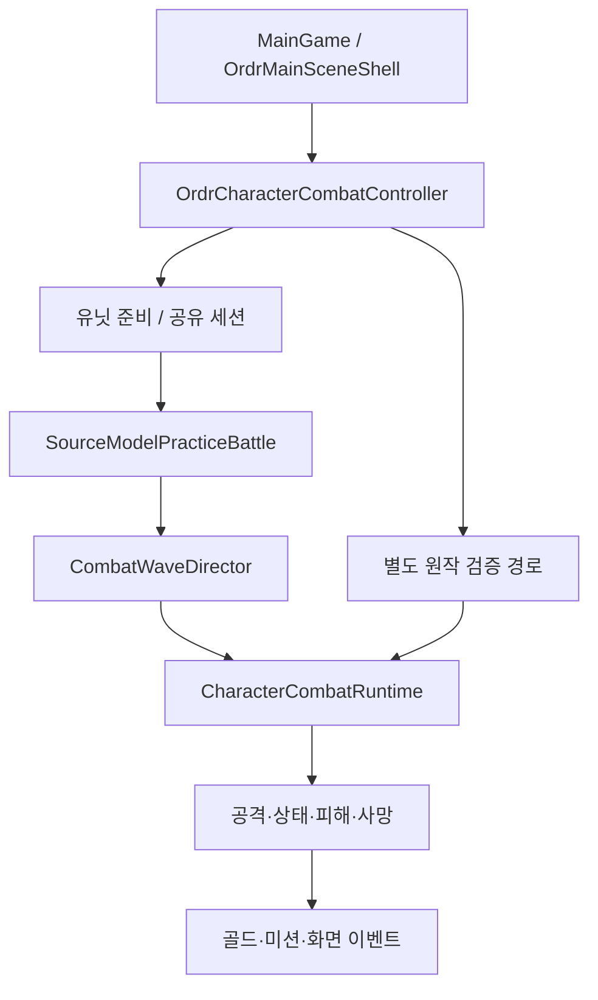

# 코드 구조와 재사용 지점

기준 게임 코드: `3cc8997` · 현재 범위는 [시작 안내](START_HERE.md), 실행 순서는 [작업목록](PLAYABLE_ROADMAP.md).

## 기본 씬에서 전투까지

연습과 원작 검증 경로는 공통 런타임을 재사용하지만 승인 의미가 다르다. 경로를 하나로 덮어쓰거나 연습 자료를 검증된 원본 관측으로 감싸지 않는다.

| 관심 영역 | 먼저 볼 파일·함수 | 재사용할 책임 |
|---|---|---|
| 화면 시작·모바일 메뉴 | [OrdrMainSceneShell.cs](../Assets/Scripts/Unity/OrdrMainSceneShell.cs), [OrdrMobileTouchPanel.cs](../Assets/Scripts/Unity/OrdrMobileTouchPanel.cs) | 시작 버튼·보유 목록·플레이/조합/상세. UI가 직접 피해·재화를 계산하지 않음 |
| 구성 진입점 | [OrdrCharacterCombatController.cs](../Assets/Scripts/Unity/OrdrCharacterCombatController.cs): `ConfigureRuntimeWithWorld`, `ConfigureCatalogOnlyWorld`, `BeginUnitPreparation`, `BeginPracticeBattle`, `Update` | 같은 세션에 데이터·경제·전투·수동 서비스 연결, 정지/준비/전투 시계 분리 |
| 도감·원본 객체 | [CharacterUnitCatalog.cs](../Assets/Scripts/Data/CharacterUnitCatalog.cs), [OriginalMapBaseStatCatalog.cs](../Assets/Scripts/Data/OriginalMapBaseStatCatalog.cs) | 프로젝트 ID와 원본 객체의 근거. 툴팁과 객체 기본값을 최종 피해로 간주하지 않음 |
| 공통 전투 | [CharacterCombatRuntime.cs](../Assets/Scripts/Combat/CharacterCombatRuntime.cs), [CombatAttackPipeline.cs](../Assets/Scripts/Combat/CombatAttackPipeline.cs), [CombatScheduler.cs](../Assets/Scripts/Combat/CombatScheduler.cs) | 대상·전장·공격 시점·이벤트·기존 거래 잠금 |
| 실제 HP·처치 | [CombatResolution.cs](../Assets/Scripts/Combat/CombatResolution.cs) | 피해와 사망의 공통 정산. 보상에서 별도 사망을 합성하지 않음 |
| 개발용 평타·효과 | [SourceModelBasicCombatRules.cs](../Assets/Scripts/Combat/SourceModelBasicCombatRules.cs), [SourceModelUnitEffects.cs](../Assets/Scripts/Combat/SourceModelUnitEffects.cs), [CharacterCombatRuntime.SourceModelEffects.cs](../Assets/Scripts/Combat/CharacterCombatRuntime.SourceModelEffects.cs) | 객체 주사위·명시적 피해 모델, 모델 대상 등록, 순수 패시브·로빈·일부 오라. 미연결 스킬은 거부 |
| 상태·오라 | [CombatStatusEngine.cs](../Assets/Scripts/Combat/CombatStatusEngine.cs), [Original323AuraCommonRules.cs](../Assets/Scripts/Combat/Original323AuraCommonRules.cs), [CharacterCombatRuntime.SpecialAuras.cs](../Assets/Scripts/Combat/CharacterCombatRuntime.SpecialAuras.cs) | 원본 정체성에 따른 중복, 남은 기절 시간, 별도 원작 대상/시점 승인 |
| 연습 진행·이동·보상 | [SourceModelPracticeBattle.cs](../Assets/Scripts/Combat/SourceModelPracticeBattle.cs), [CombatWaveDirector.cs](../Assets/Scripts/Combat/CombatWaveDirector.cs) | 출현 계획·등록된 적·생존 이력·시간 구간 이동·실제 처치 보상·10R/20R 종료 |
| 원작 피해 연결 | [Ordr323DamageWorldBinding.cs](../Assets/Scripts/Combat/Ordr323DamageWorldBinding.cs), [Ordr323OriginalDamageRules.cs](../Assets/Scripts/Combat/Ordr323OriginalDamageRules.cs), [Ordr323MapDamageMath.cs](../Assets/Scripts/Combat/Ordr323MapDamageMath.cs) | 확인된 원시 타격·방어·중첩·정수화 계약과 맵 상수. 모든 계약의 실제 공급자가 완성된 것은 아님 |
| 공유 지갑·보유 목록 | [SharedEconomySession.cs](../Assets/Scripts/Core/SharedEconomySession.cs), [EconomyTransactions.cs](../Assets/Scripts/Core/EconomyTransactions.cs), [UnitRoster.cs](../Assets/Scripts/Core/UnitRoster.cs) | 같은 지갑과 실제 인스턴스를 모든 기능이 사용 |
| 흔함 소환 | [Original323SourceCommonWispWorld.cs](../Assets/Scripts/Combat/Original323SourceCommonWispWorld.cs) | 원본 추첨 구조·배치·해적선 보류·실패 결과 유지. 별도 균등 가챠로 교체하지 않음 |
| 실제 127개 조합 | [Original323CommonFusionPort.cs](../Assets/Scripts/Mobile/Original323CommonFusionPort.cs): `RegisterReviewed`, `ConfirmFusion` | 검수한 제작식·재료/목재 차감·`OriginalFusionUnitSwap`. 모든 미리보기를 실행 허가하지 않음 |
| 원본 특수 조합 기반 | [OriginalJassFusionPlanner.cs](../Assets/Scripts/Mobile/OriginalJassFusionPlanner.cs), [OriginalJassFusionAtomicCoordinator.cs](../Assets/Scripts/Mobile/OriginalJassFusionAtomicCoordinator.cs) | 원본 조건 순서·특수 조건·정확한 재료 인스턴스. 새 거래 엔진을 만들기 전에 확인 |
| 일반 돈 도박 연습 | [SourceModelRegularMoneyGambling.cs](../Assets/Scripts/Mobile/SourceModelRegularMoneyGambling.cs), [원본 비용·재고 자료](../data/original-2323C-money-gambling-shop.json) | 실제 수동 10골드 차감/반환·공유 모바일 난수·논리 재고·영수증. 네이티브 재고/Warcraft RNG 동등성 미검증, 고급 해금 없음 |
| 판매 | [Original323LowerGradeSaleService.cs](../Assets/Scripts/Mobile/Original323LowerGradeSaleService.cs) | 원본 판매 능력, 공통 판매 포인트, 같은 지갑·난수·롤백 |
| 유닛 분해 | [Original323UnitDecompositionService.cs](../Assets/Scripts/Mobile/Original323UnitDecompositionService.cs), [CharacterCombatRuntime.UnitCasts.cs](../Assets/Scripts/Combat/CharacterCombatRuntime.UnitCasts.cs) | 시간·취소·시전자 공격 중단·여러 결과의 원자 교환. 완료 전 본체 제거 금지 |
| 원본 가이몬 X-08 추첨 객체 | [Original323CommonFusionPort.cs](../Assets/Scripts/Mobile/Original323CommonFusionPort.cs), [원본 위습 풀](../data/original-2323C-wisp-pools.json) | CSI 희귀위습 1% 분기의 h0BG를 실제 X-08 유닛으로 해석. A0YE / 희귀위습 실제 지급·SP08 조합 승인은 별개 |
| 희귀위습 조건부 원본 지급 | [Original323AutomaticUncommonWisps.cs](../Assets/Scripts/Combat/Original323AutomaticUncommonWisps.cs), [OriginalWispCombatRewardWorld.cs](../Assets/Scripts/Combat/OriginalWispCombatRewardWorld.cs) | 원본 이중 RNG·실제 A0YE·소환 위치가 모두 검증된 경우에만 99%/1% 원본 분기와 지갑/로스터 거래. 기본 앱은 검증 공급자 미연결 |
| 원본 보물 출현 묶음·미래 웨이브 보호 | [Original323TreasureHunt.cs](../Assets/Scripts/Combat/Original323TreasureHunt.cs) | 원본 BeM/BFj 관측 출현 패킷 전체 검증, 아직 등장하지 않은 상자 조기 공개/획득 거부 |
| 보물 가챠 중복 탐색 복원 경계 | [MobileTreasureGacha.cs](../Assets/Scripts/Mobile/MobileTreasureGacha.cs) | 원본 맵·교정 증빙·상자 상태·소비 ID 체크포인트 저장; 검증된 지갑·원본 시전 장부와의 외부 일치 증빙 필요. 아직 전체 게임 저장이 아님 |
| CCQ 기반 가챠 확률 입력 | [MobileTreasureGacha.cs](../Assets/Scripts/Mobile/MobileTreasureGacha.cs), [Original323GaimonRevealPort.cs](../Assets/Scripts/Combat/Original323GaimonRevealPort.cs) | 원본에서 실제 공개된 미수집 보물 위치를 내부 교정 공급자에 전달. CCQ 정보 미처리 공급자는 지급 거절, 수치·확률 변경 없음 |
| 가이몬 R 보물 공개 CCQ | [Original323GaimonRevealPort.cs](../Assets/Scripts/Combat/Original323GaimonRevealPort.cs) | 원본 R 시전/시작점 증거 → CCQ 공개만 수행, 미등장 보물 제외, 보상/난수 소모 0·이벤트 ID 중복 차단. 기본 앱의 네이티브 시전 공급자 미연결 |
| 가이몬의 꿈 CCP | [Original323GaimonDreamState.cs](../Assets/Scripts/Combat/Original323GaimonDreamState.cs) | 원본 플레이어 YL 검증 후 1회 YN/iK 적용·나미에 따른 978/1125 범위. 가챠 티켓 상태 교차 검증 |
| 수동 행동 경계 | [MobileManualInteraction.cs](../Assets/Scripts/Mobile/MobileManualInteraction.cs), [MobileInteractionPolicy.cs](../Assets/Scripts/Mobile/MobileInteractionPolicy.cs) | 사용자 확정과 서비스 호출. 자동 루프에 수동 소비를 넣지 않음 |
| 난수 | [MobileRollbackWispRandom.cs](../Assets/Scripts/Core/MobileRollbackWispRandom.cs), [Original323SharedBfiRandom.cs](../Assets/Scripts/Core/Original323SharedBfiRandom.cs) | 모바일 공유 스트림/거래 롤백과 원본 관측 스트림의 권한 구분. 발동 실패도 필요한 추첨을 소비 |
| 미션 | [OriginalPersonalMissionSession.cs](../Assets/Scripts/Core/OriginalPersonalMissionSession.cs), [PersonalMissionGameplay.cs](../Assets/Scripts/Core/PersonalMissionGameplay.cs) | 실제 성공 사건·보상 장부·중복 방지. 미리보기/거절을 집계하지 않음 |
| 캐시 생성 | [OrdrCharacterDataSync.cs](../Assets/Editor/OrdrCharacterDataSync.cs): `Sync`, `EnsureRequiredRuntimeResources` | Editor 열기·수동 메뉴·빌드 전처리에서 동일한 `data/` 동기화 |
| 화면 표시·카메라 | [OrdrUnitWorldPresenter.cs](../Assets/Scripts/Unity/OrdrUnitWorldPresenter.cs), [MobileMapSkillLayout.cs](../Assets/Scripts/Unity/MobileMapSkillLayout.cs) | 좌표·선택·체력·연출 표시. 시각 효과에서 실제 피해를 중복 적용하지 않음 |

## 미연결 스킬을 추가할 때

1. `data/unit-runtime-status.json`에서 해당 ID·원본 rawcode·이미 연결된 효과를 확인한다.
2. 실제 객체 능력 소유·JASS 등록 함수·피해 타입·타깃·시점·레벨을 확인한다. `character-skill-profiles.json`은 툴팁이지 실행 명세 전체가 아니다.
3. 기존 `Original323Uncommon*`, `Original323Native*`, `Original323SpecialRare*` 처리기와 컨트롤러의 구성 함수를 검색한다. 공급자 인터페이스만 있고 실행 구현이 없는 지점을 구분한다.
4. 동일 능력이 두 경로에서 확률·피해·기절을 중복 적용하지 않게 한다. 모델 추가와 원작 검증 승인은 별도로 기록한다.
5. 실제 소환→공격/시전→대상 HP/상태→처치/보상을 검사하고 근거·현황 자료를 갱신한다.

## 최적화 전에 지켜야 할 것

우선 측정할 후보는 오라 갱신의 유닛×대상 반복, 잦은 전장 스냅샷/정렬, 보유 목록·조합 미리보기의 재생성, 장시간 난수/영수증 이력이다. 병목이라고 단정하지 말고 실제 프레임 시간·할당량·실행 조건을 기록한다.

최적화 전후 같은 입력에서 대상 선택·난수 호출 횟수/순서·공격/상태 만료 시점·처치 보상·거래 롤백이 유지돼야 한다. `OriginalFusionUnitSwap` 도중 오라를 다시 적용하면 재료 상태 리비전이 바뀔 수 있으므로 기존 잠금·갱신 경계를 유지한다. 미사용 여부를 확인하지 않은 인터페이스·부분 클래스를 중복 코드처럼 삭제하지 않는다.

## 검사 위치

- C# 실제 전투/거래 검사: `Assets/Tests/EditMode/`.
- JSON·원본 추출/감사 회귀: `tests/`.
- 원본 입력을 읽는 추출/감사 도구: `tools/`.
- Unity 엔진 검사와 Android 작업: 기존 [워크플로](../.github/workflows/unity-editmode.yml). [실행·결과 해석](unity-editmode-test.md).

## 목록 UI의 세부 진입점

`OrdrMobileTouchPanel.DrawOwnedUnitIndex`는 보유 인스턴스 카드와 수동 관리, `DrawUnitConfirmations`는 해당 인스턴스의 최종 판매/분해 확인을 담당합니다. `DrawCatalogIndex`/`DrawUnitDetails`는 읽기 전용 도감 목록과 상세를 나눕니다. `DrawFusionConfirmation`은 기존 반복 제작 거래를 호출하는 최종 확인이며 목록 위쪽에 표시됩니다. `SelectTab`의 `restoreScroll`은 왼쪽 메뉴 복귀에만 사용하고 문맥 검색은 기본 맨 위부터 엽니다. `TabTitle`은 모든 `Tab` 값을 처리해야 하며 보물 탐색을 빠뜨리면 드로어 헤더가 실패합니다.

## Android 패킹 증빙

`OrdrAndroidDevelopmentBuild.WriteRuntimeDataBuildManifest`는 실제 `BuildReport.packedAssets`에서 `OrdrCharacterDataSync.RequiredRuntimeAssetPaths()` 전체의 비어 있지 않은 패킹을 요구하고 APK SHA-256과 목록을 `.build.json`에 저장합니다. `tools/verify_android_apk.py`는 importer의 단일 필수 목록·패킹 증빙·해시를 대조합니다. Unity 버전별 내부 리소스 파일명을 고정하지 않습니다. 자세한 실행/다운로드 절차는 [Unity와 APK 안내](unity-editmode-test.md)를 참고합니다.

APK 검증은 기존 워크플로에서 `build/Android`의 APK·패킹 증빙을 `$RUNNER_TEMP/ordr-apk-package`로 복사한 뒤 실행합니다. 결과 JSON·체크섬도 복사본 옆에 생성하고 이 단일 폴더를 업로드하여 Unity 컨테이너 출력의 소유권에 의존하지 않습니다. `AndroidApkWorkflowPackagingTests`는 해당 shell 블록의 실제 복사/검증/보고서 생성 흐름과 signer 실패 경계를 fixture로 검사합니다.

## 전장 보유 편대 표시

[MobileOwnedUnitFormation.cs](../Assets/Scripts/Unity/MobileOwnedUnitFormation.cs)의 `Group`은 실제 보유 스냅샷을 카탈로그 ID별로 읽기 전용 집계하고, `MobileOwnedFormationLayout.Calculate`는 메인 전장 안의 중앙 정렬 칸·페이지를 계산합니다. `OrdrUnitWorldPresenter.ApplyCenteredFormation`만 표시용 Transform을 배치합니다. 런타임 `UnitState`를 이동시키지 않으며, 이름·등급·수량과 실제 개체 선택은 같은 그룹/칸을 사용합니다. `CollectMainBattlefieldPositions`는 원래 게임 좌표를 유지해 화면 슬롯과 카메라 프레이밍이 서로 영향을 주지 않게 합니다. `ReadWorldSelection`은 이름 칸 탭 직전 실제 보유 그룹을 다시 확인합니다.

## 시작화면·얇은 자원 HUD

`OrdrMainSceneShell.IsStartScreenVisible`/`EnterGame`이 제목 화면과 기존 준비/검증 첫 라운드 진입을 연결합니다. 제목 화면 중에는 `OrdrMobileTouchPanel`/`OrdrUnitWorldPresenter`의 메뉴/이름표와 월드 입력을 막습니다. `MobileMapSkillLayout.HeaderHeight`는 이제 0이며 `StatusMargin`은 **하단 카드가 아닌 상단 얇은 자원 줄**입니다. `ResourceChip`은 한 줄 표식/항목명/숫자를 그립니다. 일시정지는 왼쪽 스크롤 밖에 있으며, 준비 전투 시작·초기화는 점수판에 있습니다. `DrawWisp`의 흔함 버튼은 `RequestCommonWispBatch(1)`만 직접 호출하고 별도 횟수 상태를 보유하지 않습니다. `TabGuide`/`showTabGuide`는 삭제됐습니다.

가로 공간을 채우는 레이아웃에서 `Story.yMax`와 `RightDrawer.yMax`는 같은 하단 안전 여백 경계입니다. `MobileDedicatedSkillTests.ReducedMapsKeepSkillRibbonAndStorySeparateOnSmallLandscapeScreens`도 이 동일 경계와 메인/스킬/스토리 간 분리를 검사합니다. 과거 하단 자원 카드를 위한 엄격한 부등식을 다시 적용하지 않습니다.

## 2026-10-30 자원·메뉴 소속·드래그

`StatusChipRects`는 네 칸이고 상단 줄 높이는 36 UI 단위입니다. `DrawEconomyStatus`는 기존 공유 지갑의 골드/목재/랜덤위습/`OriginalMissionWalletRewards.TraitPointsId`를 읽습니다. 오른쪽 안쪽 여백과 글자 크기를 확보했습니다. `Tab.LogPose`/왼쪽 기록지침에서만 `DrawTreasureGacha`를 표시하며, 원본 소속 근거는 `data/original-2323C-treasure-research.json`의 `searchAbilityOrigin`입니다. 기록 도구/빠른 이동은 삭제됐습니다.

[MobilePanelScrollGesture.cs](../Assets/Scripts/Unity/MobilePanelScrollGesture.cs)는 본문 드래그 임계값·상하한·탭/드래그 해제를 분리합니다. `HandlePanelScroll`은 GUI 배율 적용 전 좌표를 정규화하며, 드래그가 성립하면 IMGUI hotControl을 취소하고 드래그/해제 이벤트를 버튼보다 먼저 소비합니다. `BeginPanelScroll`/`EndPanelScroll`은 실제 Repaint 레이아웃에서 본문 높이/뷰포트를 측정합니다. 오른쪽 스크롤바는 직접 조작하도록 제외합니다. 연금술 대상 목록은 외부 본문 스크롤 하나를 사용합니다.

## 히든 채팅 조합 11개

`Original323CommonFusionPort.ReviewedHidden`은 원본 채팅 콜백에 별도 게임 상태 변경이 없고, 재료가 매핑됐으며 결과 CH8 처리도 필요 없는 11개만 허용합니다. `RegisterReviewed`의 히든 재료 범위는 흔함~희귀함이며 네이티브 능력을 가진 시전자를 요구하지 않습니다. `ConfirmFusion`은 히든만 고정 원본 플레이어 0 시작점에 만들고, 기존 116개는 능력 소유 재료의 위치를 계속 사용합니다. 원자적 거래 경로는 같습니다.

[원본 감사 도구](../tools/audit_original_hidden_fusions.py)와 [원본 히든 거래 근거](../data/original-2323C-hidden-material-swaps.json)는 채팅 등록·래퍼·콜백 전체와 공통 거래 함수를 기록합니다. YY15의 XM 초기화, 해적선/변형 재료, CH8 추가 효과는 기존 잠금을 유지합니다. `OriginalHiddenMaterialSwapTests`는 이 근거를 레지스트리/객체와 대조하고, 상태 변경·보상·위치 변경을 넣은 콜백을 거절하는지 확인합니다.
