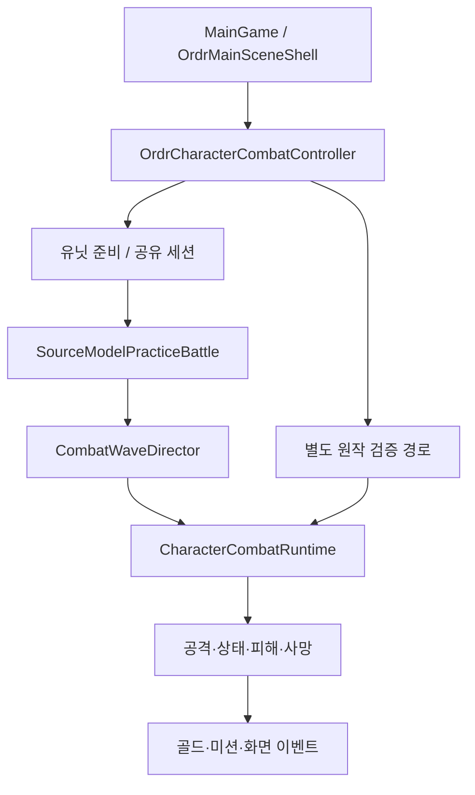

## 2026-11-03 · 12차 변신 후속 경로 (이전 · 13차는 문서 끝)

- `SourceModelEleventhForms` 공격 선언→`SourceModelTwelfthForms` 보니40스택·스턴, 킹 화재/둔화→공통 피해·타이머·상태 원장. `SourceModelOriginalSpecials.IsSourceModelPullHeld`에 세월관통 루트, `OrdrUnitWorldPresenter` 0.6배 외형, `OrdrMobileTouchPanel` 한글 폼. 세부 내용은 문서 끝의 같은 12차 섹션에 있습니다. 원작 최종 등가성 미검증.

## 2026-11-03 · 11차 동형 변신·원본 평타 객체 교체 (이전)

- `CharacterCombatRuntime.SourceModelEleventhForms.cs`는 E-01/TR-21/LI-10/LI-03의 원본 스킬 ID/소유 rawcode/비용·폼 요건을 별도로 확인하고 `SourceModelTenthForms`의 **동일 소유자 상태, 만료, 전장 리비전/제거 정리**와 `SourceModelResources` 공용 자동 시전 경로를 재사용합니다. `CharacterActiveAbilities`에 원본 SLK 변신 마나 상한 전환, `SourceModelBasicCombatRules`에 `H0BY` 독립 객체 등록을 추가했습니다.
- `SourceModelEffects`의 `ConfigurePracticeScriptAttackDeclared`는 **보니 `H0BY`에 한해서** 별도 폼 공격 객체를 콜백으로 전달하고, **쵸파/카이도는 기존 기본 rawcode native 콜백 유지**(폼 객체 공격력 교체는 별도 규칙 적용). `SourceModelAttackSkills`는 보니 기본 `H0BX`의 확인된 A04P 경로만 실행하고, `H0BY`에는 검증되지 않은 A04P를 복제하지 않습니다. 독립 유닛 소환·조합/경제 객체 증가 없음.
- `LI-10`은 **50 아머브레이크 스택·MP35**가 충족된 대상이 없으면 발동하지 않고, `LI-03`은 `ConfigureSourceModelMarcoFormEvidence` 없이 변신 상태/폼 전용 스킬을 만들지 않습니다. `E-02`는 원본 객체 미매핑으로 출전 차단 유지. 거대화 공속 감소, 보니 니카 확률 버프·세월관통 후속, 킹 광역 확대, 마르코 불사조 고정피해 추가분 등 근거 부족 효과는 보류. Unity Editor/Android 결과 미확인, `tests/test_source_model_eleventh_forms.py`와 `SourceModelScriptAttackSkillTests`에 회귀 기록.

## 2026-11-03 · 10차 변신 상태·강화 선결조건 연결 (이전)

- `CharacterCombatRuntime.SourceModelTenthForms.cs`에서 도플라밍고·로쿠규·강화 프랑키의 원본 필드 화이트리스트, 동일 유닛 상태/전장 리비전/만료/제거를 관리합니다. `TemporarySkills.PracticeFormOf`, `SourceModelEffects` 공통 시계, `SourceModelResources` 자동 시전, `SourceModelAttackSkills` 공격 선언, `CharacterActiveAbilities` 자원 원장을 공유합니다.
- 도플라밍고 4.5초·방어력 감소7.5초·공속 간격0.03초·20% 추가 공격, 로쿠규 7초·양분1, 프랑키 장군 6초·MP150·프레스·소드(33% 추가 피해 독립 난수)·빔을 구현. 프랑키 강화 선결조건은 `ConfigureSourceModelFrankyEnhancedEligibility` 실증 공급자만 승인하며 미연결 상태에서는 불가.
- 기존 native 쵸파·카이도/스네이크맨·야마토 유지; 미확인 패기 변환·원본 스플래시 피해·면역/타이밍은 별도 보류. `tests/test_source_model_tenth_forms.py`와 Unity EditMode 회귀 추가, **TOOLTIP_MODEL_ONLY**.

## 2026-11-03 · 9차 실제 명중 카운터·다중 투사체·누적 강화 (최신)

- `CombatAttackPipeline.ConfigurePracticeSuccessfulBasicHit`: 원본 `ATTACKED` 선언 경로와 분리해 **HP에 실제 피해가 들어간 확정 명중** 후 호출합니다. `CharacterCombatRuntime.SourceModelEffects`가 이 후속 콜백 및 공용 `SourceModelTimeAdvancing` 투사체 예약을 한 번 연결합니다. 공격 선언 경로는 `CharacterCombatRuntime.SourceModelAttackSkills`에서 기존 native/JASS 및 앞선 도감 스킬을 유지하며 9차만 별도 병렬 실행합니다.
- `CharacterCombatRuntime.SourceModelNinthSkills.cs`: `SourceModelNinthSkillCatalog`가 원본 ID·rawcode·명칭·트리거·대상·효과 필드를 엄격 승인. 히바리 4회 **실명중**, 징베 7초 재사용·0.2초×10회 대상 유효성 확인, 네즈코 체력 8%와 `휩쓸기` 9%/현재체력10% 보정, 거프·빅맘 기본 공격력 비율, 알비다 보스/일반 스턴 분기, S-스네이크 8% 공속 발동 및 6회 보너스를 기존 피해/상태 엔진에 연결합니다. 프랑키의 변신 필수 `제너럴 소드`는 조건 미연결로 제외. `CharacterCombatRuntime` 제거 루틴은 예약 피해·카운터·강화 기록을 함께 정리합니다.
- `CharacterCombatRuntime.SourceModelNextThirtyAttacks.SourceModelNinthDamageAdjustment`: 기존 공용 피해 원장에서 기본 공격력 비율 및 네즈코 대상 **현재 HP** 추가 피해를 계산; 새 전용 피해 정산기를 만들지 않습니다. `tests/test_source_model_ninth_10_skills.py` 및 Unity `SourceModelScriptAttackSkillTests`를 묶어서 확인합니다. 투사체 이동·스턴 저항·강화 지속시간·원작 최종 피해/Unity/Android 검증은 **TOOLTIP_MODEL_ONLY** 경계입니다.

## 2026-11-03 · 8차 조건형·접근형 공통 경로 (최신)

- `CharacterCombatRuntime.SourceModelEighthSkills.cs`: 17개 신규 도감 기반 기능 중 조건/라운드/접근/주기 실행. 야마토 폼 첫 타격 소비, 블랙 마리아 공격 13회 카운터, 조로 선택적 힘 계수, 코비 실제 5라운드마다 최대 +42% 공속, 접근 판정의 대상별 한 번·같은 패기 배타, E-11 1.5초 주기, TR-13 카무사리 14.25초 공유 주기를 한 곳에서 처리. 원본 만료 없는 코비 상태는 `CombatEffectOrigin.Aura`로 보관.
- `SourceModelNextThirtySkillCatalog.IsEighthCompositeSkill/CanModelEighthCompositeComponents`: 새 공격 8종의 ID/이름/필드 완전 검증. 기존 일반 허용 2종(I-03/I-07)은 `SourceModelUnconnectedSkillCatalog`만 확장. 모든 공격은 `CharacterCombatRuntime.SourceModelNextThirtyAttacks → SourceModelCompositeEffects → CombatStatusEngine/CombatResolution` 재사용. `SourceModelUnitEffects.ResolvePracticeAttackSpeed`는 코비 영구 버프 수치를 기존 가속 정책으로 반영합니다.
- `CharacterCombatRuntime.SourceModelEffects`는 공용 전투 시계 이벤트에 신규 주기/접근 모델을 한 번 등록합니다. `SourceModelPracticeBattle.BeginRound`가 실제 라운드 시작에만 누적 버프를 호출합니다. `CharacterCombatRuntime.TryCastActiveSkill/SourceModelResources`는 샹크스의 실제 SLK MP35를 사용하고 개별 기술 쿨타임과 주기 타이머를 공유합니다. 유닛 제거/적 제거 시 카운터·대상 표식/예약키 정리, 기존 JASS/native 콜백 우선순위 유지.
- 근거: `data/character-skill-profiles.json`과 W3X `data/original-2323C-unit-object-stats.json`. 회귀 `tests/test_source_model_eighth_17_skills.py`. 원본 피격 순서·특수 면역·폼 최고 속도·Unity Editor/Android 실행은 미검증이며 **TOOLTIP_MODEL_ONLY**입니다.

## 2026-11-03 · 7차 특수 기술과 6차 연결 오류 수리 (최신)

- `SourceModelNextThirtySkillCatalog.IsSeventhCompositeSkill/CanModelSeventhCompositeComponents`: 사보 `TR-11:skill:4`, 아오키지 `TR-16:skill:0`, 조로 `TR-20:skill:0`, 코비 `TR-24:skill:2` 정확한 ID·이름·기술 메타데이터·효과 순서 제한. `SourceModelUnconnectedSkillCatalog`에 공격 3·액티브 1 승인, 총 **공격 95 / 자동 액티브 42**.
- `CharacterCombatRuntime.SourceModelNextThirtyAttacks`의 공격 재사용 제한·MP 문턱·차감·대상 중심 광역·자동 액티브·상태/피해 적용은 기존 원장을 재사용. `CharacterCombatRuntime.SourceModelResources`는 아오키지 `H097` 원본 MP85를 연결. `CharacterCombatRuntime.SourceModelSeventhSkills`는 0.5초 지연 아이스 에이지, 조로 0.1초×11회 DoT, 코비 기본 공격 주기별 5초 임시 전투 소환, 사보 실제 버프 수/선택적 힘 공급자 피해를 처리. 임시 소환은 `CharacterCombatRuntime.SourceModelTemporarySkills`와 공동 수명 및 전장 변경 취소를 사용, 조합 재료 미등록.
- `CharacterCombatRuntime.SourceModelAttackSkills`에서 스네이크맨(H0B2)·레일리(h049) 독립 임시 콜백과 기존 6차 승인 공격을 **동일 공격에서 함께** 실행하도록 early return 누락 수정. `CharacterCombatRuntime.SourceModelSixthSkills`는 블랙 맘바 폼 상태가 살아 있을 때만 70%·1.5배·컬버린 상대 +20% 적용. 공통 전장 revision/분신 소멸/유닛 제거 시 콜백 제한.
- 원본 최종 면역·영웅 힘·외부 업그레이드와 Unity Editor/Android 실기는 미검증. Python `tests/test_source_model_seventh_4_skills.py` 및 C# `SourceModelScriptAttackSkillTests`에서 스키마/수명/기존 콜백 회귀. 원본 데이터 수치 변경 없음, TOOLTIP_MODEL_ONLY 한정.

## 2026-11-03 · 6차 20개 연결 위치 (이전 기록)

- `SourceModelNextThirtySkillCatalog.IsSixthCompositeSkill/CanModelSixthCompositeComponents`: 20개 스킬의 정확한 유닛 ID·이름·필드·순서 승인. `SourceModelUnconnectedSkillCatalog` 및 기존 30명 승인 목록에 추가; 이미 연결된 원본 JASS/객체 콜백보다 우선하지 않음.
- `CharacterCombatRuntime.SourceModelNextThirtyAttacks`: 19개 공격 발동·추가 시전 40%·조건부 상디 마법(기존 객체 기절 중복 금지)·체력 액티브 공유 적용. `CharacterCombatRuntime.SourceModelSixthSkills`: 보스 발동/타격 수 분기, 버프 수, 상태별 추가 연타, 포세이돈 원본 0.25초·2.5초 지속 및 5초 발동 제한. 기존 전장 revision·상태/방어·시간 엔진 활용.
- `tests/test_source_model_sixth_20_skills.py`와 업데이트된 `tests/test_second_thirty_tooltip_practice.py`가 승인 숫자/네이티브 중복 보호. 총 **공격 92·자동 액티브 41** 연습 허용; 강화폼·면역·원작 최종 피해/Unity/Android 실행 미검증.

## 2026-11-03 · 5차 고유 스킬 연결부 (이전 기록)

- **승인:** `SourceModelNextThirtySkillCatalog.IsFifthCompositeSkill/CanModelFifthCompositeComponents`에서 8개의 소유 ID·이름·효과 필드·순서·마나 게이트 검사, 두 유닛별 허용 카탈로그 재사용. 누적 공격 **73**, 자동 액티브 **40**.
- **경로/성장:** `CharacterCombatRuntime.SourceModelFifthSkills`는 `SourceModelPracticeBattle.RouteCorners`를 사용해 루치 람각의 최다 관통 경로 결정. `ConfigureSourceModelAccumulatedClearCount`는 실제 영구 완료 횟수를 선택적으로 공급하며 미공급=0회. 로빈은 같은 전장 최대 3명; 키자루 마나 게이트와 기존 민첩 공급자 재사용.
- **시간/상태:** 에이스 화염은 기존 `SchedulePracticeSourceAttack` 전투 시계에서 0.2초마다 예약, 같은 적에는 살아있는 화염 중 최강치만 정산. 유닛 제거·전장 변경·사망 시 취소하며 대염계 타격은 2초 예약 뒤 기존 피해·상태 경로로 들어감. 퀸 역재 방깎은 공통 `CommonSkillStatusEffects`. `data/source-model-fifth-8-composite-skills.json`/`tests/test_source_model_fifth_8_skills.py` 참고. 원본 완전 동등성 미검증.

## 2026-11-03 · 4차 공격 고유기 15개 실행 경로 (이전 기록)

- **명시적 허용:** `SourceModelNextThirtySkillCatalog.IsFourthCompositeAttack/CanModelFourthCompositeComponents`에서 소유 유닛·스킬 인덱스·이름과 구성요소 필드/순서를 검사합니다. `SourceModelNextThirtySkillCatalog`(울티/스모커) + `SourceModelUnconnectedSkillCatalog`(기존 6명/신규 루치 2명·핸콕)를 합쳐 11명 15개 신규 공격만 승인했습니다. 쿠마 전설 10% 발바닥은 이미 `CharacterCombatRuntime.SourceModelOriginalSpecials.BtL`에 있으므로 재등록하지 않았습니다. 추가 공격 **66**, 자동 액티브 **39** 유지.
- **실행/보정:** `CharacterCombatRuntime.SourceModelNextThirtyAttacks`는 대상/전장/확률 후 공통 `SourceScriptTargets`로 반경 타격 및 키자루 `ProjectileLine`을 선별합니다. `SourceModelCompositeEffects.SourceModelCompositeRawDamage`는 평타 비례·현재 HP·민첩 실수 공급자·보스/스토리 전용 마법계수를 공통 피해 정산에 전달하고, 3연타의 주 대상 +325% 별도 패킷과 에이스 적 중심 추가 단일 피해도 처리합니다. 원본 데이터 JSON은 건드리지 않습니다.
- **시간/수명:** 에이스 `불주먹`만 4.25초 성공 발동 후 재발동 차단을 적용하며 유닛 제거 시 쿨타임 자료를 정리합니다. 퀸 `빙귀`의 타깃 필드 누락은 해당 스킬에만 적 중심 반경 예외로 허용합니다. 공격 대상과 실제 적 기본 방어 유형이 없으면 기존 차단 로직을 유지합니다. 근거 `data/source-model-fourth-15-composite-attacks.json`, `tests/test_source_model_fourth_15_attacks.py`, Unity EditMode 회귀. 원본 실행 동등성은 주장하지 않습니다.

> 아래 1~3차는 이전 시점 기록입니다.

## 2026-11-03 · 3차 복합 평타 12개 실행 경로 (현재 최신)

- **식별/허용:** `SourceModelUnconnectedSkillCatalog`에 기존 7명 공격 명칭 12개 추가. `SourceModelNextThirtySkillCatalog.IsThirdCompositeAttack/CanModelThirdCompositeComponents`가 `(unitId, skill index, name, 순서, 필드)`를 완전 패킷 기준으로 검증합니다. 자동 액티브/기존 JASS 콜백과 병렬 중복을 만들지 않습니다.
- **실행:** `CharacterCombatRuntime.SourceModelNextThirtyAttacks` → 기존 `SourceScriptTargets` 전장/반경·발동 확률 → `CharacterCombatRuntime.SourceModelCompositeEffects.SourceModelCompositeRawDamage`가 객체 기본 공격력, 기존 특수기 피해, 적 HP 비례, 주문학교별 추가 피해를 공통 HP/방어/처치로 계산합니다. `SourceModelCompositeMagicFactor`는 우타 폭발 스쿨에 2차의 `ExplosiveDamageAmplification` 실제 증폭을 적용합니다.
- **생명주기:** 음표 병사 `TrySourceModelSongSoldier/SourceModelSongSoldiers`는 7초 기여 수치만 보관하며 실제 W3X 객체를 꾸며 내지 않습니다. 기간 만료·유닛 제거·전장 전환 때 정리합니다. `ConfigureSourceModelHeroStrengthProvider`로 진각 힘+17,500/힘의 출처를 나중에 공급할 수 있고, 없으면 기본 125만만 적용합니다. 근거 `data/source-model-third-12-composite-attacks.json` 및 신규 Python/Unity EditMode 회귀.

> 아래 1·2차 섹션은 이전 시점 기록입니다.

## 2026-11-03 · 1차 복합 스킬 공통 연결부 (이전 작업)

- 허용/소유권: `SourceModelNextThirtySkillCatalog.IsFirstCompositeActive`로 10개 유닛·스킬 ID·전체 효과 구성 확인. 기존 `SourceModelNextThirtySkillCatalog`의 4명(I-04/H-04/TR-10/L-25)과 `SourceModelUnconnectedSkillCatalog`의 6명에 액티브 추가; 원본 유닛 rawcode 일치 확인은 유지합니다.
- 실행: `CharacterCombatRuntime.SourceModelResources` 공용 자원/우선순위 → `SourceModelNextThirtyAttacks` 단일 전장·대상 중심·HP 정산 → `CharacterCombatRuntime.SourceModelCompositeEffects` 상태·스택·공격력 기준 고정 피해 → 기존 HP/처치. `SourceModelUnitEffects`는 연습 둔화/방어/마법효과의 최강치 충돌 정책 적용. 울티 평타 HP+1은 `SourceModelAttackSkills`에서 원본 자원에만 적용.
- 범위: 기존 원본-검증 경로의 피해 공식/JASS 이벤트는 그대로 두고, 누락 지속시간은 임의 초 단위 없이 **적 생존 동안 유지**합니다. 근거 `data/source-model-first-10-composite-actives.json`; Python/Unity 테스트·원본 불확실성은 별도 관리합니다.

## 2026-11-03 · 레드필드 모바일 결과 기준 보정 (이전 작업 기록)

- `Assets/Scripts/Mobile/SpecialGradeMobilePolicy.cs`: `Redfield = "LI-01"`, `UsesEnemyCenteredArea`는 기존 마르코와 레드필드를 명시적 모바일 보정 대상으로 제한. 원본 도감의 `casterArea` 자료는 변경하지 않음.
- `CharacterCombatRuntime.SourceModelNextThirtyAttacks.ExecuteSourceModelApprovedProfileAttacks`는 `casterArea`에 대해 해당 정책이 참이면 `Circle`(공격 대상 중심), 아니면 `AttackerCircle`(시전자 중심)을 사용. `CharacterSkillEffectExecutor`의 동일 정책과 일치. 공격 대상 중심은 반경 750을 유지하며 일반 공격 도달 사거리 무제한/메인·스토리 lane 분리/기존 5% 반경700은 그대로.
- 회귀: `SourceModelScriptAttackSkillTests.RedfieldMobileEnemyCenteredAreaStillHitsWhenCasterIsFarAway`, `SpecialGradeMobilePolicyTests`, `tests/test_source_model_followup_two_skills.py`. JASS 중심 좌표의 원작 실측 검증은 사용자 지시로 보류하며 모바일 결과 모델로만 관리.

## 2026-11-03 · 제트/제한됨 신규 패킷 호출 경로 (이전 구현 기록)

- `SourceModelUnconnectedSkillCatalog`의 `I-10/h04G` 자동 액티브 `마나 광역 공격`은 `CharacterCombatRuntime.SourceModelResources.CanProvisionSourceModelResources → AutoCastApprovedSourceModelActives → TryCastApprovedSourceModelActive → ApplySourceModelNextThirtySkill`로 원본 SLK 160 MP를 정산. `I-10`의 원본 객체 100% 추가 기절은 공통 네이티브 처리 그대로 두고 도감 중복 패킷은 승인하지 않음.
- `LI-01/h05G`의 4% `핏빛 범위 공격`은 `SourceModelNextThirtySkillCatalog.CanModelCompleteAttack`의 `casterArea` 범위 검증 후 `CharacterCombatRuntime.SourceModelNextThirtyAttacks.ExecuteSourceModelApprovedProfileAttacks → SourceScriptTargets`의 `AttackerCircle`을 사용. 기존 5% `광역 마법 공격`은 `Circle`로 계속 적 대상 중심. 기본 사거리 무제한 정책과 국소 광역 반경은 별개.
- 출처/보류: `data/source-model-followup-two-character-skills.json`, `tests/test_source_model_followup_two_skills.py`, `Assets/Tests/EditMode/SourceModelScriptAttackSkillTests.cs`. 새 액티브 1·신규 공격 패킷 1이며 기존 20 자동 액티브/36 추가 공격 패킷을 중복하지 않음. Unity·Android·원본 최종 전투 동등성은 확인 전.
- 통합 회귀: `tests/test_second_thirty_tooltip_practice.py`의 앞선 I-06 승인 이후 갱신되지 않은 액티브 기대값(7→8)·미허용 목록을 교정하고 `casterArea` 정적 판정을 실 구현과 일치시킴. 로컬 Python 271건 중 270 통과·1 건너뜀; C# Unity EditMode는 미실행.

## 2026-11-03 · 미구현 캐릭터 13명 자동 액티브 연결·공통 자원 로더 수정 (현재 최신)

- **전투 기능 13명 묶음 구현:** `MY-07 샌즈(가스터 블래스터)`, `MY-08 아냐(요르 포저)`, `L-32 쿠마 폭군(우르스스 쇼크)`, `TR-11 사보(마나 범위 타격)`, `TR-12 상디(유성소바 킥)`, `TR-15 시라호시(해왕류 다이브)`, `TR-19 우솝(파이어 버드 스타)`, `TR-24 코비(어니스티 임팩트)`, `I-01 거프(특제 대포환)`, `I-06 빅맘(대자재천신)`, `MY-04 미나토(나선섬광초륜무후삼식)`, `MY-05 바쿠야(종경백제검)`, `MY-06 부릉냐(이성의 창조물)`. 기존 7개와 합쳐 **명시적으로 허용한 자동 액티브 20개**(모든 캐릭터 전체 스킬 수가 아님).
- **엔진 경로:** `SourceModelUnconnectedSkillCatalog`에서 기존 공격 스킬 허용 목록을 보존하면서 12명 활성 스킬 연결, `SourceModelNextThirtySkillCatalog`에서 기존 I-06에 1개 연결. `CharacterCombatRuntime.SourceModelResources`의 공통 자동 대상/자원 결제/실행과 `CharacterCombatRuntime.SourceModelNextThirtyAttacks`의 타입별 피해·기절·HP·처치·이벤트 경로 재사용. **액티브만 있는 캐릭터가 평타 때 가짜 스킬 발동/보류 로그를 일으키는 경로 차단.** 기존 `SourceModelUnconnectedSkillCatalog.cs`가 namespace 닫는 중괄호 1개가 누락되어 있던 C# 구문 결함도 함께 수정.
- **확인된 구조적 원인과 수정:** 원본 `H0CO`(코비 초월)의 `UnitBalance.slk`에는 `HP=150, regenMana=0.5`인데 `manaN`이 누락되어 있었음. 이전 `SourceModelUnitResourceCatalog.FromOriginalObjectStats`는 이 1개 때문에 **265종 자원 인덱스 전체를 예외 중단**시킬 수 있었음. 누락된 마나 상한을 가상 생성하지 않고 0으로 남겨두며, `DeferredSourceManaRegeneration=0.5`에 미검증 원본 재생량을 보존·실전 적용은 보류. 0 상한이 **명시적으로 지정된** 모순 데이터는 계속 예외 처리.
- **검증 경계:** 13개 기술의 구조/마나·체력 비용·회수·범위/피해 구성은 `data/character-skill-profiles.json`에 있는 **도감 기반 TOOLTIP_MODEL_ONLY**입니다. HP/MP 시작값만 고정 W3X 객체 자료를 사용했습니다. 원본 JASS 네이티브 최종 피해·면역·공격/시전 타이밍과 RNG 동등성은 **미검증**. 아냐 '로이드 포저'처럼 미지원 이동 둔화가 포함된 복합 스킬은 임의 실행하지 않음.
- **검증 추가:** `data/source-model-additional-13-active-skills.json`에 13명의 고유 ID/원본 rawcode/기술 이름/실제 비용/미검증 표지를 고정. `tests/test_source_model_additional_active_skills.py`는 원본 데이터·대상/비용/중복/차단 증빙을 확인. Unity EditMode `SourceModelScriptAttackSkillTests`에 13종 실제 HP 공격 이벤트·자원 차감·중복 시전 차단, H0CO 예외, 복합효과 미승인 테스트를 추가. **로컬 Unity/Android 및 Actions 결과는 확인 전**이며 완전 원작 캐릭터 구현으로 오인 금지.
- **다음 과제:** 기존 상세 프로필 없는 77개(확장 포함 81개), 더 많은 고유 오라·소환·변신·피격 조건·네이티브 기술의 원본 호출 근거와 원작 결과 검증. 기존 286개 카탈로그 / 274개 평타 모델 수치는 변함없음.

## 2026-11-03 · 누락 캐릭터 전수등록 후 실제 전투 경로 보강 (최신)

- **실제 범위:** 기본 원본 277 + 위키 확장 9 = **286개 카탈로그 정체성**(5개는 독립 유닛이 아닌 전투 형태). 새 `tools/build_character_runtime_coverage.py`와 `data/character-runtime-coverage.json`으로 286개 전체를 **도감 정보/평타 객체/실행 모델/남은 원본 미검증**으로 분리해 기록합니다. 기존 `data/unit-runtime-status.json` 277행은 출처가 고정된 원본 자료이므로 임의로 286행으로 늘리지 않습니다.
- **원본 객체로 실제 새 평타 연결:** 한마 유지로 `MY-14 / h0C2`의 원본 W3X `dmgplus1=152500, dice=1, sides=4, cool=0.71, dmgpt=0.26`을 기존 `SourceModelBasicCombatRules → CombatAttackPipeline → 공통 HP/처치`에 연결. 기본 객체 피해 범위 **152501–152504**, 간격 **0.71초**입니다. 이는 **오프라인 MODEL_ONLY**로, 원본 합성 `A0QG` 실행 권한·원작 버프/방어/면역/스킬 시전 동등성을 부여하지 않습니다. 기존 273개 객체 기본 평타 모델과 합산하면 **274개**입니다.
- **변형/중복의 구조적 결함 보완:** `TR-31~35`의 원본 부모(`TR-20, TR-23, TR-30`) 도감 프로필을 **읽기 전용 메타데이터로 공유**합니다. `UnitImplementationRegistry`의 원본 상세 프로필·스킬 수 집계를 **200개·554개·295개** 그대로 유지하며, `CharacterCombatRuntime.SpawnCharacterCore`에서 추가 형태의 별도 소환/원본 조합 우회를 금지합니다. 실제 변신 효과·능력치·스킬은 별도 원본 근거 없이 발명하지 않습니다.
- **지원 객체와 UI:** 고대의 배 `R-44` 및 전설 `L-40/L-41`은 원본 기술·생성 경로 미확정 상태로 남겨둡니다. 유닛 세부 정보에서 `MY-14`처럼 base catalog에 없는 원본 객체의 평타 수치/연결 상태도 표시하며, 원본 스탯 전체 검증 전에 위키 확장을 적용하지 않습니다. 해적선은 히든으로 유지합니다.
- **전수 실태:** 총 286개 중 독립 유닛 ID **281**·형태 ID **5**, 상세 도감 프로필 원본 **200**·형태에서 부모 프로필 참조 **5**, 프로필이 전혀 없는 정체성 **81**. 원본 전투 **완전 검증 0**이며, 274개 평타 모델/오라·일부 스킬 실행과 원작에서 실제 완성된 고유 스킬은 구분합니다. 특히 새 전설 2종·고대의 배·미연결 77개 기존 상세 프로필, 초월 변신의 실제 원본 트리거, 스킬 원본 확률·면역은 **남은 작업**입니다.
- **회귀 검증:** Python `tests/test_character_runtime_coverage.py`, Unity `WikiUnitExtensionCatalogTests` 및 `SourceModelScriptAttackSkillTests`에 총수·원본 무기 숫자·한마 평타 실행·추가 형태 독립 소환 거부·부모 도감 스킬 승계 검사 추가. 로컬 Unity Editor/Android 및 CI 테스트 **결과 확인 전**이므로 아직 게임 전체 완료라고 주장하지 않습니다.

## 2026-11-03 · TMO.GG 누락 유닛·형태 카탈로그 확장 (최신)

- 원본 **277종 데이터/전투 스냅샷은 변경하지 않고**, `data/wiki-unit-catalog-extension.json`을 Editor 동기화 → Unity `CharacterUnitCatalog.ApplyWikiExtension`으로 결합해 **카탈로그 정의 286개**를 지원합니다. 원본 `OriginalMapBaseStatCatalog` 277건의 출처 검사 후 확장하며 신규 항목에 가상 공격력·조합 허가를 부여하지 않습니다.
- 신규 정체성 **4개**: 희귀 `R-44 고대의 배(h05Y)`, 전설 `L-40 장군좀비`·`L-41 히루루크의 묘비`, 신비 `MY-14 한마 유지로(h0C2, A0QG)`. 원본 rawcode가 확인되지 않은 전설 2종은 미확정. 고대의 배 등 지원 객체의 실제 거래·기술은 **미연결**입니다.
- 추가 전투 **형태 5개**(독립 조합 불가): `TR-31 조로 염왕 → TR-20`, `TR-32 쵸파 몬스터포인트 → TR-23`, `TR-33~35 베가펑크(스네이크/베어/샤크) → TR-30`. 기존 베가펑크 `TR-30`은 단일 기본 카탈로그 항목으로 유지. 상디 제르마 블랙은 별도 유닛 근거 부족으로 제외했습니다. 새로운 변신 상태/스킬 효과의 원작 동등성은 아직 구현·검증되지 않았습니다.
- `PS-01 해적선`은 Unity 확장 분류에서 **히든**으로 이동(원본 h060·위습 경로 유지). 등급 합계: 희귀 **44**, 전설 **41**, 초월 **36**(쿠마 포함), 신비 **14**, 히든 **23**, 별도 해적선 **0**. 원본 JASS/Fusion 재현 스냅샷은 277종 분석을 유지하므로 **286종 전투 완성으로 해석 금지**입니다.
- 신규 `tests/test_wiki_unit_extension.py`, Unity `WikiUnitExtensionCatalogTests`에 중복·등급·부모 형태·출처 비승인·원자적 적용 검사 추가. 로컬 Unity/Android 및 GitHub Actions 결과는 **미확인**입니다.

> **최신 호출 연결:** 문서 끝 **「캐릭터 공통 오라·독립 객체」**를 먼저 확인하세요. 카이도 `h07M` 14% 자동 변신 금지 규칙은 유지합니다.

# 2026-11-03 SourceModel 공통 오라·방어 스택·추가 스킬 (이전 기록)

- `CharacterCombatRuntime.SourceModelEffects.RefreshSourceModelAuras → RefreshSourceNativeObjectAuras`: H0B6 `A0OK/A0OL` +40 공격력, `A0OJ` +40 공속, `A0OI` -50 방어(825), H0AB `A034` -40 방어(800). 원본 `data/original-2323C-all-unit-aura-audit.json`의 능력·대상 수치를 고정하며, 0초 오라 상태를 매 프레임 기존 상태 엔진에서 재계산합니다. 혼합/동일 타입 다중 오라에 임의 합산하지 않습니다.
- `CharacterCombatRuntime.SourceModelNativeCharacters`: `ExecuteKaidoEighthPercentModelPacket`이 도감 8% 인간/용형 flat 패킷+인간형 단일 fixed/라인 기절·인간형 40% 치명/용형 1~2배 모델을 처리. `ApplySourceKaidoBasicArmor/ApplySourceKaidoArmorStack`은 공격자-적별 단일·광역 최대10 스택을 분리하고 현재 상태를 한 개 armorReduction 효과로 기록합니다. `ForgetNativeSourceCharacter`, `RemoveEnemyRuntimeState`, `RefreshSourceKaidoArmorLanes`에서 정리합니다.
- `SourceModelUnitEffects.ResolvePracticeArmorReduction`은 기존 오라+Faerie/Bonney와 카이도 적별 스택 상태를 보수적인 최대값 모델로 처리. `SourceModelBasicCombatRules.RollSourceObjectAttackPower`는 원본 독립 객체의 별도 주사위를 공유 RNG로 뽑는 모델 진입점입니다.
- `CharacterCombatRuntime.SourceModelIndependentAttacks.CompleteSourceIndependentHit`의 아틀라스 25% 45%×2.5/r400·라인기절1초, 가속 15% 발동 때 마법40만 flat과 힘 계수 보류, 시노부 분신 7.5% 절반효과 급습까지 같은 `ApplySourceModelAreaPacket/ApplySourceModelFixedPrimaryPacket`·HP/처치 이벤트 사용. 해당 수치는 툴팁 기반 모델이지 네이티브 최종 피해 증명은 아닙니다.
- 신규 EditMode 회귀는 `SourceModelScriptAttackSkillTests.cs`에 추가했습니다. 로컬 Python **255개 통과**, whitespace 검사 통과. Unity 실행기 부재로 C# EditMode/Android 실행은 미확인입니다. 런타임 전투 미검증 분기는 여전히 분리합니다.

> **이전 연결 경로:** 쵸파 스플래시/카이도 10회 flat/릴리스 발동/아틀라스 가속/슈가 자폭/시노부 분신은 이 파일 끝의 **「변신·위성·분신 공통 후속 피해 경로」**를 확인하세요.

# 2026-11-02 변신·독립 소환 객체 평타 모델 연결

- `OriginalMapBaseStatCatalog.FindMapObjectAttack` → `mapObjects` 원본 rawcode 기반 공격1, `SourceModelBasicCombatRules.SourceObjectAttack/SetSourceForm` → 기존 주사위·대상 방어 계산에 연결합니다. `CombatAttackPipeline.ConfigurePracticeAttackOverride`는 오프라인 연습에만 변신 후 실제 공격 간격/기본 공격 스펙을 공급하며, 원본 검증 공격 공급자는 건드리지 않습니다.
- `CharacterCombatRuntime.SourceModelNativeCharacters`는 쵸파 MP150 H0B6, 카이도 14% h0AD/기본형 복귀, 베가펑크 원자 거래 뒤 위성 등록을 수행합니다. `CharacterCombatRuntime.SourceModelIndependentAttacks`는 위성 세 종류와 `h06N` 장난감의 별도 ID/시계/주사위/HP/처치·전장 분리를 기존 `CombatAttackPipeline`에 연결하며, `SourceModelTemporarySkills`가 소환 수명 만료·소유자 제거/파견 변경을 정리합니다.
- 원본 객체 값: H0B6 285001~285003/1.2s, h0AD 250001/1.25s, H0AB 27001~27003/.63s, H0AE 7251~7253/1.15s, H0AM 70001~70003/.75s, h06N 185002~185008/.39s. 최초 공격 한 주기 지연은 **연습 모델 정책**입니다. 대상의 방어·HP 실제 변경은 연습 모델에서 일어나지만 스플래시/원본 네이티브 추가 기술/원작 동등성은 미인증입니다.
- EditMode: `Assets/Tests/EditMode/SourceModelScriptAttackSkillTests.cs`. Unity/Android 실행 확인 전 성공으로 표시하지 않습니다.

# 2026-11-02 특성포인트 공용 거래 연결

- 스토리 승리 `Original323SoloStoryScenario.NativeRewards` → `Original323StoryMobileProgression(SharedEconomy.Wallet)` → `EconomyWallet.TryGrantOnce(award.Receipt)` → HUD/개인 미션의 `OriginalMissionWalletRewards.TraitPointsId`로 이어집니다. 스토리 단계 8~13의 원본 `BdL`만 승인합니다.
- `SourceModelNativeCharacterRules.TraitPointsResourceId`가 같은 키를 참조하며, `Original323SourceDedicatedSkillPort`의 버튼 활성화와 `TryAcquirePracticeSatellite`의 원자 결제가 같은 잔액을 읽습니다. 스토리/미션/위성 영수증은 각자 독립적입니다.
- 스토리 포트만 단독 생성한 출처 감사 테스트는 지갑을 주입하지 않아 상태 관측만 가능하며, 실제 게임 세션은 공유 지갑을 주입합니다. 위성 **객체 기본 공격**은 위 최신 묶음에서 연결했지만 네이티브 고유 스킬·원본 전체 특성은 별도입니다.

## JASS 고유 특수 스킬 복원 — 2026-11-02

- [x] 원본 war3map.j SHA `96201e80edec1b2764f85818760306c6b2f0becd390ba4d63f41c86f3dfaff6d`의 실제 콜백 5종을 확인: L-19 슈가 `Btq`, R-03 검은수염 `Boa/BoZ`, R-07 류마 `Bos`, L-27 조로 `Bsk/Bsj`, L-32 쿠마 `BtL`.
- [x] **슈가**: 원작 순서 `1..1000 <=8` → 장난감 No.31 `h06N` 4.5초와 독립 `1..100 <=33` A0CY 능력 부여, 첫 분기 실패 때만 `1..100 <=10` 자폭 장난감 `h06P` 3초를 소환. 분신 공통 객체로 소유자/수명/스토리 전장 이탈/제거를 관리하며 조합 재료·판매 아이템 보상을 생성하지 않음. 자폭 데미지/전용 A0CY 아이템 효과는 원본 W3A/원격 네이티브 확인 전 보류.
- [x] **검은수염**: `Boa` 12% 공격 선언, `BoZ` .01초 조건부 일반 라인 몬스터 당김(공격자+타깃 방향 82)과 .14초 `Bcb(15000)` 지연 피해. 원본 `Bdi/A903/A904` 차단은 소스 모델에서 일반 라인만 허용하며 원본 네이티브 상태 동등성은 보류.
- [x] **류마**: `Bos` 매 공격 2000 카오스 선행 피해, 추가 10% 분기에서 375 범위 적 전체 4500 피해. `JD` 능력 레벨과 `Bdi/A903/A904` 상태가 필요하므로 현재 HP 10% 추가 피해는 **미적용**. 원본 정식 공격 타입·보호 규칙 동등성은 미검증.
- [x] **조로 전설**: `Bsk/Bsj` 10% 일반 분기·일반 라인 HP≤15% 조건, .04초 후 900000×1..1.5 단일+150000 반경385 광역, HP≤15% 일반 라인 대상 maxHP×2 카오스 후속. 원본 `Bdl` 네이티브 능력 플래그 판독이 없어 적 종류 기반 연습 근사이며 보스/스토리에 임의 처형은 적용하지 않음.
- [x] **쿠마 폭군**: 기존 개발용 MP115 포스트프레임 자동 시전을 중지하고 원본 `BtL` 공격 선언에서 **MP==115 → MP0, 600 반경 2450000+잃은HP4%**, 미만일 때만 **공격당 MP+1**, 별도 10% 분기에서 반경500 200000 피해를 적용하도록 변경. 기존 원본 SLK 자원 공급/쿨타임/피해 모델을 재사용하며 겹치는 도감 공격 패킷 항목을 제거.
- [x] **선행 묶음 회귀 수리:** 후속 36스킬 공통 디스패처가 존재하지 않는 `catalogId, approvedNames`를 참조하던 실제 컴파일 오류를 `row.CatalogId, row.PracticeAttackSkills`로 수정. 원본 JASS 조건 상수, 소환 생명주기, 공격 이벤트, 쿠마 중복 시전 회귀를 추가했습니다.
- [ ] 이번 결과는 JASS **분기·수치에 근거한 오프라인 SourceModel**이며, 원본 네이티브 난수 시드/타격 프로세싱/방어 면역/인게임 확인과는 별개. `S-32` 도킹5, 슈가 R 장난감화, 쵸파 폭주, 베가펑크 새틀라이트, 카이도 변신 및 보상 함수 미구현을 유지. Unity CI/Android는 실행 결과 조회 전까지 미확인.

## 2026-11-02 · 이미 구현된 효과 제외, 추가 유닛 스킬 묶음

- [x] `SourceModelUnconnectedSkillCatalog`로 **32종 유닛의 36개 신규 공격형 도감 패킷**과 쿠마 폭군의 **자원 소비형 스킬 1개**만 별도 승인. 기존 원본 스크립트 콜백 6개 카탈로그·후속30명·같은 확률의 네이티브 객체 기절/치명타는 중복 실행 목록에서 제외. 각각 원본 rawcode + 스킬명, 기존 `CanModelCompleteAttack/Active` 완전 패킷 게이트를 유지.
- [x] 신규 공격형 확률·타깃·광역·다타격·기절은 **기존 `ExecuteSourceModelApprovedProfileAttacks`와 `ApplySourceModelNextThirtySkill`**, 원본 기반 연습 전투의 동일 HP·대상/방어 엔진을 재사용. 임의 새 전투 계산기를 생성하지 않음. 기존 후속30명 29패킷도 같은 공통 처리기로 통합.
- [x] 쿠마 폭군 L-32 `우르스스 쇼크`는 기존 2450000 마법 + 잃은체력 4%/1.05초 기절 패킷을 새 검수 액티브 경로에 연결하고, 기존 SLK `manaN=115` 공유 자원 공급·자동 사용·차감과 연결. 보스 기절 면역/저항 원본 검증까지 완료한 뜻은 아님.
- [x] 오타마의 **기존** `TryUseOtamaDango` 목재+16/유닛당 1회 거래를 `Original323OtamaDedicatedSkillPort`의 가로 전용 스킬 UI에 연결. 별도 지갑/중복 보상·무료 소환을 만들지 않음.
- [x] 희귀 로우 R-05의 120%/8초/50초 도감 가속을 공통 `AttackSpeedBuff`와 사용자 자동 Q/W/R 정책으로 연결. 같은 전장 실제 보유 아군 중 기본 모델 DPS 우선 선택, 다른 발동형 가속 중복 차단. 원본 네이티브 대상 우선순위는 아직 미검증.
- [x] 기존 7종 액티브·진화체·조합·스토리 정책을 유지하면서, 신규 공격 패킷/쿠마 자원/희귀 로우 버프/오타마 1회 영수증 회귀 테스트 코드를 추가.
- [ ] **원작 동등성 검증 0종 유지**. 이 구현은 `TOOLTIP_MODEL_ONLY` 연습 모드에 한정. 원본 보스 저항, 전투 주문 면역, 스킬 확률 호출 순서, 개별 JASS 시전 결과·UI/Unity/APK 실기는 미검증.
- [ ] 이전 대상 중 R-03 검은수염의 끌어당김/증폭 지속시간, R-07 류마의 폭발 체력%, L-19 슈가 소환·판매보상, L-27 조로의 조건부 처형, S-32 도킹5 연동 스킬, L-32 쿠마의 전이는 불완전 원본 조건을 임의 가정할 수 없어 이 묶음에서 **미구현**으로 분리.

## 신규 작업: 원본 SLK 자원 공급 + 기존 액티브 7종 실사용 (2026-11-02)

- [x] **새 유닛·스킬 정의를 만들지 않고 기존 구현을 재활용.** 기존 `SourceModelNextThirtySkillCatalog` 승인 7종(반더데켄, 초월 로빈/바질호킨스/스네이크맨, 영원 니카/미호크/오뎅)이 기본 APK에서 NoResourceState로 막히던 공통 원인 해결.
- [x] `data/original-2323C-unit-object-stats.json`의 265종 원본 UnitBalance.slk `HP/manaN/regenHP/regenMana`를 W3X SHA로 확인하는 `SourceModelUnitResourceCatalog` 추가. APK에 에셋 자동 동기화 및 누락 시 빌드 차단. 카탈로그 rawcode와 검증된 유닛 매핑을 교차 사용.
- [x] 승인된 7종과 기존 야마토 변신에만 초기 자원 제공, 신규 소환·조합/판매 뒤 생명주기·롤백을 관리. 다른 미확정 액티브는 자원 제공만으로 실행 허용하지 않음. 외부 검증 자원은 오버라이드 시 원본 모델 자동 재생 대상에서 제외.
- [x] 전투 **시뮬레이션 시간**에 한정한 출처 HP/MP 재생. 로빈 HP40/0.5초, 바질 HP40/0.33초, 니카 HP115/0.25초, 미호크 MP175/2초 등은 실제 SLK 수치 사용. HP 전액 소비는 출처 기반 **연습 스킬 자원**에서만 0 허용, 외부 검증 생존 HP의 기존 엄격 기준은 유지.
- [x] `AutoCastApprovedSourceModelActives`로 기존 대상 선택·시전·피해/기절·쿨타임·자원 차감 재사용, 연습 라운드의 정산이 끝난 프레임에 호출. 보스/스토리/크립 등 대상 자격은 기존 전장 정책을 따르며 새로운 피해 공식·확률·스킬을 만들지 않음.
- [x] 선택 유닛에 실제 모델 HP/MP 표시, 원본 SLK 8종, 중복 지불 금지/재생/늦은 소환/외부 공급자 우선 등 EditMode 회귀 작성.
- [ ] 본 단계는 **TOOLTIP_MODEL_ONLY** 연습 전투 연결이다. 원작 JASS 자동 시전 시점·대상 선택·방어/면역·HP 0 처리·네이티브 재생 동등성은 아직 증명되지 않았다. Unity 테스트 결과·APK 생성/설치/실기 플레이는 별도 확인이 필요하다.
- [ ] 30개 미구현 신규 고유 스킬/변신/소환은 다음 단계에서 원본 미연결 코드만 추려 작업한다. 전체 유닛 원작 완성으로 기록하지 않는다.

# 코드 구조와 재사용 지점

## 자동 위습 거래 경계·재시도

- `MobileWispService(..., deferAutomaticUntilFlush: true)`는 실제 컨트롤러 구성에서 사용합니다. `Update`의 실행/정지 검사 뒤 `FlushAutomaticSafely`가 각 등급을 독립 정산하고, 실패 등급은 명시적 재시도 전까지 멈춥니다. 기존 동기식 서비스 호출은 호환용으로 유지합니다.
- `EconomyWalletState.PendingWispRewards`는 미처리 **추첨 결과**만 잔액/1회 지급 영수증과 함께 보존합니다. 별도 위습 수량 큐나 별도 세이브 엔진을 만들지 않았습니다. 유닛·논리 시간·난수 전체 저장은 여전히 별도 과제입니다.
- `RequestAutomaticWispRetry`와 위습 UI는 진행 중인 세션에서만 재시도하고 등급별 오류를 표시합니다. 미확인 원본 능력/난수 인증을 우회하지 않습니다.

## 자동 위습 지급 공통 연결

- `Original323WispAssignedRosterMap`: W3X 객체 근거와 156개 위습 전용 rawcode→도감 ID 검증 (조합 허용 범위 변경 없음).
- `Original323MobileWispOutcomeWorld`: 모바일 원본 결과 분포의 별도 스크립트/네이티브 추첨, 네 등급 원본 위치, 희귀 99% `A0YE` 미구현 코드 보류. 원본 난수 시드 동등성은 보장하지 않음.
- `OriginalWispCombatRewardWorld` + `MobileWispService`: 동일 공유 로스터 생성·지갑 차감·실패 시 유닛/위습/보류 기록 롤백. 완전 검증된 원본 A0YE는 기존 엄격 생성자 경로에서 계속 요구됨.
- `OrdrCharacterCombatController`: 전투 런타임 구성 뒤 원본 위습 풀·매핑 리소스로 자동 월드를 설치. UI `DrawWisp`는 임시 캐릭터 모드와 미구현 효과를 명시함.

## 선택적 비공개 도감 초상화

- `tools/import_private_portraits.py`: 저장소 **밖**에 보관한 C1~C9 PNG/ZIP을 검증해 Git 무시 경로 `Assets/Resources/CharacterPortraits/`에 C-01~C-09 이름으로 복사합니다.
- `Assets/Editor/OrdrPrivateCharacterPortraitImporter.cs`: 로컬 PNG를 Unity Sprite로 설정합니다. `Assets/Scripts/Unity/OrdrCharacterPortraits.cs`가 읽기 전용 캐시를 제공하며, `OrdrUnitWorldPresenter`와 `OrdrMobileTouchPanel`이 동일한 유닛 ID로 표시합니다.
- 공개 GitHub의 CI에는 이미지가 없어서 기존 원형 마커가 표시됩니다. 개인용 이미지 포함 APK는 [비공개 로컬 빌드](PRIVATE_PORTRAIT_BUILD.md)만 해당합니다. 전투 데이터와 도감 기술 실행 로직에는 영향을 주지 않습니다.

## 최신 — 원본 결과 기반 변신·소환 모델

- `Assets/Scripts/Combat/SourceModelTemporarySkillCatalog.cs`: 원본 도감의 완전한 단일 변신·분신 공격 패킷만 수용하는 데이터 게이트. 복합 변신·미확정 수치는 거절.
- `Assets/Scripts/Combat/CharacterCombatRuntime.SourceModelTemporarySkills.cs`: 임시 폼·시전시간·소환 수명/소유자·레일리 분신 피해·시노부 분신 기절을 독립 연습 전투에 연결. 조합 재료로 사용하거나 외부 원작 검증 경로로 승격하지 않음.
- `SourceModelBasicCombatRules`와 기존 공격 간격 콜백이 폼의 평타 증가·고정 간격 감소를 처리하며, `CombatTimedEffectQueue`와 `CombatStatusEngine`이 시전/만료 시계를 공유합니다. 새 전투 정산기는 만들지 않았습니다.

## 최신 — 후속 30명 도감 연습 스킬 (2026-11-01)

- `Assets/Scripts/Combat/SourceModelNextThirtySkillCatalog.cs`: 30명 원본 객체 매핑 및 전체 패킷 검증. 공격형 29개·체력/마나 사용형 7개(기존 16개 포함) 허용. 원본 JASS 동등성은 미인증.
- `Assets/Scripts/Combat/CharacterCombatRuntime.SourceModelNextThirtyAttacks.cs`: 기존 공격 선언·전장 대상·피해/처치·기절 경로와 정확한 타깃 방어 자료를 재사용하는 `TOOLTIP_MODEL_ONLY` 모델. 일부 고정/비례 피해·연타, 사용형 7개의 `CharacterResources` 소비·쿨타임을 실행한다. 자원 공급자가 없는 기본 APK에서는 사용형이 작동하지 않는다.
- `Assets/Tests/EditMode/SourceModelScriptAttackSkillTests.cs`: 30명 비중복/객체, 승인 36개 패킷·확률·자원 미설정 거절/체력·마나 소비와 원본 미연결 상태 회귀.

최근 보니 기본형 부분 스킬은 `CharacterCombatRuntime.SourceModelEffects.cs`의 `ApplySourceModelBonneyDeclaredArmor` → `SourceModelUnitEffects.ResolvePracticeArmorReduction`으로 이어집니다. `H0BY` 변신, +20/+2 확률 분기는 아직 연결하지 않았습니다. 예약 스킬은 `SourceModelLaneRevision/CanFinishSourceModelDelayedAttack`로 공격 선언 당시 전장과 파견 리비전을 검사합니다. 이는 `SourceModel` 개발 경로 전용이고 원본 검증 경로에 적용하지 않습니다.

- 공격 발동 20명 원본 입력: `tools/audit_attack_skill_batch.py --jass /path/to/war3map.j [--verify]` → `data/original-2323C-attack-skill-batch.json`. 실행 허용 자료가 아니며 직접 호출 다음 단계와 보조 객체 능력은 추가 추적해야 합니다.

몬스터 기본 능력은 `Original323MonsterObjectAbilityCatalog`가 원본 SLK 객체 목록을 읽고, **현재 활성 능력 및 관측된 기절 판정**은 `Original323MonsterNativeAbilityRuntime`이 처리한다. `Original323LiveBashTargetRules`와 `Original323VerifiedNativeMagicImpactAdapter`는 이 공통 공급자를 선택적으로 받아 원본 네이티브 판정을 교차 확인한다. `Aeth`는 피해 면역이 아니며 기본 65R에는 live 공급자가 없어 자동 적용되지 않는다.

22명 공속 오라는 `SourceModelUnitEffects`와 기존 공격 예약 파이프라인의 연습 전용 간격 계산으로 동작한다. 원작 검증 공속 경로와 승인은 별개다.

복합 치명타·추가 피해 13명과 제트 1단계는 기존 개발용 효과 경로에 추가되어 있다. 원작 최종 피해 검증이나 강화 기능 구현을 뜻하지 않는다.

기준 게임 코드: 최신 `main` · 현재 범위는 [시작 안내](START_HERE.md), 실행 순서는 [작업목록](PLAYABLE_ROADMAP.md).

### 최신 154개 제작: 읽기 전용 생성 후처리 두 건

`Original323CommonFusionPort.ReviewedLegendary`의 **A02D 마르코**와 `ReviewedHidden`의 **YY13 스튜시**는 기존 원자적 유닛 교체·목재 차감·출현 위치 경로를 재사용합니다. `audit_original_readonly_creation_fusions.py`는 고정 W3X/JASS의 A02D 네이티브 시전, YY13 채팅 wrapper, `CH8→Bjp/Bjm` 읽기 전용 처리 전체와 실제 C# 허용 목록을 대조합니다. [감사 JSON](../data/original-2323C-readonly-creation-fusions.json)과 [회귀 검사](../tests/test_original_readonly_creation_fusions.py)는 신규 게임 상태 변경을 거절합니다. 나머지 CH8 능력·보조 객체/영구 효과는 구현되지 않았으므로 잠겨 있습니다. 아래 152개·150개 절은 과거 단계 설명입니다.

### 보유 재료 우선·실제 152개 제작 포트 (2026-10-30)

`Original323FusionMaterialGroups` / `IOriginalJassFusionMaterialGroups`는 **실제 객체 정체성과 CWR UNIT 재료 그룹을 분리**합니다. 현재 H08T 그룹의 구성원은 원본 CHy/BH0 그대로 TR-08(H099), TR-14(H0B2)입니다. `OriginalJassFusionPlanner.SetVerifiedMaterialGroups`는 원본 재료별 실제 인스턴스를 묶어 선택하되 결과 rawcode 매핑에는 사용하지 않습니다.

`Original323CommonFusionPort`는 초월 루피 TR09와 신비 타츠마키 A12C를 추가해 **152개**를 실행합니다. 검수 상위 배열은 15개입니다. 신비 A12C는 원본 UBAN이 없고 KING/GOLD/WOOD 및 실제 시전자 소유를 확인하며, CFl의 결과 위치는 시전자 위치가 아닌 플레이어 시작점입니다. `OriginalJassReadOnlyFusionPort.ConfigureOwnedMaterialPreview`는 같은 실제 객체·그룹으로 보유 목록을 읽지만 제작 권한은 부여하지 않습니다.

유닛 구현/조합 검증에서는 실제 보유 쿠마를 입력으로 준비합니다. 사용자 최신 지시상 쿠마/토큰 획득 경로는 나중이며, 다음 필수 작업으로 강제하지 않습니다. `Original323OwnedMaterialFusionTests`는 전체 실행 허용 식에 대해 실제 공유 로스터/지갑 거래를 검사합니다. 원본 함수/능력 필드 감사는 `audit_original_owned_material_fusions.py` 및 `original-2323C-owned-material-fusions.json`을 참고합니다.

## 현재 제작 포트: 150개 (2026-10-30)

`Original323CommonFusionPort.ReviewedRestricted`는 기존 6종에 초월 6종(TR01/10/21/23/27/28)·영원 ET08을 더해 13종입니다. `RegisterRestricted`는 초월 원본에 목재 조건이 없고 다른 검수 상위 등급에는 목재 조건이 있는 차이를 유지합니다. 초월 결과는 다른 채팅형과 같은 플레이어 시작점에 생성합니다. YY04는 원본 h035/L-17 전설 재료만 예외로 허용합니다.

`tools/audit_original_transcend_material_swaps.py` / `data/original-2323C-transcend-material-swaps.json`은 고정 JASS의 wrapper/handler/명령 등록·CH8·CHy alias·Bjp/Bjm 읽기 전용 조회를 대조합니다. `tests/test_original_transcend_material_swaps.py`는 저장한 함수로 검수를 재생하고 추가 상태/능력/미검수 호출을 거절합니다. `Original323LowerGradeGameplayTests`는 공유 지갑/로스터에서 수동 쿠마 선택→제작·실제 재료/비용·중복/오래된 선택을 검사합니다. 코드 허용 150/265와 실제 획득 경로·원작 전투·기기 검증은 구분합니다.

## 해적선 히든 조합 공동 경로

`Original323CommonFusionPort.ReviewedHidden`은 원본 JASS 감사 18종(해적선 `h060` 5종 포함)의 **실행 허용 목록**입니다. `OriginalJassFusionPlanner`가 원본 CWR 재료/수량과 실제 `PS-01` 보유 객체를 다시 확인하고 `BeginOriginalFusionUnitSwap`이 한 거래로 소비·생성·복구합니다. **`UPUN`은 소비/무료 소환 조건이 아닙니다.** 게임 원작 대사·음성은 별도 후속 이식 대상이며 `YY01/YY13/YY15/YY20/YY26`은 미승인입니다. 근거: [히든 조합 JASS 함수 감사](../data/original-2323C-hidden-material-swaps.json).

### 초월 쿠마·행운 토큰 사건 기반 재료 획득

`Assets/Scripts/Combat/Original323SourceMaterialRewardWorld.cs`는 실제 `IOriginal323SourceMaterialEventWitness`가 원본 *상위 거래 정산 완료*를 증명한 사건만 받아 원본 `e01A` 권리 또는 `LT-01` 토큰 유닛을 기존 공유 지갑/보유 런타임에 기록합니다. 유저는 `OrdrCharacterCombatController.RequestOriginalTranscendKumaChoice`로 이미 획득한 초월위습 1개를 `KM-01`로 바꾸며, 위습 UI 버튼은 보유할 때만 열립니다. **기본 게임에 외부 원본 사건 제공자는 아직 없음** → 플레이 자체에서 보스 클리어·고급 도박 보상을 자동 지급하지 않음. `CJB/CJC` 돈도박은 별도입니다. 원본 함수·비용·조건: [source-material-acquisition](../data/original-2323C-source-material-acquisition.json). 도감 정체성 연결은 제작 허용이 아니며 `KING/PICK` 등 미구현 조합은 여전히 잠깁니다.

## 기본 씬에서 전투까지

연습과 원작 검증 경로는 공통 런타임을 재사용하지만 승인 의미가 다르다. 경로를 하나로 덮어쓰거나 연습 자료를 검증된 원본 관측으로 감싸지 않는다.

| 관심 영역 | 먼저 볼 파일·함수 | 재사용할 책임 |
|---|---|---|
| 화면 시작·모바일 메뉴 | [OrdrMainSceneShell.cs](../Assets/Scripts/Unity/OrdrMainSceneShell.cs), [OrdrMobileTouchPanel.cs](../Assets/Scripts/Unity/OrdrMobileTouchPanel.cs) | 시작 버튼·보유 목록·플레이/조합/상세. UI가 직접 피해·재화를 계산하지 않음 |
| 구성 진입점 | [OrdrCharacterCombatController.cs](../Assets/Scripts/Unity/OrdrCharacterCombatController.cs): `ConfigureRuntimeWithWorld`, `ConfigureCatalogOnlyWorld`, `BeginUnitPreparation`, `BeginPracticeBattle`, `Update` | 같은 세션에 데이터·경제·전투·수동 서비스 연결, 정지/준비/전투 시계 분리 |
| 도감·원본 객체 | [CharacterUnitCatalog.cs](../Assets/Scripts/Data/CharacterUnitCatalog.cs), [OriginalMapBaseStatCatalog.cs](../Assets/Scripts/Data/OriginalMapBaseStatCatalog.cs) | 프로젝트 ID와 원본 객체의 근거. 툴팁과 객체 기본값을 최종 피해로 간주하지 않음 |
| 공통 전투 | [CharacterCombatRuntime.cs](../Assets/Scripts/Combat/CharacterCombatRuntime.cs), [CombatAttackPipeline.cs](../Assets/Scripts/Combat/CombatAttackPipeline.cs), [CombatScheduler.cs](../Assets/Scripts/Combat/CombatScheduler.cs) | 대상·전장·공격 시점·이벤트·기존 거래 잠금 |
| 실제 HP·처치 | [CombatResolution.cs](../Assets/Scripts/Combat/CombatResolution.cs) | 피해와 사망의 공통 정산. 보상에서 별도 사망을 합성하지 않음 |
| 개발용 평타·효과 | [SourceModelBasicCombatRules.cs](../Assets/Scripts/Combat/SourceModelBasicCombatRules.cs), [SourceModelUnitEffects.cs](../Assets/Scripts/Combat/SourceModelUnitEffects.cs), [CharacterCombatRuntime.SourceModelEffects.cs](../Assets/Scripts/Combat/CharacterCombatRuntime.SourceModelEffects.cs) | 객체 주사위·명시적 피해 모델, 순수 패시브, 20명 1단계 및 39명 추가 피해 연습 패시브, 로빈·일부 오라. 원작 최종 계산과 별개 |
| 공통 스킬 상태 | [CombatStatusEngine.cs](../Assets/Scripts/Combat/CombatStatusEngine.cs), [CharacterSkillEffectExecutor.cs](../Assets/Scripts/Combat/CharacterSkillEffectExecutor.cs) | 상태 수치·시간 사전 검증 및 적용/만료. 원본 피해·중첩·면역 승인과 별개 |
| 상태·오라 | [CombatStatusEngine.cs](../Assets/Scripts/Combat/CombatStatusEngine.cs), [Original323AuraCommonRules.cs](../Assets/Scripts/Combat/Original323AuraCommonRules.cs), [CharacterCombatRuntime.SpecialAuras.cs](../Assets/Scripts/Combat/CharacterCombatRuntime.SpecialAuras.cs) | 원본 정체성에 따른 중복, 남은 기절 시간, 별도 원작 대상/시점 승인 |
| 연습 진행·이동·보상 | [SourceModelPracticeBattle.cs](../Assets/Scripts/Combat/SourceModelPracticeBattle.cs), [CombatWaveDirector.cs](../Assets/Scripts/Combat/CombatWaveDirector.cs) | 출현 계획·등록된 적·생존 이력·시간 구간 이동·실제 처치 보상·10R/20R 종료 |
| 원작 피해 연결 | [Ordr323DamageWorldBinding.cs](../Assets/Scripts/Combat/Ordr323DamageWorldBinding.cs), [Ordr323OriginalDamageRules.cs](../Assets/Scripts/Combat/Ordr323OriginalDamageRules.cs), [Ordr323MapDamageMath.cs](../Assets/Scripts/Combat/Ordr323MapDamageMath.cs) | 확인된 원시 타격·방어·중첩·정수화 계약과 맵 상수. 모든 계약의 실제 공급자가 완성된 것은 아님 |
| 공유 지갑·보유 목록 | [SharedEconomySession.cs](../Assets/Scripts/Core/SharedEconomySession.cs), [EconomyTransactions.cs](../Assets/Scripts/Core/EconomyTransactions.cs), [UnitRoster.cs](../Assets/Scripts/Core/UnitRoster.cs) | 같은 지갑과 실제 인스턴스를 모든 기능이 사용 |
| 흔함·해적선 위습 소환 | [Original323SourceCommonWispWorld.cs](../Assets/Scripts/Combat/Original323SourceCommonWispWorld.cs), [OriginalWispCombatRewardWorld.cs](../Assets/Scripts/Combat/OriginalWispCombatRewardWorld.cs) | 원본 24/10000 해적선 별도 분기와 흔함 9종 추첨 유지, PS-01 보유 유닛 생성·위습 차감·실패 롤백·동일 당첨 재사용. 해적선은 모바일 자동 배치이고 원본 특수 출현 위치는 미확인 |
| 실제 154개 조합 | [Original323CommonFusionPort.cs](../Assets/Scripts/Mobile/Original323CommonFusionPort.cs): `RegisterReviewed`, `RegisterRestricted`, `ConfirmFusion` | 검수한 제작식·원본 UNIT/GOLD/WOOD 차감·`OriginalFusionUnitSwap`, 채팅형 히든/불멸/영원 시작 위치. 미리보기만으로 제작 허가하지 않음 |
| 이세계 밴·항법·라운드 상태 | [Original323FusionVerifiedRestrictions.cs](../Assets/Scripts/Mobile/Original323FusionVerifiedRestrictions.cs), [OriginalJassKnownConditions.cs](../Assets/Scripts/Mobile/OriginalJassKnownConditions.cs) | 원본 CNn 밴은 변질모드 전용이므로 이세계모드 0종, CKQ 미선택 RC=0, 승인된 웨이브 기록 후 RMAX; 다른 특수 소비/효과는 계속 거부 |
| 원본 특수 조합 기반 | [OriginalJassFusionPlanner.cs](../Assets/Scripts/Mobile/OriginalJassFusionPlanner.cs), [OriginalJassFusionAtomicCoordinator.cs](../Assets/Scripts/Mobile/OriginalJassFusionAtomicCoordinator.cs) | 원본 조건 순서·특수 조건·정확한 재료 인스턴스. 새 거래 엔진을 만들기 전에 확인 |
| 일반 돈 도박 연습 | [SourceModelRegularMoneyGambling.cs](../Assets/Scripts/Mobile/SourceModelRegularMoneyGambling.cs), [원본 비용·재고 자료](../data/original-2323C-money-gambling-shop.json) | 실제 수동 10골드 차감/반환·공유 모바일 난수·논리 재고·영수증. 네이티브 재고/Warcraft RNG 동등성 미검증, 고급 해금 없음 |
| 판매 | [Original323LowerGradeSaleService.cs](../Assets/Scripts/Mobile/Original323LowerGradeSaleService.cs) | 원본 판매 능력, 공통 판매 포인트, 같은 지갑·난수·롤백 |
| 유닛 분해 | [Original323UnitDecompositionService.cs](../Assets/Scripts/Mobile/Original323UnitDecompositionService.cs), [CharacterCombatRuntime.UnitCasts.cs](../Assets/Scripts/Combat/CharacterCombatRuntime.UnitCasts.cs) | 시간·취소·시전자 공격 중단·여러 결과의 원자 교환. 완료 전 본체 제거 금지 |
| 원본 가이몬 X-08 추첨 객체 | [Original323CommonFusionPort.cs](../Assets/Scripts/Mobile/Original323CommonFusionPort.cs), [원본 위습 풀](../data/original-2323C-wisp-pools.json) | CSI 희귀위습 1% 분기의 h0BG를 실제 X-08 유닛으로 해석. A0YE / 희귀위습 실제 지급·SP08 조합 승인은 별개 |
| 희귀위습 조건부 원본 지급 | [Original323AutomaticUncommonWisps.cs](../Assets/Scripts/Combat/Original323AutomaticUncommonWisps.cs), [OriginalWispCombatRewardWorld.cs](../Assets/Scripts/Combat/OriginalWispCombatRewardWorld.cs) | 원본 이중 RNG·실제 A0YE·소환 위치가 모두 검증된 경우에만 99%/1% 원본 분기와 지갑/로스터 거래. 기본 앱은 검증 공급자 미연결 |
| 원본 보물 출현 묶음·미래 웨이브 보호 | [Original323TreasureHunt.cs](../Assets/Scripts/Combat/Original323TreasureHunt.cs) | 원본 BeM/BFj 관측 출현 패킷 전체 검증, 아직 등장하지 않은 상자 조기 공개/획득 거부 |
| 보물 가챠 중복 탐색 복원 경계 | [MobileTreasureGacha.cs](../Assets/Scripts/Mobile/MobileTreasureGacha.cs) | 원본 맵·교정 증빙·상자 상태·소비 ID 체크포인트 저장; 검증된 지갑·원본 시전 장부와의 외부 일치 증빙 필요. 아직 전체 게임 저장이 아님 |
| CCQ 기반 가챠 확률 입력 | [MobileTreasureGacha.cs](../Assets/Scripts/Mobile/MobileTreasureGacha.cs), [Original323GaimonRevealPort.cs](../Assets/Scripts/Combat/Original323GaimonRevealPort.cs) | 원본에서 실제 공개된 미수집 보물 위치를 내부 교정 공급자에 전달. CCQ 정보 미처리 공급자는 지급 거절, 수치·확률 변경 없음 |
| 가이몬 R 보물 공개 CCQ | [Original323GaimonRevealPort.cs](../Assets/Scripts/Combat/Original323GaimonRevealPort.cs) | 원본 R 시전/시작점 증거 → CCQ 공개만 수행, 미등장 보물 제외, 보상/난수 소모 0·이벤트 ID 중복 차단. 기본 앱의 네이티브 시전 공급자 미연결 |
| 가이몬의 꿈 CCP | [Original323GaimonDreamState.cs](../Assets/Scripts/Combat/Original323GaimonDreamState.cs) | 원본 플레이어 YL 검증 후 1회 YN/iK 적용·나미에 따른 978/1125 범위. 가챠 티켓 상태 교차 검증 |
| 수동 행동 경계 | [MobileManualInteraction.cs](../Assets/Scripts/Mobile/MobileManualInteraction.cs), [MobileInteractionPolicy.cs](../Assets/Scripts/Mobile/MobileInteractionPolicy.cs) | 사용자 확정과 서비스 호출. 자동 루프에 수동 소비를 넣지 않음 |
| 난수 | [MobileRollbackWispRandom.cs](../Assets/Scripts/Core/MobileRollbackWispRandom.cs), [Original323SharedBfiRandom.cs](../Assets/Scripts/Core/Original323SharedBfiRandom.cs) | 모바일 공유 스트림/거래 롤백과 원본 관측 스트림의 권한 구분. 발동 실패도 필요한 추첨을 소비 |
| 미션 | [OriginalPersonalMissionSession.cs](../Assets/Scripts/Core/OriginalPersonalMissionSession.cs), [PersonalMissionGameplay.cs](../Assets/Scripts/Core/PersonalMissionGameplay.cs) | 실제 성공 사건·보상 장부·중복 방지. 미리보기/거절을 집계하지 않음 |
| 캐시 생성 | [OrdrCharacterDataSync.cs](../Assets/Editor/OrdrCharacterDataSync.cs): `Sync`, `EnsureRequiredRuntimeResources` | Editor 열기·수동 메뉴·빌드 전처리에서 동일한 `data/` 동기화 |
| 화면 표시·카메라 | [OrdrUnitWorldPresenter.cs](../Assets/Scripts/Unity/OrdrUnitWorldPresenter.cs), [MobileMapSkillLayout.cs](../Assets/Scripts/Unity/MobileMapSkillLayout.cs) | 좌표·선택·체력·연출 표시. 시각 효과에서 실제 피해를 중복 적용하지 않음 |

## 미연결 스킬을 추가할 때

1. `data/unit-runtime-status.json`에서 해당 ID·원본 rawcode·이미 연결된 효과를 확인한다.
2. 실제 객체 능력 소유·JASS 등록 함수·피해 타입·타깃·시점·레벨을 확인한다. `character-skill-profiles.json`은 툴팁이지 실행 명세 전체가 아니다.
3. 기존 `Original323Uncommon*`, `Original323Native*`, `Original323SpecialRare*` 처리기와 컨트롤러의 구성 함수를 검색한다. 공급자 인터페이스만 있고 실행 구현이 없는 지점을 구분한다.
4. 동일 능력이 두 경로에서 확률·피해·기절을 중복 적용하지 않게 한다. 모델 추가와 원작 검증 승인은 별도로 기록한다.
5. 실제 소환→공격/시전→대상 HP/상태→처치/보상을 검사하고 근거·현황 자료를 갱신한다.

## 최적화 전에 지켜야 할 것

우선 측정할 후보는 오라 갱신의 유닛×대상 반복, 잦은 전장 스냅샷/정렬, 보유 목록·조합 미리보기의 재생성, 장시간 난수/영수증 이력이다. 병목이라고 단정하지 말고 실제 프레임 시간·할당량·실행 조건을 기록한다.

최적화 전후 같은 입력에서 대상 선택·난수 호출 횟수/순서·공격/상태 만료 시점·처치 보상·거래 롤백이 유지돼야 한다. `OriginalFusionUnitSwap` 도중 오라를 다시 적용하면 재료 상태 리비전이 바뀔 수 있으므로 기존 잠금·갱신 경계를 유지한다. 미사용 여부를 확인하지 않은 인터페이스·부분 클래스를 중복 코드처럼 삭제하지 않는다.

## 검사 위치

- C# 실제 전투/거래 검사: `Assets/Tests/EditMode/`.
- JSON·원본 추출/감사 회귀: `tests/`.
- 원본 입력을 읽는 추출/감사 도구: `tools/`.
- Unity 엔진 검사와 Android 작업: 기존 [워크플로](../.github/workflows/unity-editmode.yml). [실행·결과 해석](unity-editmode-test.md).

## 목록 UI의 세부 진입점

`OrdrMobileTouchPanel.DrawOwnedUnitIndex`는 보유 인스턴스 카드와 수동 관리, `DrawUnitConfirmations`는 해당 인스턴스의 최종 판매/분해 확인을 담당합니다. `DrawCatalogIndex`/`DrawUnitDetails`는 읽기 전용 도감 목록과 상세를 나눕니다. `DrawFusionConfirmation`은 기존 반복 제작 거래를 호출하는 최종 확인이며 목록 위쪽에 표시됩니다. `SelectTab`의 `restoreScroll`은 왼쪽 메뉴 복귀에만 사용하고 문맥 검색은 기본 맨 위부터 엽니다. `TabTitle`은 모든 `Tab` 값을 처리해야 하며 보물 탐색을 빠뜨리면 드로어 헤더가 실패합니다.

## Android 패킹 증빙

`OrdrAndroidDevelopmentBuild.WriteRuntimeDataBuildManifest`는 실제 `BuildReport.packedAssets`에서 `OrdrCharacterDataSync.RequiredRuntimeAssetPaths()` 전체의 비어 있지 않은 패킹을 요구하고 APK SHA-256과 목록을 `.build.json`에 저장합니다. `tools/verify_android_apk.py`는 importer의 단일 필수 목록·패킹 증빙·해시를 대조합니다. Unity 버전별 내부 리소스 파일명을 고정하지 않습니다. 자세한 실행/다운로드 절차는 [Unity와 APK 안내](unity-editmode-test.md)를 참고합니다.

APK 검증은 기존 워크플로에서 `build/Android`의 APK·패킹 증빙을 `$RUNNER_TEMP/ordr-apk-package`로 복사한 뒤 실행합니다. 결과 JSON·체크섬도 복사본 옆에 생성하고 이 단일 폴더를 업로드하여 Unity 컨테이너 출력의 소유권에 의존하지 않습니다. `AndroidApkWorkflowPackagingTests`는 해당 shell 블록의 실제 복사/검증/보고서 생성 흐름과 signer 실패 경계를 fixture로 검사합니다.

## 전장 보유 편대 표시

[MobileOwnedUnitFormation.cs](../Assets/Scripts/Unity/MobileOwnedUnitFormation.cs)의 `Group`은 실제 보유 스냅샷을 카탈로그 ID별로 읽기 전용 집계하고, `MobileOwnedFormationLayout.Calculate`는 메인 전장 안의 중앙 정렬 칸·페이지를 계산합니다. `OrdrUnitWorldPresenter.ApplyCenteredFormation`만 표시용 Transform을 배치합니다. 런타임 `UnitState`를 이동시키지 않으며, 이름·등급·수량과 실제 개체 선택은 같은 그룹/칸을 사용합니다. `CollectMainBattlefieldPositions`는 원래 게임 좌표를 유지해 화면 슬롯과 카메라 프레이밍이 서로 영향을 주지 않게 합니다. `ReadWorldSelection`은 이름 칸 탭 직전 실제 보유 그룹을 다시 확인합니다.

## 시작화면·얇은 자원 HUD

`OrdrMainSceneShell.IsStartScreenVisible`/`EnterGame`이 제목 화면과 기존 준비/검증 첫 라운드 진입을 연결합니다. 제목 화면 중에는 `OrdrMobileTouchPanel`/`OrdrUnitWorldPresenter`의 메뉴/이름표와 월드 입력을 막습니다. `MobileMapSkillLayout.HeaderHeight`는 이제 0이며 `StatusMargin`은 **하단 카드가 아닌 상단 얇은 자원 줄**입니다. `ResourceChip`은 한 줄 표식/항목명/숫자를 그립니다. 일시정지는 왼쪽 스크롤 밖에 있으며, 준비 전투 시작·초기화는 점수판에 있습니다. `DrawWisp`의 흔함 버튼은 `RequestCommonWispBatch(1)`만 직접 호출하고 별도 횟수 상태를 보유하지 않습니다. `TabGuide`/`showTabGuide`는 삭제됐습니다.

가로 공간을 채우는 레이아웃에서 `Story.yMax`와 `RightDrawer.yMax`는 같은 하단 안전 여백 경계입니다. `MobileDedicatedSkillTests.ReducedMapsKeepSkillRibbonAndStorySeparateOnSmallLandscapeScreens`도 이 동일 경계와 메인/스킬/스토리 간 분리를 검사합니다. 과거 하단 자원 카드를 위한 엄격한 부등식을 다시 적용하지 않습니다.

## 2026-10-30 자원·메뉴 소속·드래그

`StatusChipRects`는 네 칸이고 상단 줄 높이는 36 UI 단위입니다. `DrawEconomyStatus`는 기존 공유 지갑의 골드/목재/랜덤위습/`OriginalMissionWalletRewards.TraitPointsId`를 읽습니다. 오른쪽 안쪽 여백과 글자 크기를 확보했습니다. `Tab.LogPose`/왼쪽 기록지침에서만 `DrawTreasureGacha`를 표시하며, 원본 소속 근거는 `data/original-2323C-treasure-research.json`의 `searchAbilityOrigin`입니다. 기록 도구/빠른 이동은 삭제됐습니다.

[MobilePanelScrollGesture.cs](../Assets/Scripts/Unity/MobilePanelScrollGesture.cs)는 본문 드래그 임계값·상하한·탭/드래그 해제를 분리합니다. `HandlePanelScroll`은 GUI 배율 적용 전 좌표를 정규화하며, 드래그가 성립하면 IMGUI hotControl을 취소하고 드래그/해제 이벤트를 버튼보다 먼저 소비합니다. `BeginPanelScroll`/`EndPanelScroll`은 실제 Repaint 레이아웃에서 본문 높이/뷰포트를 측정합니다. 오른쪽 스크롤바는 직접 조작하도록 제외합니다. 연금술 대상 목록은 외부 본문 스크롤 하나를 사용합니다.

## 히든 채팅 조합 13개·영원 채팅 조합 1개

`Original323CommonFusionPort.ReviewedHidden`은 원본 채팅 콜백에 별도 게임 상태 변경이 없고, 재료가 매핑됐으며 결과 CH8 처리가 필요 없는 13개만 허용합니다. `RegisterReviewed`의 히든 재료 범위는 흔함~희귀함이며 네이티브 능력 시전자를 요구하지 않습니다. `ReviewedEternal`은 동일한 실시간 UNIT/WOOD 거래를 재사용하는 **ET01 비비 1개**로, 원본 JASS의 추가 오디오/대사 호출과 게임 상태 변경을 구분해 감사했습니다. 히든/ET01 결과는 원본 플레이어 0 시작점, 전설 등 능력형 결과는 시전 재료 위치에 배치합니다. A01S·ET01의 목재 5와 다른 전설의 목재 3은 원본 등록 데이터에서 읽습니다.

[원본 히든 감사](../tools/audit_original_hidden_fusions.py)와 [히든 거래 근거](../data/original-2323C-hidden-material-swaps.json), [영원 ET01 감사](../tools/audit_original_simple_eternal_fusion.py)는 채팅 등록·래퍼·콜백·원본 매핑을 검사합니다. YY15의 XM 초기화, 해적선 h060, CH8 추가 효과는 기존 잠금을 유지합니다. 원본 전용 **R-43=h05X**는 실제 W3X 객체로 추가했지만 UU01은 UPUN 표식만 있어 무료 생성되지 않습니다.

`tools/classify_original_fusion_blockers.py`는 원본 265개와 `Reviewed*` 실제 허용 배열을 자동 집계해 [미연결 조합 127건과 중첩 원인](../data/original-fusion-unconnected-review.json)을 재생성합니다. [조건부 조합 6건 감사](../data/original-2323C-conditional-fusion-audit.json)는 **변질/이세계 모드별 밴 트리거**와 항법·콜백 부가 효과를 분리합니다. 남은 상위 등급의 `KING`/`UBAN` 외 추가 생성, 원본 패왕의길 선택 효과, `RDUN`·변신·아이템 조건은 전체 원본 상태·효과·정산이 실제 연결되기 전까지 제작을 거절합니다. 이 분류는 미리보기 UI나 실제 지급 권한이 아닙니다.

## 전체 스킬 분류

`tools/classify_character_skills.py`는 현재 도감·원본 객체·`unit-runtime-status.json`의 ID 집합/원본 해시를 대조하고 `data/original-2323C-skill-research-queue.json`을 생성합니다. 툴팁 스킬 유형별 묶음과 유닛별 기존 모델 효과를 함께 제공하되, 두 항목을 자동으로 동일 스킬이라고 판정하거나 전투 실행을 승인하지 않습니다. 누락 프로필은 `null`로 표시합니다.

## 원작 채팅 점수판 화면 (2026-11-01)

`Assets/Scripts/Unity/OrdrMobileTouchPanel.cs`의 `Tab.Play`는 `ScoreboardPage` 두 화면(개인 기록, 흔함 획득)을 제공합니다. 성현 님 결정으로 클리어 점수, 득점·감점 항목과 계산은 **구현 대상에서 제외**했습니다. `Assets/Scripts/Mobile/MobileOriginalChatScoreboard.cs`는 오직 `OrdrCharacterCombatController.RequestVerifiedCommonWispRecruitment()`에서 성공적으로 거래된 `C-01`~`C-09` 흔함 소환만 세션 기록으로 셉니다. 전투·경제 원본 거래 로직은 변경하지 않습니다. 항목명은 공개 ORDR **1.31** JASS `ShowScoreBoard`를 참고했으며 **S2 2.323[C]의 저장 시스템은 미연결**입니다.

`Assets/Scripts/Unity/MobileOwnedUnitFormation.cs`는 전장 좌표를 바꾸지 않고 한 그룹당 정사각형 터치 칸을 계산합니다. `OrdrUnitWorldPresenter`는 실제 월드 아이콘을 타일 상단 중앙에, 이름·등급·수량을 하단에 배치합니다. 좁은 전장에서는 기존과 같이 페이지 수가 늘어날 수 있습니다.

# 2026-11-02 변신·위성·분신 공통 후속 피해 경로 (최신)

- **원본 입력:** `original-2323C-map-base-stats.json → mapObjects`의 `H0B6/h0AD/H0AB/H0AE/H0AM/h06N/h085/h0A9` 평타 자료, `character-skill-profiles.json`의 추가 피해·범위·확률. 원본 불명 수치는 채우지 않습니다.
- **분산 공격:** `CharacterCombatRuntime.SourceModelEffects.CompleteSourceModelHit → ApplySourceChopperSplash`는 변신 후 성공한 기본 타격에서 반경400 보조 대상만 추가 주사위/방어 정산. `SourceModelNativeCharacters.ExecuteKaidoTenthModelPacket`은 카이도 원본 10회 신호 뒤 확인된 flat 물리 + 라인 기절만 처리, 기본공격 비례/고정 보너스 보류.
- **독립 공격:** `SourceModelTemporarySkills.SpawnSourceTemporaryActor`가 h06N·h085 소환수의 생명주기/전장/소유자 정리. `SourceModelIndependentAttacks.CompleteSourceIndependentHit`는 구입 위성 릴리스 22%/11%와 아틀라스 15% 가속, 시노부 분신 .73초 평타 뒤 반경325 마법을 적용. 소유자 프로필을 위성 객체에 보존하여 구매자 제거 후 발동을 유지.
- **공통 정산:** `ApplySourceModelAreaPacket`와 `ApplySourceModelLineStun`은 같은 전장·실제 방어/HP/처치·상태 이벤트·대상 ID 순서를 사용하며 네이티브 원본 피해/면역 인증을 주장하지 않습니다. `SourceModelOriginalSpecials.ExecuteSourceSugar`는 `Btq` 두 분기를 유지하면서 `h06P` 도감 50만 자폭을 즉시 적용하는 **모바일 근사**입니다.
- **회귀:** `Assets/Tests/EditMode/SourceModelScriptAttackSkillTests.cs`의 소환 객체 동일 주기, 원본 `else-if` 자폭, 구매자 제거 후 위성 발동·아틀라스 가속, 카이도 10회 부분 피해, 분신 독립 공격. 로컬 Python 전체 255개 통과. Unity/Android 빌드 실행 환경이 없으므로 C# EditMode 성공 확인 불가입니다.

# 2026-11-02 원본 콜백·MPQ 재확인 (최신)

- `tools/extract_mpq_war3map_j.py`: 기존 고정 `war3map.j` 추출에 `--member war3map.w3a` 등 임의 MPQ 멤버 추출을 추가했습니다. `--verify-2323c`는 맵 SHA를 고정, 기본 JASS는 출력 SHA도 고정합니다. 실제 비공개 소스는 Git 밖, 검증된 수치는 `data/original-2323C-source-character-callback-evidence.json`에 기록. `tests/test_original_source_character_callbacks.py`가 맵 객체·실제 JASS·W3A 교차 검사(원본 파일이 없는 CI에서는 소스 재추출만 skip)를 합니다.
- `SourceModelNativeCharacterRules.KaidoCanRollAutoMorph/KaidoUserDataIncrease` → `CharacterCombatRuntime.SourceModelNativeCharacters.ExecuteKaidoSourceAttack`: `h07M`에 없는 `A0PS`로 잘못 실행하던 14% 자동 변신을 차단. `CBL/CBM`의 선행 8% / 후속 15% / 기본 분기와 사용자 데이터 +2/+2/+1, 10 이상일 때 다음 공격의 특수기를 구현. `ExecuteKaidoHundredLifeModelPacket`은 `B_m/B_k/B_l` 반경900의 11개 소스 수치 패킷을 공유 전투 정산에 지연 연결하며, `ExecuteKaidoSecondSpecialModelPacket/ExecuteKaidoOrdinaryModelPacket`은 고정 피해 부분만 처리하고 `GetEventDamage` 비례분은 명시 보류.
- `SourceModelOriginalSpecials.ExecuteSourceSugar`는 `roster.Get(actor.Id)`로 생성 위치를 공격자에게 고정. `SourceModelTemporarySkills.ExecuteSourceTimedClone`은 JASS `h042→h085`와 피격자 중심 119 오프셋을 모델 PRNG 각도로 반영. `SourceModelSummonState.SpawnX/Y`에서 실제 생성 위치를 검증할 수 있습니다. firebolt·selfdestruct 네이티브 효과는 도감 근사와 분리해 기록합니다.

# 2026-11-02 캐릭터 공통 오라·독립 객체 (현재 최신)

- `Original323MapObjectAuraCatalog.FromJson(data/original-2323C-all-unit-aura-audit.json, MapBaseStats)`: `mapObjectAuraOwners`의 168개 **원본 소유 목록**을 검증한 뒤 `AHad` 방어 감소, `AOae` 이동 감소/아군 공속, `ACac` 공격력 오라의 완전한 단순 1단계 항목만 채택. 캐릭터 `Original323CompositeAuraCatalog`와 객체 catalog를 별도 유지하므로 `H0AB/H0B6/h0AD`의 원본 객체 ID를 유닛 도감 ID로 오인하지 않습니다. 복합·W3A 상속 미상은 미승인.
- `OrdrCharacterCombatController.ConfigureCatalogOnlyWorld` → `SourceModelUnitEffects(..., OriginalMapObjectAuras)` → `CharacterCombatRuntime.RefreshSourceModelAuras` → `ApplySourceModelAuraGroup`: 일반 캐릭터의 `AurasFor`, 변신 시 `SourceModelBasicCombatRules.SourceFormRawcodeOf`→`AurasForObject`, 독립 객체의 `SourceIndependentAttacker.Rawcode`→`AurasForObject`를 동일 `Original323AuraCommonRules.TryResolveIdenticalAura`로 통합. 이종 코드/랭크/버프를 임의 합산하지 않으며 충돌은 `DeferredAuraGroups`에 집계합니다.
- 캐릭터 아군·독립 공격자 아군·연습 적 수신 경로 모두 **같은 전장**에서만 원본 대상 역할을 지키되 **모바일 정책상 오라 반경을 없앴습니다**. 이전 쵸파·릴리스 전용 하드코딩과 대상 거리 판정은 제거합니다. 릴리스 `H0AB/A034/B088/-40`은 원본 객체 자료에서 로드하고 소유자 제거 이후에도 별도 위성 ID로 유지합니다. 이는 오프라인 `MODEL_ONLY`이며 실전 Warcraft 버프 인증은 아닙니다.
- 관련 Unity EditMode: `SourceModelScriptAttackSkillTests`의 `PinnedMapObjectAuras`, `TransformedChopperRawObjectAuras`, `LilithArmorAura`, `DifferentCharacterAndSatelliteArmorAuras`, `NativeObjectAuraDoesNotLeakAcrossStoryAndMainLanes`. 원본 파일이나 새로운 보상 버튼은 Git에 넣지 않습니다.

## 2026-11-03 · 2차 복합 스킬 실행 경로 (현재 최신)

- **허용:** `SourceModelUnconnectedSkillCatalog`에 신규 8개 액티브·2개 공격 패킷 명칭을 추가했습니다. `SourceModelNextThirtySkillCatalog.IsSecondCompositeSkill/CanModelSecondCompositeComponents`가 11개 `(unitId, skillId, name, 전체 효과)`를 검증합니다. `RN-04`는 이 카탈로그 공격 명칭에 추가하지 않습니다.
- **실행:** `CharacterCombatRuntime.SourceModelResources` 기존 자동 시전/자원 → `SourceModelNextThirtyAttacks` 실제 상태·HP·처치 → `SourceModelCompositeEffects` 자기 회복, 계수/결손체력 추가 물리, 조건부 징베 방깎, 알비다 같은 전장 강화/소스별 강한 효과 선택. `SourceModelBasicCombatRules` 및 `SourceModelUnitEffects`가 알비다 공격력 버프를 평타에 반영. `SpecialGradeMobilePolicy`에서 레베카를 적 중심 모바일 예외 처리.
- **중복 차단:** `CharacterCombatRuntime.SourceModelAttackSkills`의 기존 `RN-04/CCg` 17% 피해 콜백과 `SourceModelLegacyFollowups` 60초 방깎을 그대로 사용하고, 동일한 성공 발동에서 **마법 증폭 +18%만** 부착. `data/source-model-second-11-composite-skills.json`, `tests/test_source_model_second_11_composites.py`, EditMode `SourceModelScriptAttackSkillTests` 참조. 원본 패리티와 Unity/Android 구동 검증은 별개입니다.

## 2026-11-03 · 12차 변신 후속 실행 코드 (최신)

- `CharacterCombatRuntime.SourceModelTwelfthForms.cs`: 보니 스택40 최초 도달/대상별 중복 차단, 일반 적 이동 봉쇄·축소 상태, 스턴 광역기 15초 제한, 킹 화재 10틱/방감20과 매 공격 둔화/3초 지속 피해를 원본 도감 필드 검증 후 실행합니다. 기존 `SourceModelEleventhForms`의 실제 공격 선언에서 이를 부르고 `SourceModelSeventhSkills` 공통 피해/시간 예약/전장 리비전을 재사용합니다.
- `SourceModelOriginalSpecials.IsSourceModelPullHeld`가 세월관통 이동 봉쇄를 기존 이동로 처리에 합치고, `OrdrUnitWorldPresenter.SyncEnemies`는 스택 달성 후 대상 스프라이트만 0.6배로 표시합니다. `OrdrMobileTouchPanel`은 `PracticeFormOf`를 한글 유닛 폼 상태로 보여 줍니다. 적 삭제·소유자 삭제 시 예약 키와 문턱 기록을 정리합니다. `tests/test_source_model_twelfth_forms.py` 및 `SourceModelScriptAttackSkillTests`가 스택·틱·조건·쵸파/카이도 회귀를 확인합니다.
- SourceModel은 여전히 **TOOLTIP_MODEL_ONLY**이며, 원작 필드만으로 계산되지 않는 마르코 고정40%, 거대화 공속225%, 보니 추가 물리/니카 속도, 킹 불명 추가 방감10/참수 광역은 보류. E-02가 E-01의 `H0BK`를 무단 사용하지 못하도록 기존 진입 제한 유지. Unity 실행·원본 최종 실전 등가성은 별도로 검증할 과제입니다.

## 2026-11-03 · 13차 변신 생명주기 공통 정리 (최신)

- `CharacterCombatRuntime.SourceModelNativeCharacters`의 `SourceChopperBurst`가 원본 프로필의 4초/MP150/반경400과 H091→H0B6를 확인해 동일 객체 폼 시각·전장 리비전을 추적합니다. `SourceModelEffects.SourceModelTimeAdvancing`에서 만료 후 `ClearSourceForm`을 통해 평타·오라·추가 스플래시가 기본형으로 돌아옵니다. 원본 JASS 비명시 마나 소비는 **추측하지 않으며** 풀 MP 즉시 재진입 방지 게이트를 둡니다.
- `CharacterCombatRuntime.RefreshAfterCommittedStoryLaneChange`는 전장 전환 직후 `EndSourceChopperBurst`, `ForgetSourceModelEleventhActor`(보니 스택·이동 봉쇄), `RefreshSourceTemporaryActors`(시노부·슈가 등의 독립 공격자 제거)를 호출한 다음 기존 적·아군 오라를 갱신합니다. 지연 공격의 전장 리비전 차단은 그대로 유지합니다.
- 검증 코드: `tests/test_source_model_thirteenth_form_lifecycle.py`, `Assets/Tests/EditMode/SourceModelScriptAttackSkillTests.cs`. 이 경로는 연습 모델이며 네이티브 Warcraft 변신/마나/면역의 최종 증거가 아닙니다.

## 2026-11-03 · 14차 독립 위성 자원·액티브 재사용 경로 (최신)

- `OriginalMapBaseStatCatalog.FindMapObjectResources` → `SourceModelBasicCombatRules.SourceObjectResources`: 고정 W3X `mapObjects[].baseStats.mana/manaRegeneration`을 독립 객체 원본 자원 원장으로 제공. 캐릭터/위성 rawcode 구분, 비정상 값 미승인.
- `CharacterCombatRuntime.SourceModelIndependentAttacks`: `RegisterSourceIndependentAttack`에서 원본 위성 MP를 초기화, `AdvanceSourceIndependentMana`에서 원본 자연 재생+본체 3초 보너스를 실제 지난 시간 구간만 가산·상한 제한. `ExecuteReadySourceIndependentAttacks` 성공한 평타 후 `TryAutoCastSourceSatelliteMana`로 릴리스 H0AB·아틀라스 H0AE의 필드 전체를 승인하여 **별도 자원 차감→반경 피해→공용 실제 HP/처치 기록**. 요크 H0AM은 자동 마나 기술 미등록, 영웅 힘·민첩 원본 미공급 계수는 명시 보류.
- `CharacterCombatRuntime.SourceModelNativeCharacters.ExecuteVegapunkSourceAttack`은 본체의 기존 MP200 사용 뒤 원본 25MP/s·3초 도감 필드가 일치할 때만 구매 위성의 재생 창을 엽니다. 공통 시계 `CharacterCombatRuntime.SourceModelEffects`, 조회 API `PracticeSatelliteManaOf/PracticeSatelliteMaximumManaOf`; 위성 생명주기·동일 전장·로스터/결제 분리는 유지.
- 5종 위키 `alternate-form`은 `data/source-model-fourteenth-satellite-and-variant-audit.json`에 상태를 기록합니다. TR-32=기존 쵸파 H0B6 폼; 조로 염왕/베가펑크 3종은 원본 변신 트리거·rawcode 미확인. SR-01~03 독립 세라핌 객체를 위장 전환하지 않습니다. Python/Unity EditMode 테스트는 추가했으나 Unity 실행 결과 확인 전이며 `TOOLTIP_MODEL_ONLY`입니다.

## 2026-11-03 · 15차 20개 고유기 실행 경로 (최신)

- `data/source-model-fifteenth-20-skills.json`의 **20개 서로 다른 도감 ID/원본 객체**를 `SourceModelUnconnectedSkillCatalog`의 공격16/자동 액티브4 허용명과 대조합니다. 이미 등록한 L-28/I-10/I-08/H-14/H-20은 같은 rawcode 행에만 추가하므로 유닛별 스킬 카탈로그 중복이 생기지 않습니다. 이전 JASS 기본 공격 발동 기술은 재등록하지 않습니다.
- `SourceModelNextThirtySkillCatalog.CanModelCompleteAttack/Active` → `SourceModelFifteenthSkillCatalog.CanModelExactSpecial`(11개 전체 필드 값 검증), 나머지 9개는 기존 엄격한 일반 패킷 검증. 공격 선언에서 `CharacterCombatRuntime.SourceModelNextThirtyAttacks.ExecuteSourceModelApprovedProfileAttacks`, 자동 액티브에서 `SourceModelResources.AutoCastApprovedSourceModelActives`→`TryCastApprovedSourceModelActive`→같은 `ApplySourceModelNextThirtySkill`을 사용합니다.
- `CharacterCombatRuntime.SourceModelFifteenthSkills`는 보스 차등 확률·대상 종류별 HP 비례·실측 힘 조건·단일 한정 추가 마법을 **기존 HP/방어/전장/기절/둔화/자원 정산 앞에서만** 계산합니다. LI-05 단일 30만은 두 연타 반복을 피하여 정확히 한 번 추가; RN-14 둔화는 기존 공통 상태 엔진을 사용. 불명 힘 공급자=0 보정이며 원본 피해/면역·Unity C# 실행은 `TOOLTIP_MODEL_ONLY`입니다.

## 2026-11-03 · 16차 기존 인물 미연결 20개 기술 (최신)

- `data/source-model-sixteenth-20-skills.json`이 **14개 캐릭터/20개 신규 기술**과 고정 원본 ID·rawcode·스킬 순번을 기록합니다. `SourceModelUnconnectedSkillCatalog`는 11개 기존 행에 신규 기술명만 추가하고 `E-05/h05A`, `D-02/h03V`, `H-15/h03L` 세 새 주인만 생성합니다. E-02 미매핑, E-06 B59/B52, TR-28 BzH는 중복·오인 방지를 위해 제외합니다.
- `SourceModelSixteenthSkillCatalog.CanModelExactSpecial`은 원본 필드·컴포넌트·값/배열/override까지 명시적으로 고정(18개 복합 기술), 나머지 2개 일반 기술은 기존 완전 패킷 승인 경로를 재사용합니다. `SourceModelNextThirtyAttacks`에서 16차 상태/복합·난수·대상 종류 처리를 먼저 추가 계산하고 공통 HP/방어/처치 및 연습 전장 규칙은 보존합니다. 3연타 아인의 기본 대상 단일 30만 보너스는 `SourceModelFifteenthPrimaryFollowup`을 공동 이용합니다.
- `CharacterActiveAbilities.CanExecuteAllComponents`의 `D-02:skill:0` 원본 누락 `target`은 전체 스키마 일치·반경625일 때만 **정확히** 지역 액티브로 해석합니다. 공통 승인 `TryCastApprovedSourceModelActive`의 다단형 승인 경로는 소모 전 전체 컴포넌트가 허용된 경우에 한해서 원본 표기 `hits`를 수행합니다(실제 타격 시간/Warcraft 동등성 검증과 구분). 써니호 `ConfigureSourceModelSunnyKnowledgeEvidence`는 지식 획득 여부만 외부에서 전달하며 지식을 가짜로 판매하지 않습니다.
- **성현 님 지시:** Python/Unity/Android 검사를 **명시적 요청 전에 실행하지 않습니다.** 정적 코드 검토만 수행하고 미검증은 그대로 표기합니다. 커밋→main 자동 Actions `in_progress` 확인→즉시 종료, 결과 조회 금지.

## 2026-11-03 · 17차 근거형 소환·변신·위성 계수 연결 (현재 최신)

- `SourceModelUnconnectedSkillCatalog` H-15 행의 지식 포격 액티브를 `SourceModelResources` 자동 시전/`SourceModelNextThirtyAttacks.TryCastSourceModelUnconnectedActive`의 **지식 증거 게이트**로 연결. `CharacterCombatRuntime.SourceModelSixteenthSkills.SourceModelSunnyHasVerifiedKnowledge`가 확인된 상태에 한해 일반 포격을 중단하고 MP100 액티브를 실행함. 원본 연구 구매는 생성하지 않음.
- `CharacterCombatRuntime.SourceModelSeventeenthSpecials`의 `ConfigureSourceModelSatelliteAttributeEvidence` → `SourceModelIndependentAttacks.TryAutoCastSourceSatelliteMana/CompleteSourceIndependentHit` → 원래 대상 HP/방어/처치 원장. 릴리스 민첩 계수와 아틀라스 힘 계수를 공급받은 경우에만 적용; 미공급 시 기존 flat 유지. 본체·위성 생명주기/마나 재생 정책은 변경하지 않음.
- 같은 17차 파일의 `ConfigureSourceModelBuggyCrewIdentityEvidence`/`TrySpawnWitnessedSourceBuggyCrew`는 외부 확인 원본 rawcode·생성 좌표/추첨 결과와 원본 도감 4개 후보·3/4초 수명을 검증하고, `SourceModelTemporarySkills.SpawnSourceTemporaryActor`의 원본 공격 객체 검사 후 **독립 공격자 등록/만료/제거**를 재사용. `ConfigureSourceModelKaidoNativeMorphEvidence`/`TryApplyWitnessedSourceKaidoForm`은 실제 h07M/h0AD 관측 결과만 적용하며 원래 인스턴스를 유지. 기본 엔진은 후보를 임의 추첨하거나 변신시키지 않음. 이 포트들에는 현재 기본 게임 이벤트 공급자가 없음.
- 근거/보류 `data/source-model-seventeenth-specials.json`. 새 연결은 Unity/Android·원본 난수/보스 면역 동등성 **미검증**이며 Python·Unity·Actions 결과 조회는 요청 전 실행하지 않음.

## 2026-11-03 · 18차 10개 원본 기술의 미연결 효과·직선 자동 타격 (현재 최신)

- `data/source-model-eighteenth-10-skills.json`의 원본 8명·10개 **실제 미승인 도감 공격**만 새로 추가: 3개 일반 완전 패킷, 7개 전체 원본 스키마가 고정된 복합 패킷. `SourceModelUnconnectedSkillCatalog`의 기존 R-42 한 행에 1개 추가하고 MY-01/R-25/SR-02/H-10/RN-10/D-05/MY-10 일곱 원본 객체 소유자 행을 추가함. 기존 JASS 소유자를 이중 등록하지 않음.
- `SourceModelEighteenthSkillCatalog.CanModelExactSpecial`이 발동형/확률/대상/반경/중첩 필드·배열·소유 스킬 ID까지 엄격하게 승인. `SourceModelNextThirtySkillCatalog.CanModelCompleteAttack`은 일반 gate 이전에 18차의 완전한 특수 패킷만 선택하여 원래 `TOOLTIP_MODEL_ONLY` 허용 구조를 유지.
- `CharacterCombatRuntime.SourceModelNextThirtyAttacks`에서 완전 승인된 `line` 기술만 `ProjectileLine`(기존 TR-26과 같은 현재 타깃 방향, 원본 투사체 길이 미검증)으로 연결. `targetCircle`은 기존 타격 대상 중심. `CharacterCombatRuntime.SourceModelEighteenthSkills`는 주 타깃 전용 추가 피해·최대/현재HP 비례·스토리 제외·원본 기본 공격력 배수를 계산하고 기존 `ApplySourceModelCompositeArmorBreak/Status` 및 HP/처치/전장 게이트로 전달함. R-25 일반 라인 폭발과 R-42 주 타깃 폭발은 일반/보스 구분을 보존함.
- **검증 상태:** 코드를 원본 도감 프로필·mapObjects와 대조한 구현으로, Python·Unity Editor·Android·Actions는 성현 님 명시 요청 전 **실행하지 않음**. 실제 Warcraft 면역·방어·난수·광역 피격 및 출처가 없는 소환/변신 트리거는 미연결.

